# PLAN.md — Katalog Paket Terisolasi per App Eksternal (`GET /external/subscription-plans`)

> Repo ini: **ElProof** (`AmandaYora/elproof`) — sisi **penyedia**.
> Konsumen pertama: jwswedding (`AmandaYora/jwswedding`), yang sisi kliennya sudah diimplementasikan
> dan terblokir karena endpoint ini 404.
>
> **Revisi (design review):** versi pertama dokumen ini hanya menutup 404-nya. Review lanjutan
> menemukan bahwa isolasi paket **belum benar-benar terjadi** — lihat T9–T11. Dokumen ini sudah
> memuat perbaikannya.
>
> **Revisi 2 (verifikasi PLAN — semua klaim dicek ulang ke kode):** verifikasi menemukan enam hal
> yang akan pecah saat diimplementasikan — satu kebocoran baru yang justru **dibuka oleh A12** di
> jalur penetapan langganan tenant (T16), kontradiksi guard method antara task 5.3/8.2 dan 9.1/9.3
> (T17), penulisan ledger yang bisa **kehilangan pembayaran** (T18), down-migration yang berisiko
> menghapus paket 1 (T19), `.env.example` yang tidak diperbarui (T20), dan `TabNav` yang tidak bisa
> dipakai untuk tab di dalam modal (T21). Semuanya sudah diperbaiki di dokumen ini, beserta
> perombakan UI Platform Console (D13, §9) dan koleksi Postman (D14, §10).
>
> **Lingkup (D10): repo ElProof SAJA.** Tidak ada satu pun perubahan pada repo jwswedding di dokumen
> ini — sisi konsumen dikerjakan lewat plan terpisah yang akan dibuat user sendiri. §8 adalah
> spesifikasi handoff untuk plan itu, bukan task list yang harus dijalankan dari sini.

---

## 1. Requirement yang disepakati

Membangun `GET /api/v1/external/subscription-plans` di ElProof supaya **setiap aplikasi standalone
punya katalog paketnya sendiri yang terisolasi** — nama, harga, **dan rincian fiturnya** berbeda per
App, tidak terlihat oleh App lain, dan tidak bocor ke tenant WO ElProof sendiri.

Contoh sasaran yang harus bisa dilayani: JWS Wedding Rp2.000.000 dengan detailnya sendiri, XXX
Wedding Rp1.500.000 dengan detailnya sendiri, YYY Wedding dengan detailnya sendiri, dan seterusnya —
sementara ElProof tetap punya katalog publiknya sendiri untuk demo calon klien dan kebutuhan internal.

**Ditambahkan setelah design review (D7):** ElProof juga harus **mencatat langganan tiap App
eksternal** — App mana membeli paket mana, dan berlaku sampai kapan — supaya pemilik platform punya
pandangan atas bisnisnya sendiri begitu semua aplikasi jadi standalone dan ElProof menjadi pusat
payment gateway (D5). Hari ini catatan itu tidak ada sama sekali (T13).

Dan satu penegasan yang menjawab pertanyaan yang memicu revisi ini: aplikasi standalone di ElProof
mengacu pada **`payment_apps` (menu Manajemen Aplikasi)**, **bukan** pada `tenants`. Seluruh scoping
paket, ledger, dan endpoint di dokumen ini dikunci pada `app_id`. Baris `tenants` warisan milik JWS
tetap dibiarkan apa adanya (D8/A21) — bukan karena ia relevan bagi jalur ini, tapi karena `elproof_db`
memang tidak disentuh dokumen ini sama sekali (D6).

**Klasifikasi intent: New capability.** Bukan bug di ElProof — endpoint ini belum pernah dibangun.
Yang membuatnya terasa seperti blocker adalah sisi konsumennya rampung lebih dulu.

---

## 2. Keputusan yang terkunci

### 2.1 Keputusan requirement (Step 0 — dijawab user)

| # | Pertanyaan | Jawaban user |
|---|---|---|
| R1 | Bagaimana paket ditentukan per App, padahal tidak ada kolom penghubung sama sekali (T4)? | **Tabel relasi baru (join table)** `app_id` × `plan_id`. Katalog `subscription_plans` tetap global; yang di-scope adalah **visibilitasnya**. |
| R2 | Apakah endpoint ini relevan untuk Elkasir (yang memakai gateway untuk menagih pelanggannya sendiri)? | **Hanya untuk App yang membayar ElProof.** Paket milik Elkasir bukan milik ElProof. Elkasir tidak dipetakan ke paket mana pun dan menerima **array kosong** — itu jawaban yang benar, bukan kekurangan. |

### 2.2 Keputusan desain (Step 4 — dijawab user)

**Ronde pertama:**

| # | Pertanyaan | Jawaban user |
|---|---|---|
| D1 | Modul mana yang memiliki endpoint + tabel relasinya? | **`billing`.** Ia sudah memiliki `subscription_plans`, dan "App mana boleh melihat paket mana" adalah soal visibilitas katalog. Konsekuensi yang diterima: permukaan API eksternal tersebar di dua modul. |
| D2 | Bagaimana pemetaan dikelola setelah dibuat? | **Sekalian buat UI di Platform Console** — editor pemetaan paket di halaman Manajemen Aplikasi (`AppListPage`), bukan SQL manual. |

**Ronde kedua (hasil design review — T9–T11):**

| # | Pertanyaan | Jawaban user |
|---|---|---|
| D3 | Paket privat milik App bocor ke halaman langganan tenant WO ElProof (T9). Bagaimana memisahkannya? | **Paket yang punya baris di `subscription_plan_apps` = privat** milik App itu dan disembunyikan dari daftar tenant WO. Paket **tanpa** pemetaan = katalog publik ElProof. Tidak ada kolom baru — keberadaan pemetaan itu sendiri yang jadi penanda. |
| D4 | Detail/fitur paket tidak pernah sampai ke aplikasi standalone (T10). Diperbaiki sekarang? | **Ya** — tambahkan `features` ke kontrak eksternal, dan jwswedding memparsenya. UI jwswedding sudah menunggu, jadi langsung hidup tanpa perubahan tampilan. |
| D5 | Sisi SaaS multi-tenant ElProof masih dipakai atau arahnya standalone semua? | **Arahnya standalone semua seperti JWS**, dan **ElProof menjadi pusat payment gateway**. Tapi ElProof **jangan sampai bermasalah** — ia tetap dibutuhkan untuk demo calon klien baru dan kebutuhan internal pemilik platform. |
| D6 | Paket id=1 dipakai bersama WO Testing (demo) dan JWS (T11). Baris `plan_id` mana yang diubah? | **Paket 1 tetap milik ElProof** (publik, tanpa pemetaan, untuk demo & internal). **JWS dapat paket baru** dengan detailnya sendiri, dipetakan ke `app_02ef90c52704`. Yang di-`UPDATE` adalah `tenants.plan_id` di **`jwswedding_db`** — bukan `elproof_db` yang sedang live. |

**Ronde ketiga (hasil pertanyaan "tenant atau Manajemen Aplikasi?" — T13–T15):**

| # | Pertanyaan | Jawaban user |
|---|---|---|
| D7 | ElProof tidak menyimpan catatan langganan App eksternal sama sekali (T13). Ditutup di plan ini? | **Ya — catat langganan per App di ElProof.** Saat charge App eksternal lunas, ElProof mencatat App mana, paket mana, nominal, dan berlaku sampai kapan, supaya pemilik platform punya pandangan atas siapa membayar apa. |
| D8 | Baris `tenants` id=2 (JWS) terlihat seolah masih pelanggan WO aktif (T11). Diapakan? | **Biarkan dulu apa adanya** — JWS-sebagai-tenant **masih diakses** selama DNS server baru belum propagasi merata ke semua resolver. Yang disempurnakan adalah **jalur App standalone**, termasuk untuk JWS yang sudah standalone. |
| D9 | Tautan charge→paket harus dibuat saat charge dibuat, supaya ElProof bisa menghitung "sampai kapan". Caranya? | **Endpoint langganan baru milik `billing`** — `POST /api/v1/external/subscriptions/charges`: mencatat niat (app_id, plan_id, order_ref, snapshot harga+durasi), lalu memanggil `payment.Client` secara internal, dan mengembalikan charge seperti biasa. App standalone memakai endpoint ini untuk langganan, bukan `/external/payments/charges`. |

**Ronde keempat (pemotongan lingkup):**

| # | Pertanyaan | Jawaban user |
|---|---|---|
| D10 | Lingkup dokumen ini | **Perubahan di sisi ElProof saja.** Jangan membuat perubahan apa pun untuk repo jwswedding — plan untuk repo itu akan dibuat user secara terpisah. |
| D11 | Ledger hanya terisi dari endpoint langganan baru; selama jwswedding belum dialihkan, JWS masih bayar lewat endpoint lama sehingga ledger kosong. Bagaimana? | **Bangun semua sekarang, ledger kosong sementara.** Sisi ElProof selesai dan siap; Manajemen Aplikasi menampilkan "—" untuk App yang belum pernah bayar lewat endpoint baru. Semua aditif — endpoint lama tetap jalan. Begitu plan jwswedding landing, sisi ElProof tidak perlu disentuh lagi. |

**Ronde kelima (hasil verifikasi PLAN — T16–T21):**

| # | Pertanyaan | Jawaban user |
|---|---|---|
| D12 | A12 membuat platform_admin melihat paket privat — dan itu membuat paket privat muncul di picker “Aktifkan Langganan” untuk tenant WO, yang bisa mengunci tenant dari paketnya sendiri (T16). Bagaimana menutupnya? | **Tambah `appIds: string[]` ke `planResponse`** sebagai field aditif, terisi hanya untuk `platform_admin`. Satu field itu menutup tiga kebutuhan sekaligus: memfilter picker tenant ke paket publik, memberi badge “Privat — <nama App>” di halaman Paket, dan mengelompokkan paket per App (D13). Konsekuensi: **task 6.4 versi lama dibatalkan** — `planResponse` memang berubah, secara aditif. |
| D13 | Seberapa jauh perombakan UI Platform Console? | **Rombak total, dua bagian.** (1) Manajemen Aplikasi: tabel **tidak** ditambah kolom lagi (sudah 7); ganti dengan satu aksi **“Detail”** yang membuka `AppDetailModal` bertab **Info / Paket / Langganan**. (2) Halaman Paket dirombak menjadi **dua seksi terpisah**: “Katalog Publik ElProof” dan “Paket Privat per App” (dikelompokkan per App). Spesifikasi lengkapnya di §9. |
| D14 | Koleksi Postman diperluas sejauh mana? | **Folder baru “3. Langganan”** berisi katalog paket, buat charge langganan, dan cek status langganan; plus variable `planId` yang terisi otomatis lewat test script, dan penegasan di deskripsi folder “2. Pembayaran” bahwa endpoint charge lama untuk transaksi **umum**, bukan langganan. Endpoint konsol (`/app-plans`, `/app-subscriptions`) **tidak** masuk — koleksi ini khusus External App API. Spesifikasi lengkapnya di §10. |
| D15 | Migrasi `000043` memuat tiga hal sekaligus padahal `migrate down` hanya melangkah satu. Dipecah? | **Pecah jadi tiga file**: `000043` tabel `subscription_plan_apps`, `000044` tabel `subscription_app_charges`, `000045` seed paket JWS + pemetaannya. Alasannya operasional: seed bisa dibatalkan tanpa ikut men-`DROP` tabel ledger, dan tiap nama file jujur menggambarkan isinya. |
| D16 | §7 menyebut ~40 test padahal repo ini hanya punya **satu** file test dan tidak ada harness DB maupun test frontend sama sekali (T22). Bagaimana §7 ditulis? | **Turunkan ke yang bisa jalan sekarang.** §7 dipecah tiga tingkat: test yang **bisa ditulis hari ini tanpa harness apa pun** (masuk Definition of Done), test **ber-DB yang butuh harness yang belum ada** (dikeluarkan dari DoD, biayanya ditaksir di task terpisah), dan sisanya jadi verifikasi manual. Tidak ada test fiktif yang tidak bisa dicentang di task list. |

### 2.3 Keputusan analis (diputuskan berdasarkan trace, bukan pertanyaan user)

| # | Keputusan | Alasan |
|---|---|---|
| A1 | Nama tabel **`subscription_plan_apps`**, bukan `payment_app_plans`. | D1 menjadikan `billing` pemiliknya, jadi prefix `payment_` akan salah menunjukkan kepemilikan. Mengikuti konvensi tabel `billing` yang sudah ada (`subscription_plans`, `subscription_transactions`). |
| A2 | `plan_id` memakai **FK sungguhan** ke `subscription_plans` (`ON DELETE CASCADE`); `app_id` **VARCHAR(100) tanpa FK** ke `payment_apps`. | `.claude/rules/database.md`: FK dalam satu modul boleh (`plan_features` sudah begitu), FK **lintas** modul dilarang — relasi lintas batas disimpan sebagai ID primitif. `VARCHAR(100)` + `utf8mb4_unicode_ci` menyamai `payment_apps.app_id` yang terverifikasi. |
| A3 | Endpoint eksternal mengembalikan **semua paket yang dipetakan, termasuk yang non-aktif**, beserta flag `active`. | Tiga alasan dari kode konsumen: (1) kontraknya **punya** field `active` — kalau selalu `true`, field itu tak berguna; (2) frontend jwswedding sudah memfilter sendiri (`activePlans = plans.filter(p => p.isActive)`, `SubscriptionPage.tsx:82`); (3) **yang menentukan** — `SubscriptionPage.tsx:301` menandai paket aktif lewat `p.id === tenant?.planId`, dan `ElProofPlanSource.FindByID` tidak memfilter aktif. Menyembunyikan paket non-aktif akan menghilangkan penanda "paket aktif" tenant tanpa sebab yang terlihat. |
| A4 | Pemetaan kosong → **`200` dengan `data: []`**, bukan `404`. | Konsumen memperlakukan **setiap** status non-200 sebagai galat (`client.go:313`). "App ini tidak punya paket" adalah keadaan sah (R2 — Elkasir), bukan galat. Aman di sisi konsumen: `make([]Plan, 0, ...)` menghasilkan slice kosong tanpa error, dan `SubscriptionPage.tsx:292` sudah punya cabang empty-state. |
| A5 | `billing` mengimpor **`payment/contracts`** langsung, menerima `AppRegistry` di konstruktor. Bukan interface lokal duplikat. | Preseden `main.go:210`: `platform.NewModule(db, staff.Contracts(), identity.Contracts(), billing.Contracts(), payment.Client(), storage)` — modul memang saling menerima `contracts` secara langsung. Tidak ada risiko siklus: `payment` terverifikasi **nol** impor ke `billing` (T6). |
| A6 | Urutan konstruksi di `main.go` **tidak perlu diubah**, tanpa two-phase wiring. | `paymentModule` di `main.go:203`, `billingModule` di `:209` — `payment` sudah lebih dulu. Inilah alasan teknis utama D1 lebih murah daripada kebalikannya. |
| A7 | `billing/presentation` menulis helper error eksternalnya sendiri (2 baris di atas `shared/response`). | Mengimpor paket `presentation` modul lain dilarang aturan. `writeExternalError` di `payment` pun hanya sebesar itu (`external_handler.go:188-190`). Duplikasi kecil yang disengaja. |
| A8 | API pengelolaan pemetaan: `GET /api/v1/app-plans?appId=X` dan `PUT /api/v1/app-plans` (ganti seluruh himpunan), platform_admin-only. | Rute `/api/v1/plans/` sudah dipakai parser id paket. `PUT` bersemantik **replace-set** mengikuti preseden `MySQLPlanRepository.Update` yang melakukan `DELETE FROM plan_features WHERE plan_id=?` lalu insert ulang dalam satu transaksi (`mysql_plan_repository.go:160-166`). |
| A9 | ~~Nomor migrasi ElProof berikutnya adalah **`000043`**.~~ **Digantikan A33** setelah D15 memecahnya jadi `000043`+`000044`+`000045`. Bagian yang masih berlaku: peringatan konfliknya. | Migrasi terakhir di repo ini `000042`. Repo jwswedding punya `000043` miliknya sendiri dengan isi berbeda — dua repo, dua database. Dicatat supaya tidak dikira konflik. |
| A10 | **`billing/contracts` tidak diubah.** Method baru hanya ada di `PlanService`. | Satu-satunya pengimpor `billing/contracts` adalah `platform`, dan ia cuma butuh `GetPlan(planID)` untuk langganan tenant WO ElProof — bukan katalog per-App. Menambah method di sana = API publik yang tidak dipanggil siapa pun. |
| A11 | `AppRegistry` punya **dua** method: `IsAppActive` **dan** `AppExists`. | Tanpa FK ke `payment_apps` (A2), `PUT` akan menerima `app_id` apa pun — salah ketik menghasilkan pemetaan mati yang **terlihat seperti sukses**. `AppExists` menutup itu dengan biaya nyaris nol: `FindByAppID` sudah ada (`mysql_app_repository.go:56`) dan `IsAppActive` cuma pembungkus 5 baris di atasnya. Dibedakan dari `IsAppActive` — memetakan paket ke App yang **dinonaktifkan** itu sah; yang tidak sah adalah App yang **tidak ada**. |
| A12 | Handler `list` menjadi **principal-aware**, bukan difilter membabi buta: `platform_admin` melihat **semua** paket, principal lain hanya paket **tanpa pemetaan**. | T9: `useSubscriptionPlanStore` dipakai **tiga** halaman lewat satu endpoint yang sama — `PlanListPage` & `TenantListPage` (platform_admin) dan `SubscriptionPage` (tenant Owner). Memfilter tanpa melihat principal akan membuat Platform Console **tidak bisa lagi mengelola paket privat** yang baru saja kita buat. |
| A13 | **ElProof di-deploy lebih dulu, jwswedding menyusul.** Frontend jwswedding memakai `raw.features ?? []`. | Menambah field ke response bersifat aditif: `encoding/json` Go mengabaikan field yang tidak dikenal, jadi jwswedding versi lama tetap berjalan normal setelah ElProof merilis `features`. `?? []` membuat urutan sebaliknya juga aman, sehingga tidak ada jendela rusak di kedua arah. |
| A14 | Migrasi seed (**`000045`** setelah D15) **tidak** memetakan paket 1. Ia membuat paket JWS baru + fiturnya + pemetaannya, memakai `LAST_INSERT_ID()`. | D6: paket 1 harus tetap publik. Id paket baru bersifat auto-increment sehingga tidak diketahui saat migrasi ditulis — `LAST_INSERT_ID()` adalah satu-satunya cara menyambungkan ketiga insert itu secara andal dalam satu file migrasi. |
| A15 | Harga & fitur paket JWS di migrasi seed **menyalin nilai paket 1 saat ini** (Rp2.000.000; *VPS Regular*, *Domain Website*, *SSL Security*). | Terverifikasi itulah yang JWS pakai hari ini, dan user menyebut angka yang sama (2.000.000). Menyeed nilai berbeda akan mengubah kesepakatan komersial yang sedang berjalan sebagai efek samping perubahan teknis. Setelah ini keduanya **terpisah** — mengubah harga demo tidak lagi mengubah harga JWS. |
| A16 | Penyelesaian intent langganan dikerjakan **reconciler milik `billing`** yang mem-polling `payment.Client.CheckStatusForApp`. Switch dispatch di `payment` **tidak diubah**. | T15: cabang `switch app.Kind` di `HandleWebhook` dan `reconcileOne` bersifat **eksklusif** (internal→consumer, eksternal→relay) dan **terduplikasi di dua tempat** — mengubahnya berarti menyentuh jalur yang hari ini memproses uang sungguhan milik tenant WO ElProof lewat App internal `platform-billing`. D5 mensyaratkan ElProof jangan sampai bermasalah, jadi menambah komponen terisolasi lebih aman daripada mengedit jalur live. Polanya pun sudah terbukti dua kali di codebase ini: `payment.ReconcilePending` dan reconciler jwswedding. Konsekuensi yang diterima: ledger tertinggal paling lama satu interval — untuk catatan bisnis (bukan kontrol akses) itu memadai. |
| A17 | Ledger memakai **tabel baru** `subscription_app_charges` milik `billing`, bukan `subscription_transactions` yang sudah ada. | Terverifikasi `subscription_transactions.tenant_id` adalah **`NOT NULL`** — baris ber-App tidak punya `tenant_id` yang sah, jadi memakainya ulang berarti mengubah nullability tabel ledger yang sedang hidup dan dipakai alur langganan tenant WO. Itu gap yang nyata, bukan preferensi. |
| A18 | Nominal charge diambil dari **harga paket di sisi server**, bukan dari body request. | Endpoint `/external/payments/charges` yang lama menerima `amount` dari klien. Karena endpoint langganan yang baru sudah tahu `planId`, harganya bisa (dan harus) dibaca dari katalog — App tidak lagi bisa menentukan sendiri berapa yang ia bayar untuk sebuah paket. |
| A19 | **Jangan** memakai parameter `contextID` sebagai tautan charge→paket. | T14: `contextID` terverifikasi **parameter mati** — muncul hanya di tanda tangan `CreateCharge`/`CreateChannelCharge` (`infrastructure/client.go:192,193,198`), tidak pernah dipakai di body, dan **tidak ada kolom `context%` di database mana pun**. Padahal `MODULE_PAYMENT.md` §2.2 mendeskripsikannya sebagai "threaded through for the caller's own use". Memakainya akan menaruh tautan yang menentukan di parameter yang dibuang begitu saja. |
| A21 | Alasan asli D8 ("tenant warisan masih diakses karena DNS belum merata") **sudah lapse** — DNS `journey.jwswedding.com` sudah menunjuk VPS baru. **Diverifikasi independen** dalam sesi ini, bukan hanya dilaporkan: `ns1.niagahoster.com` (otoritatif) dan `8.8.8.8` (publik) keduanya menjawab `103.186.1.229`. Resolver lokal mesin dev masih menjawab `103.189.235.79` — itu cache lokal yang akan habis sendiri, dan terbukti tidak mewakili keadaan sebenarnya. User juga melaporkan `certbot renew --dry-run` sukses. **Keputusannya tetap: tenant 2 tidak disentuh.** | Yang berubah adalah alasannya, bukan keputusannya — dan itu perlu dicatat supaya tidak ada yang mengira syarat lamanya masih berlaku. Sekarang keputusan itu berdiri di atas dasar yang lebih kuat dan permanen: D6 dan `migrasi-data-jws` R1 sama-sama menetapkan `elproof_db` tidak di-`UPDATE`. Konsekuensi yang perlu kamu tahu: pembersihan tenant 2 **kini tidak lagi terhalang DNS** kalau nanti kamu memutuskan melakukannya — tapi itu di luar lingkup dokumen ini dan bukan sesuatu yang saya putuskan sendiri. |
| A22 | `UPDATE tenants.plan_id` di `jwswedding_db` **dikeluarkan** dari dokumen ini (D10), dan itu **aman** karena nilainya memperbaiki diri sendiri. | Terverifikasi di `jwswedding/.../tenant_service.go`: `ApplyWebhookEvent` memanggil `s.repo.UpdateSubscription(ctx, pending.TenantID, **pending.PlanID**, ...)` — jadi `tenants.plan_id` otomatis menjadi paket yang benar-benar dibayar, pada pembayaran pertama lewat katalog baru. Sampai itu terjadi, satu-satunya efek adalah **kosmetik**: badge "paket aktif" tidak muncul dan judul modal berbunyi "Berlangganan ElProof" alih-alih "Perpanjang Langganan" (`SubscriptionPage.tsx:301,422`). Tidak ada alur yang rusak, dan pembayaran tetap berfungsi. |
| A20 | Baris intent ditulis **sebelum** memanggil `payment`, dan dihapus kalau pembuatan charge gagal. Reconciler memperlakukan **404** dari `CheckStatusForApp` sebagai baris hantu. | Meniru D16 di `docs/plan/migrasi-data-jws/PLAN.md` yang menyelesaikan kelas bug yang sama: kalau charge dibuat lebih dulu lalu proses mati, ada charge di gateway tanpa jejak lokal dan tidak ada jalan pulih. Urutan terbalik ini membuat baris hantu (tertulis tapi charge gagal) aman karena `CheckStatusForApp` membalas 404 untuk `orderRef` yang tidak pernah ada. |
| A23 | `AppIDs []string` ditambahkan ke **`domain.Plan`** dan diisi **hanya** oleh `List`/`ListPaginated` (jalur platform_admin). Jalur lain membiarkannya `nil` sehingga response mengirim `[]`. | Aman total terhadap A10: **terverifikasi `billing/contracts.Plan` adalah struct tersendiri** (`contracts.go`, 4 field: ID/Name/DurationMonths/Price) yang dipetakan field-per-field dari `domain.Plan` di `GetPlan` — jadi menambah field ke `domain.Plan` tidak bisa menyentuh `platform` sama sekali. Polanya identik `Features`: satu loader map (`loadAppIDs`) meniru `loadFeatures` (`mysql_plan_repository.go:206`). Mengirim `[]` untuk non-admin bukan penyembunyian — paket yang mereka lihat memang paket **tanpa** pemetaan, jadi `[]` adalah nilai yang benar, dan satu bentuk response tetap dipertahankan. |
| A24 | Rute **eksternal** milik `billing` **tidak** dibungkus `httpx.Method`; cek method dikerjakan di dalam handler. Rute konsol tetap boleh memakainya. | T17: `httpx.Method` membalas 405 lewat `response.Error(..., nil)` — **tanpa** `{code}`, sementara kontrak eksternal (dan test `TestExternalPlans_MethodSelainGet`) menuntut `{code:"bad_request"}`. Preseden `payment` sudah memutuskan hal yang sama: ketiga rute `/external/payments/*` di `payment.module.go:101-103` **tidak** memakai `httpx.Method`, dan tiap handler mengecek method sendiri (`external_handler.go:81,120,143`). Sebaliknya rute internal memang memakainya (`billing.module.go:44`), jadi `/app-subscriptions` boleh. `/app-plans` tidak bisa memakainya karena satu handler melayani GET **dan** PUT — sama seperti `/api/v1/plans`. |
| A25 | Hasil terminal ditulis dengan **satu UPDATE atomik** (`MarkPaidIfUnresolved`, `MarkResolvedIfUnresolved`), bukan `ClaimUnresolved` lalu `MarkPaid`. | T18: di `payment`, aksi setelah klaim adalah **dispatch** (`reconcileOne`, `client.go:565-597`) — bukan penulisan DB, jadi claim-then-act aman di sana. Di `billing`, aksi setelah klaim **adalah** penulisan ledger; klaim terpisah menciptakan jendela di mana proses mati meninggalkan baris ber-`resolved_at` tapi berstatus `pending` selamanya — **pembayaran yang sudah lunas hilang tanpa jejak dan tanpa jalan pulih**, karena `FindUnresolved` tidak akan melihatnya lagi. Satu UPDATE ber-`WHERE resolved_at IS NULL` memberi jaminan pemenang-tunggal yang sama tanpa jendela itu. |
| A26 | Down-migration `000045` mengidentifikasi paket JWS lewat **pemetaan `subscription_plan_apps` + nilai seed**, ditangkap ke variabel **sebelum** `DELETE` apa pun. Mencocokkan **nama saja dilarang**. | T19: A15 menyeed nama, durasi, dan harga yang **sama** dengan paket 1 (`'Paket 1 Tahun'`, 12, 2.000.000) — `DELETE ... WHERE name = 'Paket 1 Tahun'` akan ikut menghapus paket 1 milik ElProof dan mematikan demo (D5). Urutannya juga menentukan: FK `ON DELETE CASCADE` menghapus baris pemetaan begitu paketnya dihapus, jadi id-nya harus ditangkap lebih dulu. Nama boleh tetap sama karena yang membedakannya di konsol sekarang adalah pengelompokan D13, bukan nama. |
| A27 | `.env.example` masuk task list. | T20: terverifikasi `.env.example:51` mendokumentasikan `PAYMENT_RECONCILE_INTERVAL=3m`. Dua env baru dari task 8.7 punya default di kode, jadi tidak ada yang rusak kalau lupa — tapi orang berikutnya (dan `docs/DEPLOYMENT.md`) tidak akan tahu keduanya ada. |
| A28 | `AppDetailModal` memakai **state lokal** untuk tab-nya, bukan `TabNav`. | T21: `TabNav` terverifikasi berbasis `NavLink to=...` (`TabNav.tsx:1,20`) — ia **butuh route**, jadi memakainya di dalam modal akan mengubah URL dan menabrak router. Ketiga pemakainya adalah layout berbasis route (`ProjectDetailLayout`, `ClientPortalLayout`). Tab modal dibuat dari tombol biasa dengan kelas aktif/nonaktif yang **menyamai** `TabNav` (`border-b-2`, `border-navy-900`, `font-semibold`) supaya visualnya tetap satu bahasa. |
| A29 | Dua seksi di halaman Paket memakai `Card` + `CardHeader` + `CardContent` yang sudah ada. | Terverifikasi `CardHeader` sudah menerima `title`/`subtitle`/`action` (`Card.tsx:14-25`) — persis yang dibutuhkan judul seksi. Tidak ada komponen "Section" baru yang perlu dibuat. |
| A30 | `sort_order` di seed memakai **0-based** (0,1,2). | Terverifikasi `insertFeatures` menulis `sort_order` dari indeks slice yang **mulai 0** (`mysql_plan_repository.go:174-183`). Menyeed 1-based membuat paket JWS berbeda dari setiap paket lain di sistem, dan berubah sendiri jadi 0-based begitu admin pertama kali menyimpan paket itu lewat konsol. |
| A31 | Picker paket tenant memfilter `appIds.length === 0`, **bukan** memakai endpoint terpisah. | Satu-satunya picker adalah `ActivateSubscriptionModal` (dipanggil `TenantListPage.tsx:383`, satu-satunya pemakai) dan ia sudah menerima `plans` sebagai props — jadi filternya cukup di sisi props, tanpa endpoint baru dan tanpa store baru. `TenantFormModal` terverifikasi **tidak** memakai daftar paket. |
| A32 | Dua reconciler memanggil gateway untuk `order_ref` yang sama; itu diterima dan didokumentasikan. | `payment.ReconcilePending` sudah menyapu **semua** dispatch yang belum resolved (termasuk milik App eksternal), dan reconciler `billing` menyapu intent-nya sendiri. Volumenya kecil (hanya intent langganan yang belum resolved, batch 50), tapi ini konsekuensi nyata dari A16 yang harus tercatat supaya tidak dikira bug rate-limit. |
| A33 | Nomor migrasi menjadi **`000043`, `000044`, `000045`** (menggantikan A9). | D15. Terverifikasi migrasi terakhir di `apps/api/migrations/` adalah `000042` dan nomor `000036` memang tidak pernah ada. |
| A34 | Test tingkat 1 memakai **stub + `httptest`**, bukan DB; gaya mengikuti `cmd/server/sitemeta_test.go` (satu-satunya preseden test di repo ini). Supaya itu mungkin, **konstruktor handler baru menerima interface sempit yang dideklarasikan di paket `presentation` sendiri**, bukan `*application.PlanService`. | D16/T22, dan ini koreksi terhadap asumsi awal saya: terverifikasi `application.PlanService` adalah **struct konkret** (`plan_service.go:20`) dan tidak ada satu pun interface di `billing/presentation` maupun `payment/presentation` — jadi `NewExternalPlanHandler(plans *application.PlanService, ...)` **tidak bisa** distub, dan test handler tingkat 1 akan mustahil ditulis kalau bentuk itu dipertahankan. Interface yang dideklarasikan **di sisi pemakai** adalah idiom Go yang standar, nol biaya runtime, dan repo ini sudah memakainya satu tingkat di bawah: `NewPlanService(repo PlanRepository)` menerima interface, bukan `*MySQLPlanRepository` (`plan_service.go:24`). Cakupannya: **semua handler baru**, plus **`PlanHandler` yang sudah ada** (task 6.7) — karena Fase 6 memang sudah mengedit file itu, dan tanpa seam-nya perbaikan T9/T16 yang paling menentukan justru menjadi satu-satunya bagian yang tidak teruji. `TransactionHandler` tidak disentuh (di luar lingkup). |

### 2.4 Verdict reuse / extend / create-new

| Sifat | Bagian |
|---|---|
| **Reuse apa adanya** | `shared/response.OK`/`.Created`/`.Error` (envelope sudah cocok kontrak), `shared/apperror` + `HTTPStatus`, `middleware.FromContext`, `loadFeatures`/`loadFeaturesForPlan` (`mysql_plan_repository.go:186,206`), pola transaksi DELETE+INSERT dari `plan_features` (`:146-167`), `requirePlatformAdmin` (`plan_handler.go:167`), `writeAppError` yang **sudah ada di paket yang sama** (`plan_handler.go:176`), `httpx.Method` **untuk rute konsol saja** (A24), `reconcileConcurrency` sebagai pola fan-out terbatas, **`domain.Plan.Features` yang sudah ada** (T12), `Modal` (`size="lg"`, sudah punya scroll `max-h-[65vh]`), `Card`+`CardHeader`+`CardContent` untuk seksi (A29), `Badge`, `Table`/`CardList`, `IconActionButton`, `Select`+`Field`, `EmptyState`, `formatCurrency`/`formatDate` |
| **Extend** | `payment/contracts` (+`AppRegistry`), `payment/infrastructure` (+`AppExists`), `payment.Module` (+`AppRegistry()`), `billing/domain/plan.go` (+`AppIDs`, A23), `billing/infrastructure/mysql_plan_repository.go`, `billing/application/plan_service.go`, `billing/presentation/plan_handler.go` (list principal-aware **+ `appIds` di `planResponse`**, D12), `billing/billing.module.go`, `main.go` (2 baris), `shared/config/config.go`, `.env.example` (A27), `AppListPage.tsx`, `PlanListPage.tsx` (rombak dua seksi, D13), `TenantListPage.tsx` + `ActivateSubscriptionModal.tsx` (filter paket publik, A31), `useAppsStore.ts`, `useSubscriptionPlanStore.ts` (+`appIds`), `shared/data/subscriptionPlans.ts` (+`appIds`), `api-endpoints.ts` |
| **Create new** | migrasi `000043` (tabel `subscription_plan_apps`), **`000044`** (tabel `subscription_app_charges`, A17), **`000045`** (seed paket JWS, D15), `billing/presentation/external_plan_handler.go`, `billing/presentation/app_plan_handler.go`, **`billing/presentation/external_subscription_handler.go` (D9)**, `billing/presentation/app_subscription_handler.go`, **`billing/application/subscription_service.go`**, **`billing/application/subscription_reconciler.go` (A16)**, `billing/infrastructure/mysql_app_charge_repository.go`, **`AppDetailModal.tsx` (D13, menggantikan `AppPlanMappingModal.tsx`)** |
| **Tidak dibuat** | Tidak ada modul baru, tidak ada kolom baru di `subscription_plans`/`payment_apps`, tidak ada perubahan urutan konstruksi modul (A6), **`billing/contracts` tidak diubah** (A10 — dikonfirmasi ulang lewat A23), **`elproof_db` produksi tidak di-`UPDATE`** (D6), tidak ada komponen Tabs/Section baru di `shared/` (A28/A29), tidak ada endpoint `?visibility=` terpisah (A31), **`AppPlanMappingModal.tsx` tidak dibuat** — diserap `AppDetailModal` (D13) |

---

## 3. Temuan trace

### T1 — 404-nya nyata, dan preseden identik sudah ada

`grep -rn "subscription-plans"` di seluruh `apps/api`, `apps/web`, `docs`, `knowledge` → **nol hasil**.

Rute eksternal yang sudah ada, semuanya di `payment/payment.module.go:99-103`: `POST /auth/app/token`,
`POST|GET /external/payments/charges`, `GET /external/payments/channels`. `ExternalListChannels`
(`external_handler.go:142-153`) adalah preseden terdekat: cek method → panggil service →
`response.OK(w, "ok", channels)`.

### T2 — Kontrak dari kode konsumen (bukan dari dokumen)

Dari `jwswedding/apps/api/internal/shared/elproofpay/client.go`: path `GET {baseURL}/external/subscription-plans`
(baris 309, `baseURL = .../api/v1`), `Authorization: Bearer` (baris 211), body
`{"success":bool,"data":[{"id","name","durationMonths","price","active"}]}` (`planListResponse`,
baris 110-119), setiap non-`200` → `mapErrorResponse` (baris 313-315), cache klien 60 detik.
`response.OK(w, "ok", data)` sudah menghasilkan envelope yang pas.

### T3 — Bentuk field eksternal berbeda dari internal

`plan_handler.go:25-32` (`planResponse`) mengirim `isActive` **dan** `features`. Kontrak eksternal
minta **`active`**. Jadi endpoint eksternal butuh struct response sendiri — perbedaan yang disengaja.

### T4 — Tidak ada relasi App↔paket, dan sudah ada dua App eksternal

`payment_apps`: `id, app_id, name, kind, secret_hash, secret_encrypted, callback_url, is_active,
created_at, updated_at` — tidak ada `plan_id`. `subscription_plans`: `id, name, duration_months,
price, is_active, created_at, updated_at` — tidak ada `app_id`.

| `app_id` | Nama | `kind` | Aktif |
|---|---|---|---|
| `platform-billing` | ElProof Billing (internal) | internal | ya |
| `app_fe5c333cb26c` | Elkasir - Billing Subscription | external | ya |
| `app_02ef90c52704` | **JWS Wedding** | external | ya |

JWS sudah terdaftar dengan `callback_url` `https://journey.jwswedding.com/webhooks/elproof-payment` —
persis rebrand PLAN.md D1, jadi Fase 12.1 rebrand sudah selesai. Keberadaan App eksternal **kedua**
inilah yang membuat scoping R1 kebutuhan nyata.

### T5 — `tenants.plan_id` menentukan penanda "paket aktif" di sisi konsumen

`SubscriptionPage.tsx:301` menandai paket aktif dengan `p.id === tenant?.planId`; `:422` memakainya
untuk judul modal ("Perpanjang Langganan" vs "Berlangganan ElProof"). Jadi **id paket JWS wajib sama
dengan `tenants.plan_id` di `jwswedding_db`** — lihat §8 untuk konsekuensi D6 terhadap hal ini.

### T6 — Batas modul: `billing` bisa menerima `payment`, kebalikannya mahal

`payment` → `billing`: **nol** impor. `billing` → `payment`: **nol** impor. `MODULE_PAYMENT.md` §2.2
menyatakan `payment` "**Not aware of tenants, plans, or any other business concept**". `IsAppActive`
bukan di `contracts` — ia method pada `PaymentService` (`infrastructure/client.go:722`). Urutan
konstruksi mendukung D1 (A6).

### T7 — ⚠️ Produksi tertinggal 6 migrasi, dan `migrate up` menerapkan SEMUA yang pending

| Fakta | Nilai terverifikasi |
|---|---|
| `schema_migrations` di `elproof_db` produksi | **versi 35**, `dirty=0` |
| Migrasi terakhir di repo | `000042` (nomor `000036` tidak pernah ada) |
| Image container produksi | `ghcr.io/amandayora/elproof:19fd4498...` |
| Apakah image itu memuat migrasi 41/42? | **Tidak** (`git ls-tree 19fd449` → kosong) |
| Kapan migrasi 37–42 ditambahkan? | Semuanya di commit **`5e0957c`** — HEAD lokal, **belum ter-deploy** |

**Tidak ada kerusakan laten** — skema 35 memang cocok dengan kode `19fd449` yang berjalan
(diverifikasi silang: `project_vendors.event_start_time` dan `vendors.price_resepsi` tidak ada di
produksi). Tapi `migrator.Up()` memanggil `m.Up()` golang-migrate = **seluruh** migrasi pending
(`migrator.go:41`), bukan satu langkah (hanya `Down` yang `Steps(-1)`, `migrator.go:53`). Jadi deploy
plan ini akan menerapkan **37–45 sekaligus** (tiga migrasi baru, D15) plus merilis 2 commit fitur. `docs/DEPLOYMENT.md` §6 yang
menulis `up` sebagai "one step" **salah** dan itulah yang menyembunyikan situasi ini (task 11.5).

### T8 — Preseden replace-set sudah ada di modul yang sama

`MySQLPlanRepository.Update` (`mysql_plan_repository.go:146-166`) mengganti seluruh himpunan anak
`plan_features` dengan `DELETE ... WHERE plan_id = ?` lalu `insertFeatures(...)`, keduanya dalam satu
`*sql.Tx`. Persis pola yang dibutuhkan `PUT /api/v1/app-plans` (A8).

### T9 — 🔴 Kebocoran: paket privat akan terlihat oleh tenant WO ElProof sendiri

Ini yang membuat versi pertama dokumen ini **belum benar-benar mengisolasi** paket.

- `PlanHandler.list` (`plan_handler.go:97`) **tidak punya guard principal sama sekali**. Hanya `create` (`:118`), `update` (`:137`), dan `toggleActive` (`:156`) yang dijaga `requirePlatformAdmin` (`:167`).
- Rutenya dibungkus `authed(...)` saja, jadi **principal apa pun yang punya JWT valid** bisa membacanya — termasuk `staff` milik tenant WO mana pun.
- `useSubscriptionPlanStore` memanggil `GET /api/v1/plans?all=true` (`useSubscriptionPlanStore.ts:53`) dan dipakai **tiga** halaman: `PlanListPage`, `TenantListPage` (keduanya platform_admin) dan **`SubscriptionPage`** — halaman langganan tenant WO ElProof, yang merender `activePlans = plans.filter(p => p.isActive)` (`SubscriptionPage.tsx:76,284`) tanpa filter kepemilikan apa pun.

Konsekuensinya konkret: begitu "Paket XXX @1.500.000" dibuat untuk XXX Wedding, tenant WO ElProof
biasa akan melihatnya sebagai pilihan yang **bisa dibeli**. Isolasi hanya ada di pintu eksternal;
pintu internal terbuka lebar. Karena itu D3 + A12.

### T10 — 🔴 Detail/fitur paket tidak pernah sampai ke aplikasi standalone

Datanya **ada** di ElProof (`plan_features`, dan `planResponse.Features`), tapi rantainya putus di
enam titik — dan UI-nya sudah dibangun menunggu data yang tidak pernah datang:

| Titik | Keadaan sekarang |
|---|---|
| Kontrak eksternal (dokumen ini, versi pertama) | `{id,name,durationMonths,price,active}` — **tanpa** `features` |
| `elproofpay.planListResponse` (jwswedding, baris 110-119) | tanpa `features` |
| `elproofpay.Plan` (jwswedding, baris 78-84) | tanpa `Features` |
| `billing/domain.Plan` (jwswedding) | tanpa `Features` |
| `billing/presentation.planResponse` (jwswedding) | tanpa `features` |
| Frontend `RawPlan` + `toPlan` (jwswedding) | `features: []` **di-hardcode** (`useSubscriptionPlanStore.ts:20`) |
| Frontend render (jwswedding) | `SubscriptionPage.tsx:320-329` merender `p.features.map(...)` dengan ikon centang — **blok mati permanen** |

Jadi hari ini setiap aplikasi standalone hanya bisa membedakan nama, harga, dan durasi. **Sisi ElProof**-nya
ditutup di dokumen ini (task 5.1/5.4 mengirim `features`); rantai 6 titik di sisi konsumen ada di §8
sebagai handoff untuk plan jwswedding terpisah (D10).

### T11 — 🔴 Paket 1 dipakai bersama tenant demo dan JWS, sehingga D3 saja akan mematikan demo

Terverifikasi di produksi:

| Fakta | Nilai |
|---|---|
| Jumlah paket | **satu**: `id=1`, "Paket 1 Tahun", 12 bulan, **Rp2.000.000**, aktif |
| Fitur paket 1 | **3**: *VPS Regular*, *Domain Website*, *SSL Security* |
| `tenants.plan_id` | **WO Testing (id=1) → 1**, dan **JWS Wedding (id=2) → 1** |

Kalau seed memetakan paket 1 ke JWS dan berlaku aturan D3 ("dipetakan = privat"), maka paket 1 hilang
dari daftar **WO Testing** → tenant demo melihat **nol paket**, bertentangan langsung dengan D5
("ElProof jangan sampai bermasalah"). Karena itu D6 + A14 + A15: paket 1 tetap publik, JWS dapat paket
sendiri.

### T12 — Kabar baik: `domain.Plan` ElProof sudah punya `Features`

`billing/domain/plan.go` sudah mendeklarasikan `Features []string`, dan `MySQLPlanRepository.List`
sudah mengisinya lewat `loadFeatures(ctx)` (`mysql_plan_repository.go:186,206`). Jadi menambahkan
fitur ke response eksternal di sisi ElProof **nyaris gratis** — datanya sudah dimuat, yang kurang cuma
memasukkannya ke struct response. Seluruh biaya D4 yang tersisa ada di sisi konsumen, dan itu keluar
dari lingkup dokumen ini (D10) — lihat §8.

### T13 — 🔴 ElProof tidak punya catatan bisnis apa pun untuk pembayaran App eksternal

Inilah jawaban sebenarnya atas pertanyaan "mengacu tenant atau Manajemen Aplikasi". Jalur ini
**mengacu `payment_apps` (Manajemen Aplikasi)**, bukan tenant — tapi di situ pula celahnya.

- `ExternalCreateCharge` (`payment/presentation/external_handler.go`) memanggil `CreateChannelCharge(ctx, appID, **""**, orderRef, amount, channel, opts)` dan **tidak pernah** menulis ke `subscription_transactions`.
- Yang tersimpan hanya `payment_charge_dispatch`, kolomnya: `order_ref, app_id, provider_ref, expires_at, resolved_at, created_at` — **tanpa `amount`, tanpa `plan_id`**. `MODULE_PAYMENT.md` §4 memang menyebutnya bukan ledger, hanya index idempotensi.
- `subscription_transactions` punya **nol** kolom ber-`app` — ia tenant-keyed (`tenant_id NOT NULL`, lihat A17).
- `Manajemen Aplikasi` hanya menampilkan `appId, name, kind, callbackUrl, isActive, createdAt` (`useAppsStore.ts:6-11`) — tidak ada informasi langganan.
- `payment_charge_dispatch` saat ini **0 baris** — belum ada satu pun charge App eksternal yang pernah dibuat, jadi belum ada data yang hilang. Celah ini ditutup sebelum dipakai, bukan sesudah.

Akibatnya, setelah JWS membayar Rp2.000.000, ElProof **tidak tahu** JWS berlangganan paket apa sampai
kapan — satu-satunya yang tahu adalah jwswedding di databasenya sendiri. Selama ElProof hanya
penyedia gateway itu wajar; begitu ia jadi **pusat** dan semua App standalone (D5), pemilik platform
kehilangan pandangan atas bisnisnya sendiri. Karena itu D7 + D9.

### T14 — `contextID` adalah parameter mati

`contracts.Client.CreateCharge(ctx, appID, contextID, orderRef, amount)` punya parameter `contextID`
yang oleh `MODULE_PAYMENT.md` §2.2 dideskripsikan "opaque ... threaded through for the caller's own
use". Kenyataannya: `contextID` muncul **hanya** di tanda tangan fungsi
(`infrastructure/client.go:192,193,198`), tidak pernah dibaca di dalam body, dan pencarian kolom
`%context%` di seluruh `elproof_db` mengembalikan **nol** hasil. Ia tidak di-thread ke mana pun — ia
dibuang. Karena itu A19: tautan charge→paket tidak boleh menumpanginya.

### T15 — Hasil terminal charge di-dispatch di DUA tempat, dan cabangnya eksklusif

`HandleWebhook` (`infrastructure/client.go:358-370`) dan `reconcileOne` (fungsi terpisah, yang
komentarnya sendiri di baris 495 menyebut ia "dispatches a terminal result exactly the way
HandleWebhook") memuat `switch app.Kind` yang **identik**:

```
case domain.AppKindInternal:  -> consumer.ApplyWebhookEvent(...)
default:                      -> relayWebhookToExternalApp(...)
```

Dua hal penting dari sini. Pertama, cabangnya **eksklusif**: hasil terminal App eksternal **tidak
pernah** mencapai consumer in-process, jadi tidak ada seam yang bisa langsung dipakai untuk menulis
ledger. Kedua, kalau seam itu dipaksa dibuka, perubahannya harus dilakukan **dua kali secara
identik** — di jalur yang hari ini memproses uang sungguhan tenant WO ElProof lewat `platform-billing`.
Itulah alasan A16 memilih reconciler terisolasi ketimbang mengedit switch-nya.

---

## 3b. Temuan verifikasi PLAN (T16-T21)

Enam temuan berikut didapat dengan membaca ulang kode terhadap isi PLAN versi kedua. Semuanya
adalah hal yang **akan pecah saat diimplementasikan**, bukan catatan gaya.

### T16 - Kebocoran yang justru DIBUKA oleh A12: paket privat bisa ditetapkan ke tenant WO

Ini temuan paling serius. A12 memutuskan `platform_admin` melihat **semua** paket - benar untuk
mengelolanya, tapi ada satu jalur lain yang memakai daftar yang sama untuk **menetapkan** paket:

- `TenantListPage.tsx:383` mengirim `plans={plans}` - **seluruh** isi store - ke `ActivateSubscriptionModal`.
- `ActivateSubscriptionModal.tsx:24` hanya memfilter `p.isActive`; tidak ada filter kepemilikan apa pun. Seluruh isi `activePlans` dirender sebagai `<option>` (baris 82-86).
- Terverifikasi ini **satu-satunya** picker paket untuk tenant: `grep useSubscriptionPlanStore` memberi tiga pemakai (`PlanListPage`, `TenantListPage`, `SubscriptionPage`), dan `TenantFormModal` **tidak** memakai daftar paket sama sekali.

Akibatnya berantai dan senyap:

1. Admin membuka "Aktifkan Langganan" untuk WO Testing, dan **paket privat JWS ikut muncul** di dropdown - tidak bisa dibedakan dari paket publik.
2. Kalau terpilih, `tenants.plan_id` tenant itu menunjuk paket privat.
3. Tenant tersebut lalu membuka halaman Langganan - dan `ListPublic` (D3) **menyaring paketnya sendiri**. Badge "paket aktif" hilang, dan paketnya tidak ada di daftar untuk diperpanjang.
4. Lebih buruk: `ActivateSubscriptionModal.tsx:25` men-default `values.planId` ke `tenant?.planId`. Kalau nilai itu tidak ada di daftar `<option>`, browser menampilkan opsi **pertama** - jadi membuka lalu menyimpan modal itu diam-diam **memindahkan** tenant ke paket lain.

Jadi isolasi versi kedua menutup pintu eksternal dan pintu baca internal, tapi membuka pintu
**tulis** internal. Karena itu D12 + A31, dan karena itu task 6.4 versi lama ("jangan ubah
`planResponse`") dibatalkan - UI tidak mungkin membedakan apa yang tidak dikirim kepadanya.

### T17 - Kontradiksi guard method: 405 tanpa `{code}`

`httpx.Method` membalas `response.Error(w, 405, "...", nil)` - `errors` **kosong**. Sementara:

| Tempat | Yang diminta |
|---|---|
| Task 5.3 / 8.2 | handler mengecek method sendiri, 405 dengan `{code:"bad_request"}` |
| Task 9.1 / 9.3 | rute dibungkus `authed(httpx.Method(...))` |
| Test `TestExternalPlans_MethodSelainGet` (7.1) | 405 **dengan** `{code:"bad_request"}` |

Kalau rute dibungkus `httpx.Method`, cek di dalam handler **tidak pernah tercapai** dan test itu
gagal. Preseden di modul yang sudah jalan menyelesaikan ini dengan jelas: `payment.module.go:101-103`
mendaftarkan ketiga rute eksternal **tanpa** `httpx.Method`, dan tiap handler mengecek method sendiri
(`external_handler.go:81,120,143`) supaya body galatnya tetap ber-`code`. Rute internal justru
sebaliknya (`billing.module.go:44`). Karena itu A24.

### T18 - Claim-lalu-tulis bisa kehilangan pembayaran yang sudah lunas

Task 8.6 menulis hasil terminal dalam dua write: `ClaimUnresolved` (set `resolved_at`) lalu
`MarkPaid`. Kalau proses mati di antara keduanya, barisnya:

- punya `resolved_at` terisi -> `FindUnresolved` (yang memfilter `resolved_at IS NULL`, task 3.6) **tidak akan melihatnya lagi**;
- tetap `status='pending'`, `subscription_until` NULL.

Pembayaran yang sudah lunas hilang permanen, tanpa galat dan tanpa jalan pulih otomatis. Pola
claim-then-act aman di `payment` karena aksi setelah klaim adalah **dispatch**, bukan penulisan DB
(`client.go:565-597`) - di `billing` aksi setelah klaim justru penulisan ledger itu sendiri. Karena
itu A25: satu UPDATE atomik yang sekaligus mengklaim dan menulis hasilnya.

### T19 - Down-migration seed berisiko menghapus paket 1 milik ElProof

A15 menyeed paket JWS dengan nama, durasi, dan harga yang **identik** dengan paket 1
(`'Paket 1 Tahun'`, 12 bulan, Rp2.000.000 - terverifikasi di T11). Task 2.6 lama hanya berbunyi
"hapus baris paket JWS" tanpa menyebut kuncinya. Kunci yang paling natural ditulis orang - nama -
justru akan **ikut menghapus paket 1**, yang bertentangan langsung dengan D5/D6 (demo mati).

Ada jebakan urutan kedua: FK `plan_id ... ON DELETE CASCADE` (task 2.1) berarti menghapus paketnya
**otomatis menghapus baris pemetaannya**. Jadi id paket harus ditangkap ke variabel **sebelum**
`DELETE` apa pun, kalau tidak subquery berikutnya sudah kehilangan acuannya. Karena itu A26.

### T20 - Dua env baru tidak masuk `.env.example`

Task 8.7 menambah `SUBSCRIPTION_RECONCILE_INTERVAL` dan `SUBSCRIPTION_CHARGE_MAX_AGE`. Terverifikasi
`.env.example:51` mendokumentasikan `PAYMENT_RECONCILE_INTERVAL=3m` dan `:24` `APP_TOKEN_TTL=1h` -
jadi konvensinya memang setiap env didokumentasikan di sana. Keduanya punya default di kode
(`getDuration`, `config.go:106`), jadi tidak ada yang rusak - tapi tidak terdokumentasi. Karena itu A27.

### T21 - `TabNav` tidak bisa dipakai untuk tab di dalam modal

Untuk D13 perlu tab di dalam `AppDetailModal`. `TabNav` yang sudah ada **tidak** bisa dipakai:
terverifikasi ia dibangun dari `NavLink to=...` (`TabNav.tsx:1,20`), jadi ia berpindah **route**,
bukan state - memakainya di dalam modal akan mengubah URL dan menutup modalnya. Ketiga pemakainya
memang layout berbasis route (`ProjectDetailLayout`, `ClientPortalLayout`, `ProjectPaymentsTabPage`).
Kabar baiknya, sisa komponennya sudah siap: `Modal` menerima `size="lg"` (max-w-3xl) dan sudah punya
scroll internal `max-h-[65vh]` (`Modal.tsx:19,55`), dan `CardHeader` sudah menerima
`title`/`subtitle`/`action` untuk judul seksi di halaman Paket (`Card.tsx:14-25`). Karena itu A28 + A29.

### T22 - Harness test yang diasumsikan §7 tidak ada di repo ini

§7 versi kedua menamai sekitar 40 test, beberapa di antaranya menuntut fasilitas yang tidak ada:

| Yang diasumsikan | Keadaan terverifikasi |
|---|---|
| Suite test Go dengan fixture DB | **Satu** file test di seluruh `apps/api`: `cmd/server/sitemeta_test.go`. Isinya murni fungsi + `httptest`, **tanpa database**. |
| Library assertion | `testify` hanya muncul di `go.sum` (transitif), bukan di `go.mod` sebagai dependensi langsung. |
| Test frontend | `apps/web/package.json` hanya punya `dev`, `build`, `preview` - **tidak ada** script `test`, tidak ada vitest/jest, nol file `*.test.*`. |
| Helper injeksi klaim JWT ke context | Tidak ada di mana pun; setiap handler membacanya lewat `middleware.FromContext`. |

Jadi test seperti `TestReplaceAppPlans_Atomik` (butuh transaksi DB sungguhan) atau
`TestSubRecon_ClaimHanyaSatuPemenang` (dua goroutine berlomba di satu baris DB) tidak bisa ditulis
tanpa lebih dulu membangun harness - pekerjaan tersendiri yang tidak ada di task mana pun dan
belum pernah dilakukan di repo ini. Membiarkannya tertulis apa adanya akan membuat sebagian task
list tidak mungkin dicentang. Karena itu D16 + A34.

---

## 4. Lingkup

### 4.1 In scope

**Backend `payment`** — `contracts/client.go` (+`AppRegistry`), `infrastructure/client.go`
(+`AppExists`), `payment.module.go` (+`AppRegistry()`).

**Backend `billing`** — `migrations/000043_create_subscription_plan_apps.{up,down}.sql`,
`migrations/000044_create_subscription_app_charges.{up,down}.sql`,
`migrations/000045_seed_jws_private_plan.{up,down}.sql` (ketiganya baru, D15);
`domain/plan.go` (+`AppIDs`, A23); `infrastructure/mysql_plan_repository.go` (+`ListForApp`,
`ListPublic`, `ListPublicPaginated`, `ListPlanIDsForApp`, `ReplaceAppPlans`, `loadAppIDs`);
`application/plan_service.go`; `presentation/plan_handler.go` (list principal-aware **+ `appIds`
di `planResponse`**, D12); `presentation/external_plan_handler.go` (baru);
`presentation/app_plan_handler.go` (baru); **`presentation/external_subscription_handler.go`
(baru, D9)**; **`presentation/app_subscription_handler.go` (baru)**;
**`application/subscription_service.go` (baru)**; **`application/subscription_reconciler.go`
(baru, A16)**; **`infrastructure/mysql_app_charge_repository.go` (baru, A17)**; `billing.module.go`.

**Shared** — `internal/shared/config/config.go` (+2 durasi, task 8.7).

**Composition root** — `cmd/server/main.go:209` (konstruktor) dan satu baris baru sejajar
`paymentModule.StartReconciler` di `:256`.

**Frontend Platform Console (D13, spesifikasi lengkap §9)** — `api-endpoints.ts`,
`useAppsStore.ts`, `useSubscriptionPlanStore.ts` (+`appIds`), `shared/data/subscriptionPlans.ts`
(+`appIds`), `AppDetailModal.tsx` (baru, bertab), `AppListPage.tsx` (aksi Detail),
`PlanListPage.tsx` (rombak dua seksi), `TenantListPage.tsx` + `ActivateSubscriptionModal.tsx`
(filter paket publik, A31).

**Konfigurasi** — `.env.example` (A27).

**Dokumentasi** — `docs/PAYMENT_INTEGRATION_GUIDE.md`,
`docs/postman/ElProof-Payment-Gateway.postman_collection.json` (D14, spesifikasi lengkap §10),
`docs/API_CONTRACT.md`, `docs/DB_SCHEMA.md`, `docs/DEPLOYMENT.md` (perbaikan T7),
`knowledge/MODULE_PAYMENT.md`, `knowledge/MODULE_MAP.md`, dan ADR baru.

### 4.2 Out of scope

| Yang tidak dikerjakan | Alasan |
|---|---|
| Menyimpan katalog paket milik Elkasir | R2 — paket Elkasir bukan milik ElProof. Elkasir menerima `data: []`. |
| Mengubah `subscription_plans`/`payment_apps` secara struktural | R1/D3 — scoping lewat tabel relasi; tidak ada kolom baru, termasuk **tidak ada `is_public`** (ditolak eksplisit di D6 karena mengunci harga demo dan harga JWS jadi satu). |
| **Seluruh repo `AmandaYora/jwswedding`** | **D10** — user akan membuat plan terpisah untuk repo itu. Yang dibutuhkan dari sisi konsumen sudah dirangkum sebagai spesifikasi handoff di §8, jadi ini keputusan yang tercatat, bukan celah. Aman ditunda karena semua perubahan ElProof bersifat aditif (A13) dan `plan_id` memperbaiki diri sendiri (A22). |
| Mengisi ledger dari charge lewat `/external/payments/charges` yang lama | **D11** — ledger sengaja kosong sampai konsumen beralih ke endpoint langganan. Menangkap charge endpoint lama berarti menyentuh jalur dispatch `payment` (yang A16 hindari demi D5), dan barisnya pun tidak akan bisa menjawab "sampai kapan" karena charge lama tidak membawa `planId`. |
| Membersihkan tenant warisan JWS di `elproof_db` | **A21** — halangan DNS-nya sudah hilang, tapi ini tetap keputusan terpisah milikmu, bukan bagian dari dokumen ini. |
| `UPDATE` baris apa pun di `elproof_db` produksi | D6, **D8/A21**, dan **D10**. `elproof_db` hanya menerima migrasi skema + seed paket baru (Fase 2) — **tidak ada baris tenant yang disentuh**. Dan dengan D10, dokumen ini juga tidak menyentuh `jwswedding_db`: satu-satunya `UPDATE` di sana (menyelaraskan `plan_id`) sudah dipindahkan ke §8.3 sebagai handoff, dan bahkan itu opsional karena nilainya memperbaiki diri sendiri (A22). |
| Membereskan identitas ganda JWS (`tenants` id=2 vs `payment_apps`) | **D8** — JWS-sebagai-tenant **masih diakses** selama DNS server baru belum propagasi merata, jadi menyentuhnya sekarang berisiko memutus akses yang sedang dipakai. Dibiarkan sebagai keadaan transisi yang disadari, bukan kelalaian; yang disempurnakan adalah jalur App standalone-nya. |
| Mengunci `GET /api/v1/plans` ke platform_admin saja | Ditolak di D3 — akan menyentuh alur langganan tenant WO ElProof yang sekarang berjalan normal, melanggar D5. A12 memilih branching, bukan penguncian. |
| Endpoint "beli paket" untuk App eksternal | Sudah ada — `POST /external/payments/charges`. |
| Deploy migrasi 37–42 sebagai rilis terpisah | T7 — itu keputusan rilis milikmu; Fase 12 menyodorkannya sebagai pilihan eksplisit, tidak memutuskannya. |
| Menurunkan tenant WO ElProof yang ada menjadi standalone | D5 menyatakan itu arah jangka panjang, tapi bukan pekerjaan dokumen ini. |
| Mengedit `docs/plan/migrasi-data-jws/PLAN.md` | **Terverifikasi file itu tidak ada di repo ini** — `docs/plan/` hanya memuat `external-subscription-plans`, `invoice-kwitansi-client`, dan `revisi-timeline-vendor-role-sales`. Dokumen itu milik repo jwswedding, jadi D10 melarangnya dan §8.3 yang menjadi rujukannya (task 11.9). Versi kedua dokumen ini keliru mencantumkannya sebagai file in-scope; itu sudah dikoreksi. |
| Endpoint konsol di koleksi Postman | **D14** — koleksi itu berjudul "External App API" dan variabelnya `appId`/`secret`, bukan JWT admin. `/app-plans` dan `/app-subscriptions` dipakai Platform Console lewat sesi login admin, jadi memasukkannya akan mengaburkan untuk siapa koleksi itu dibuat. Keduanya tetap didokumentasikan di `docs/API_CONTRACT.md` (task 11.3). |
| Mengubah `subscription_transactions` atau alur langganan tenant WO | A17 — tabel itu `tenant_id NOT NULL` dan dipakai jalur uang yang sedang hidup. Ledger App eksternal memakai tabelnya sendiri. |
| Membuat halaman nav baru untuk langganan App | **D13** — opsi itu ditimbang dan tidak dipilih; informasi langganan tinggal di dalam `AppDetailModal` supaya tetap satu tempat dengan App-nya. |

---

## 5. Diagram

### 5.1 Class diagram

```mermaid
classDiagram
    direction TB

    class AppRegistry {
        <<baru, payment/contracts>>
        +IsAppActive(ctx, appID) bool
        +AppExists(ctx, appID) bool
    }
    note for AppRegistry "Satu-satunya tambahan di modul payment.\nIsAppActive SUDAH ADA di PaymentService\n(infrastructure/client.go:722). AppExists BARU\ntapi 4 baris, memakai FindByAppID yang sudah\nada (A11)."

    class PaymentService {
        +IsAppActive(ctx, appID) bool
        +AppExists(ctx, appID) bool
    }

    class PlanRepository {
        +List(ctx) PlanList
        +ListPaginated(ctx, params, search) PlanList
        +FindByID(ctx, id) Plan
        +Update(ctx, plan) error
        +ListForApp(ctx, appID) PlanList
        +ListPublic(ctx) PlanList
        +ListPublicPaginated(ctx, params, search) PlanList
        +ListPlanIDsForApp(ctx, appID) int64List
        +ReplaceAppPlans(ctx, appID, planIDs) error
        -loadAppIDs(ctx) mapPlanIDToAppIDs
    }
    note for PlanRepository "billing/infrastructure/mysql_plan_repository.go\n6 method terakhir BARU. ListPublic* memfilter\nNOT EXISTS terhadap subscription_plan_apps (D3).\nSemuanya mengisi Features lewat loadFeatures\nyang sudah ada (T12). ReplaceAppPlans memakai\npola DELETE+INSERT satu Tx seperti plan_features (T8).\nloadAppIDs meniru loadFeatures dan HANYA dipakai\nList/ListPaginated -- jalur platform_admin (D12/A23)."

    class Plan {
        +ID int64
        +Name string
        +DurationMonths int
        +Price int64
        +Features stringList
        +IsActive bool
        +AppIDs stringList
    }
    note for Plan "billing/domain/plan.go -- SUDAH ADA.\n+AppIDs BARU (A23). Terisi hanya oleh\nList/ListPaginated; nil di jalur lain,\ndikirim sebagai [] oleh handler.\nTIDAK menyentuh billing/contracts.Plan\nyang struct-nya terpisah (A10/A23)."

    class PlanService {
        +List(ctx) PlanList
        +ListPaginated(ctx, params, search) PlanList
        +Get(ctx, id) Plan
        +ListForApp(ctx, appID) PlanList
        +ListPublic(ctx) PlanList
        +ListPublicPaginated(ctx, params, search) PlanList
        +GetAppPlanIDs(ctx, appID) int64List
        +SetAppPlans(ctx, appID, planIDs) error
    }

    class PlanHandler {
        +Collection(w, r)
        +Item(w, r)
        -list(w, r)
    }
    note for PlanHandler "SUDAH ADA, list() DIUBAH jadi principal-aware (A12):\nplatform_admin -> List/ListPaginated (semua paket)\nprincipal lain -> ListPublic* (tanpa pemetaan).\nplanResponse DAPAT satu field aditif: appIds (D12) --\nterisi untuk platform_admin, [] untuk yang lain.\nInilah yang memungkinkan UI membedakan paket privat\ndan menutup T16."

    class ExternalPlanHandler {
        <<baru>>
        +List(w, r)
        -requireActiveApp(w, r) string
    }
    note for ExternalPlanHandler "billing/presentation/external_plan_handler.go\nGET /api/v1/external/subscription-plans.\nResponse: id, name, durationMonths, price,\nactive, features (D4) -- BUKAN planResponse\nyang pakai isActive (T3)."

    class AppPlanHandler {
        <<baru>>
        +Collection(w, r)
    }
    note for AppPlanHandler "billing/presentation/app_plan_handler.go\nGET /api/v1/app-plans?appId=X\nPUT /api/v1/app-plans (ganti himpunan)\nplatform_admin only (A8)."

    class BillingModule {
        +NewModule(db, appRegistry) Module
        +Contracts() Contracts
        +RegisterRoutes(mux, authed)
    }
    note for BillingModule "billing.module.go: +1 parameter konstruktor,\n+2 rute. Tanpa two-phase wiring karena payment\ndibangun lebih dulu (main.go:203 vs :209, A6)."

    class AppChargeRepository {
        <<baru, A17>>
        +Create(ctx, intent) error
        +FindUnresolved(ctx, olderThan, limit) IntentList
        +MarkPaidIfUnresolved(ctx, orderRef, until) bool
        +MarkResolvedIfUnresolved(ctx, orderRef, status) bool
        +Delete(ctx, orderRef) error
        +CurrentUntilForApp(ctx, appID) datePtr
        +LatestPaidPerApp(ctx) SummaryList
    }
    note for AppChargeRepository "billing/infrastructure/mysql_app_charge_repository.go\nTabel subscription_app_charges. Kedua Mark*IfUnresolved\nadalah SATU UPDATE yang sekaligus mengklaim dan menulis\nhasilnya (... SET status=?, resolved_at=NOW() WHERE\norder_ref=? AND resolved_at IS NULL), mengembalikan\nRowsAffected==1 sebagai penanda pemenang (A25).\nTIDAK ada ClaimUnresolved terpisah -- klaim terpisah\nmembuka jendela di mana pembayaran lunas hilang (T18)."

    class ExternalSubscriptionHandler {
        <<baru, D9>>
        +CreateCharge(w, r)
    }
    note for ExternalSubscriptionHandler "billing/presentation/external_subscription_handler.go\nPOST /api/v1/external/subscriptions/charges.\nHANYA guard + parsing + pemetaan status: principal app,\nIsAppActive, body tanpa amount, lalu meneruskan ke\nSubscriptionService. Aturan bisnisnya (A18/A20) ada\ndi service, bukan di sini -- itu yang membuat handler\nbisa diuji dengan stub (A34/§7.1).\nRutenya TIDAK dibungkus httpx.Method (T17/A24)."

    class AppSubscriptionHandler {
        <<baru>>
        +List(w, r)
    }
    note for AppSubscriptionHandler "billing/presentation/app_subscription_handler.go\nGET /api/v1/app-subscriptions -- ringkasan langganan\nper App untuk Manajemen Aplikasi. platform_admin only."

    class SubscriptionService {
        <<baru, D9>>
        +StartSubscriptionCharge(ctx, appID, orderRef, planID) ChargeResult
        +ComputeUntil(currentUntil, durationMonths) date
    }
    note for SubscriptionService "billing/application/subscription_service.go\nDI SINI aturan bisnisnya, bukan di handler:\nvalidasi paket dipetakan ke App itu, harga\ndari katalog (A18), tulis intent SEBELUM\nmemanggil payment lalu hapus kalau gagal (A20).\nComputeUntil sengaja fungsi murni supaya bisa\ndiuji tanpa DB (tingkat 1, §7.1)."

    class SubscriptionReconciler {
        <<baru, A16>>
        +ReconcilePending(ctx) error
        +Start(ctx, interval)
        -decideOutcome(status, err, createdAt, now) decision
    }
    note for SubscriptionReconciler "billing/application/subscription_reconciler.go\nMem-polling payment.Client.CheckStatusForApp.\nTIDAK mengubah switch dispatch payment (T15/A16)."

    class PaymentClient {
        +CreateChannelCharge(ctx, appID, contextID, orderRef, amount, channel, opts) ChargeResult
        +CheckStatusForApp(ctx, appID, orderRef) ChargeResult
    }
    note for PaymentClient "payment/contracts.Client -- SUDAH ADA, tidak diubah.\nbilling memakai 2 dari 7 method-nya. contextID\ntetap dikirim \"\" karena ia parameter mati (T14/A19)."

    class AppDetailModal {
        <<baru, React, D13>>
        +open bool
        +app PaymentApp
        -tab InfoOrPaketOrLangganan
        +onSubmitPlans(planIds)
    }
    note for AppDetailModal "platform-admin/components/AppDetailModal.tsx\nModal size=lg dengan TIGA tab dari state lokal:\nInfo (data App), Paket (checkbox pemetaan),\nLangganan (paket berjalan + berlaku sampai).\nBUKAN TabNav -- TabNav berbasis NavLink/route dan\nakan menabrak router di dalam modal (T21/A28).\nMenggantikan AppPlanMappingModal versi lama, supaya\ntabel Manajemen Aplikasi tidak tumbuh jadi 8 kolom."

    class PlanListPage {
        <<diubah, React, D13>>
        -publicPlans PlanList
        -privatePlansByApp mapAppIdToPlans
    }
    note for PlanListPage "Dirombak jadi DUA seksi Card+CardHeader (A29):\n'Katalog Publik ElProof' (appIds kosong) dan\n'Paket Privat per App' (dikelompokkan per appId).\nPemisahnya appIds dari planResponse (D12)."

    class ActivateSubscriptionModal {
        <<diubah, React, A31>>
        +plans PlanList
    }
    note for ActivateSubscriptionModal "SUDAH ADA. Baris 24 filter p.isActive DITAMBAH\nsyarat appIds.length === 0 -- inilah perbaikan T16.\nTanpa ini paket privat App bisa ditetapkan ke\ntenant WO dan tenant itu terkunci dari paketnya sendiri."

    AppRegistry <|.. PaymentService : implementasi
    BillingModule --> AppRegistry : diterima di konstruktor
    ExternalPlanHandler --> AppRegistry : IsAppActive
    ExternalPlanHandler --> PlanService : ListForApp
    AppPlanHandler --> AppRegistry : AppExists (validasi appId, A11)
    AppPlanHandler --> PlanService : GetAppPlanIDs / SetAppPlans
    PlanHandler --> PlanService : List / ListPublic (branching A12)
    PlanService --> PlanRepository
    BillingModule --> ExternalPlanHandler
    BillingModule --> AppPlanHandler
    BillingModule --> PlanHandler
    AppDetailModal --> AppPlanHandler : GET / PUT /api/v1/app-plans
    AppDetailModal --> PlanHandler : GET /api/v1/plans (daftar pilihan, appIds ikut)
    AppDetailModal --> AppSubscriptionHandler : GET /api/v1/app-subscriptions (tab Langganan)
    PlanListPage --> PlanHandler : GET /api/v1/plans (dipisah publik vs privat lewat appIds)
    ActivateSubscriptionModal --> PlanHandler : hanya paket appIds kosong (A31)
    PlanRepository --> Plan : mengisi Features dan AppIDs
    ExternalSubscriptionHandler --> AppRegistry : IsAppActive
    ExternalSubscriptionHandler --> SubscriptionService : StartSubscriptionCharge
    SubscriptionService --> PlanService : cek paket dipetakan ke App (ListPlanIDsForApp)
    SubscriptionService --> AppChargeRepository : Create / Delete intent
    SubscriptionService --> PaymentClient : CreateChannelCharge
    SubscriptionReconciler --> SubscriptionService : ComputeUntil
    SubscriptionReconciler --> AppChargeRepository : FindUnresolved / Claim / Mark
    SubscriptionReconciler --> PaymentClient : CheckStatusForApp
    AppSubscriptionHandler --> AppChargeRepository : LatestPaidPerApp
    BillingModule --> ExternalSubscriptionHandler
    BillingModule --> AppSubscriptionHandler
    BillingModule --> SubscriptionService
    BillingModule --> SubscriptionReconciler
    BillingModule --> PaymentClient : diterima di konstruktor
```

### 5.2 ERD

```mermaid
erDiagram
    subscription_plans ||--o{ subscription_app_charges : "FK plan_id (satu modul, boleh)"
    payment_apps }o..o{ subscription_app_charges : "app_id sebagai ID PRIMITIF, TANPA FK"
    subscription_plans ||--o{ subscription_plan_apps : "FK plan_id, ON DELETE CASCADE (satu modul, boleh)"
    subscription_plans ||--o{ plan_features : "FK plan_id (sudah ada) -- inilah detail paket yang dikirim ke App (D4/T10)"
    payment_apps }o..o{ subscription_plan_apps : "app_id sebagai ID PRIMITIF, TANPA FK (lintas modul, A2)"

    subscription_plans {
        bigint id PK "EXISTING"
        varchar name "EXISTING"
        int duration_months "EXISTING"
        bigint price "EXISTING"
        tinyint is_active "EXISTING - dikirim sebagai active di kontrak eksternal (T3)"
    }

    plan_features {
        bigint id PK "EXISTING - struktur tidak diubah"
        bigint plan_id FK "EXISTING"
        varchar label "EXISTING - paket 1 punya 3: VPS Regular, Domain Website, SSL Security (T11)"
        int sort_order "EXISTING - menentukan urutan features di response"
    }

    subscription_plan_apps {
        bigint id PK "BARU"
        bigint plan_id FK "BARU - BIGINT UNSIGNED, FK ke subscription_plans"
        varchar app_id "BARU - VARCHAR(100) utf8mb4_unicode_ci menyamai payment_apps.app_id (terverifikasi). TANPA FK"
        timestamp created_at "BARU"
    }

    payment_apps {
        bigint id PK "EXISTING - milik modul payment, TIDAK DIUBAH"
        varchar app_id "EXISTING - app_02ef90c52704 = JWS Wedding"
        varchar kind "EXISTING - internal / external"
        tinyint is_active "EXISTING - dibaca lewat AppRegistry"
    }

    subscription_app_charges {
        varchar order_ref PK "BARU - tautan ke payment_charge_dispatch.order_ref (ID primitif lintas modul)"
        varchar app_id "BARU - VARCHAR(100), ID primitif, TANPA FK ke payment_apps"
        bigint plan_id FK "BARU - FK ke subscription_plans (satu modul, boleh)"
        varchar plan_name "BARU - snapshot saat charge dibuat"
        bigint plan_price "BARU - snapshot; ini juga nominal charge (A18)"
        int plan_duration_months "BARU - snapshot; dasar hitung subscription_until"
        varchar status "BARU - pending paid expired failed cancelled"
        date subscription_until "BARU NULLABLE - diisi saat lunas; inilah jawaban sampai kapan (D7)"
        timestamp created_at "BARU"
        timestamp paid_at "BARU NULLABLE"
        timestamp resolved_at "BARU NULLABLE - diisi dalam UPDATE yang SAMA dengan status (A25); WHERE resolved_at IS NULL adalah kunci pemenang-tunggal"
    }

    subscription_transactions {
        bigint id PK "EXISTING - TIDAK DIPAKAI untuk App eksternal"
        bigint tenant_id "EXISTING - NOT NULL, inilah alasan tabel ini tidak bisa dipakai ulang (A17)"
    }
```



**Aturan visibilitas (D3), diturunkan dari data — bukan kolom baru:**

| Paket | Ada baris di `subscription_plan_apps`? | `appIds` di response platform_admin (D12) | Terlihat oleh |
|---|---|---|---|
| Paket 1 "Paket 1 Tahun" (ElProof) | **tidak** | `[]` | tenant WO ElProof (demo/internal) **dan** platform_admin |
| Paket JWS (baru, seed A14) | ya → `app_02ef90c52704` | `["app_02ef90c52704"]` | JWS lewat endpoint eksternal, **dan** platform_admin |
| Paket XXX / YYY (nanti) | ya → `app_id` masing-masing | `["app_..."]` | hanya App-nya sendiri, **dan** platform_admin |

Kolom `appIds` itulah yang membuat aturan di atas **terlihat** di Platform Console: halaman Paket
memakainya untuk memisahkan dua seksi (D13), dan picker langganan tenant memakainya untuk hanya
menawarkan paket ber-`appIds` kosong (A31/T16). Untuk principal non-admin nilainya selalu `[]` —
benar apa adanya, karena paket yang mereka terima memang paket tanpa pemetaan.

Constraint tabel baru: `UNIQUE (app_id, plan_id)` + index pada `app_id` (jalur baca endpoint
eksternal). **Tidak ada** kolom `is_public` (ditolak di D6).

### 5.3 Sequence diagram

> **Cara membaca (D10):** participant `JWS`/`EPC` di Alur A dan D adalah **sisi konsumen**, digambar
> untuk menunjukkan alur utuhnya. Yang dibangun dokumen ini hanya bagian ElProof — dari `GW` ke kanan.
> Alur A sudah bekerja apa adanya begitu ElProof di-deploy (klien memanggil path yang sama hari ini,
> §8.4); Alur D baru aktif setelah plan jwswedding terpisah mengalihkan pemanggilnya (§8.2), dan sampai
> saat itu ledger sengaja kosong (D11).

```mermaid
sequenceDiagram
    actor Owner as Owner JWS (di jwswedding)
    participant JWS as jwswedding SubscriptionPage
    participant EPC as elproofpay.Client
    participant AUTH as ElProof POST /auth/app/token
    participant GW as middleware RequireAuth
    participant EPH as ExternalPlanHandler
    participant AR as AppRegistry (payment)
    participant PS as PlanService (billing)
    participant ESH as ExternalSubscriptionHandler
    participant SS as SubscriptionService (billing)
    participant PC as payment.Client
    participant ACR as AppChargeRepository
    participant SR as SubscriptionReconciler
    participant DB as subscription_plans + plan_features + subscription_plan_apps

    Note over Owner,DB: A. App standalone mengambil katalognya sendiri (terisolasi)
    Owner->>JWS: buka /langganan
    JWS->>EPC: ListPlans()
    alt cache klien masih segar (kurang dari 60 detik)
        EPC-->>JWS: dari cache, tidak ada request
    else perlu ambil baru
        EPC->>AUTH: POST /auth/app/token {appId, secret}
        AUTH-->>EPC: accessToken (TTL 1 jam)
        EPC->>GW: GET /api/v1/external/subscription-plans + Bearer
        GW->>GW: verifikasi JWT
        alt token tidak valid atau kedaluwarsa
            GW-->>EPC: 401 (tanpa field errors)
            EPC->>EPC: invalidasi cache token, coba ulang SEKALI
        else token valid
                GW->>EPH: teruskan, klaim ada di context
                EPH->>EPH: klaim.PrincipalType == "app"?
                alt bukan principal app
                    EPH-->>EPC: 403 {code: forbidden}
                else principal app
                    EPH->>AR: IsAppActive(appID)
                    alt galat baca registry
                        AR-->>EPH: error
                        EPH-->>EPC: 500 {code: internal}
                        Note over EPH: "tidak tahu" bukan "tidak berhak"<br/>(meniru external_handler.go:36-39)
                    else App dinonaktifkan
                        AR-->>EPH: false
                        EPH-->>EPC: 403 {code: forbidden}
                    else App aktif
                        EPH->>PS: ListForApp(appID)
                        PS->>DB: JOIN subscription_plans x subscription_plan_apps WHERE app_id=?<br/>plus loadFeatures untuk tiap paket
                        Note over DB: HANYA paket milik App ini. Paket App lain<br/>dan paket publik ElProof tidak ikut.<br/>Paket non-aktif IKUT, dengan active:false (A3)
                        DB-->>PS: paket + fitur
                        PS-->>EPH: daftar Plan
                        alt tidak ada pemetaan (mis. Elkasir, R2)
                            EPH-->>EPC: 200 {success:true, data:[]}
                            Note over EPH: 200 + array kosong, BUKAN 404 (A4)
                        else ada pemetaan
                            EPH-->>EPC: 200 data dengan id name durationMonths price active features
                        end
                    end
                end
            end
            EPC->>EPC: simpan ke cache 60 detik
        end
        EPC-->>JWS: daftar Plan (dengan features, D4)
        JWS->>Owner: tampilkan paket + rincian fitur; tandai p.id === tenant.planId sebagai aktif
        alt galat jaringan atau ElProof down
            EPC-->>JWS: error
            JWS->>Owner: tampilkan pesan galat, sembunyikan tombol Bayar
        end

        Note over Owner,DB: B. Tenant WO ElProof sendiri -- perbaikan kebocoran (D3/A12)
        actor WO as Owner tenant WO ElProof
        participant PH as PlanHandler
        WO->>PH: GET /api/v1/plans?all=true (lewat useSubscriptionPlanStore)
        PH->>PH: klaim.PrincipalType == "platform_admin"?
        alt platform_admin
            PH->>PS: List / ListPaginated
            PS->>DB: SELECT semua paket
            Note over DB: Platform Console WAJIB melihat semua paket,<br/>termasuk yang privat -- dialah yang mengelola<br/>pemetaannya (A12)
        else principal lain (staff atau client)
            PH->>PS: ListPublic / ListPublicPaginated
            PS->>DB: SELECT ... WHERE NOT EXISTS<br/>(SELECT 1 FROM subscription_plan_apps WHERE plan_id = id)
            Note over DB: Paket privat milik App tersaring di sini.<br/>Paket 1 (tanpa pemetaan) TETAP terlihat,<br/>jadi demo dan internal tidak terganggu (D5/D6)
        end
        DB-->>PS: paket
        PS-->>PH: paket
        PH-->>WO: planResponse (isActive + features + appIds, D12)

        Note over Owner,DB: B2. platform_admin menetapkan paket ke tenant WO -- perbaikan T16 (A31)
        actor Admin2 as platform_admin
        participant TLP as TenantListPage
        participant ASM as ActivateSubscriptionModal
        Admin2->>TLP: buka Tenant, klik "Aktifkan Langganan"
        TLP->>PH: GET /api/v1/plans?all=true (principal platform_admin)
        PH-->>TLP: SEMUA paket, masing-masing dengan appIds
        TLP->>ASM: plans (belum difilter)
        ASM->>ASM: filter p.isActive DAN p.appIds.length === 0
        Note over ASM: Inilah satu baris yang menutup T16.<br/>Tanpa ini paket privat JWS ikut jadi option,<br/>dan tenant WO yang terpilih akan kehilangan<br/>paketnya sendiri karena tersaring ListPublic.
        alt tidak ada paket publik aktif
            ASM-->>Admin2: dropdown kosong, tombol Aktifkan tidak bisa dipakai
            Note over ASM: Lebih baik kosong daripada menawarkan<br/>paket yang akan mengunci tenant
        else ada paket publik aktif
            ASM-->>Admin2: hanya paket publik yang bisa dipilih
        end

        Note over Owner,DB: C. platform_admin memetakan paket ke App (D2)
        actor Admin as platform_admin
        participant ALP as AppListPage
        participant APM as AppDetailModal
        participant APH as AppPlanHandler

        Admin->>ALP: buka Manajemen Aplikasi, klik "Detail" (D13)
        ALP->>APM: buka modal, pindah ke tab Paket
        APM->>APH: GET /api/v1/app-plans?appId=X
        APH->>PS: GetAppPlanIDs(appID)
        PS->>DB: SELECT plan_id FROM subscription_plan_apps WHERE app_id=?
        DB-->>PS: daftar plan_id
        PS-->>APH: daftar plan_id
        APH-->>APM: appId dan planIds
        APM->>PH: GET /api/v1/plans (semua paket, karena principal platform_admin)
        PH-->>APM: semua paket untuk daftar pilihan
        Admin->>APM: centang atau hapus centang, simpan
        APM->>APH: PUT /api/v1/app-plans dengan appId dan planIds
        APH->>APH: klaim.PrincipalType == "platform_admin"?
        alt bukan platform_admin
            APH-->>APM: 403
            Note over APH: Guard otorisasi memutus DI SINI -<br/>sebelum query apa pun ke registry
        else platform_admin
            APH->>AR: AppExists(appId)
            alt galat baca registry
                APH-->>APM: 500
                Note over APH: "tidak tahu" bukan "tidak valid"
            else appId tidak ada di payment_apps
                APH-->>APM: 422 validasi
                Note over APH: Tanpa FK lintas modul (A2), ini satu-satunya<br/>penjaga dari pemetaan mati akibat salah ketik (A11)
            else appId valid
                APH->>PS: SetAppPlans(appID, planIDs)
                PS->>DB: BEGIN; DELETE WHERE app_id=?; INSERT baru; COMMIT
                Note over DB: Pola replace-set yang sama dengan<br/>plan_features di Update (T8)
                alt plan_id tidak ada
                    DB-->>PS: galat FK
                    PS-->>APH: galat validasi
                    APH-->>APM: 422 validasi
                else berhasil
                    DB-->>PS: ok
                    PS-->>APH: ok
                    APH-->>APM: 200
                    APM->>ALP: tutup modal, refresh
                end
            end
        end

        Note over Owner,DB: D. App standalone membeli/memperpanjang langganan (D9) + ledger ElProof (D7)
        Owner->>JWS: pilih paket, klik Bayar
        JWS->>EPC: buat charge langganan (orderRef, planId)
        EPC->>GW: POST /api/v1/external/subscriptions/charges + Bearer
        GW->>GW: verifikasi JWT
        alt token tidak valid atau kedaluwarsa
            GW-->>EPC: 401
            EPC->>EPC: invalidasi cache token, coba ulang SEKALI
        else token valid
        GW->>ESH: teruskan, klaim ada di context
        ESH->>AR: IsAppActive(appID)
        alt App tidak aktif atau galat registry
            ESH-->>EPC: 403 atau 500
        else App aktif
            ESH->>SS: StartSubscriptionCharge(appID, orderRef, planId)
            Note over ESH: Handler berhenti di sini -- guard, parsing, dan<br/>pemetaan galat saja. Aturan bisnisnya milik service,<br/>supaya handler bisa diuji dengan stub (A34)
            SS->>PS: ListPlanIDsForApp(appID)
            PS->>DB: cek subscription_plan_apps
            alt paket tidak dipetakan ke App ini
                SS-->>ESH: galat validasi
                ESH-->>EPC: 422 - App tidak berhak atas paket ini
                Note over SS: Mencegah App membeli paket App lain walau ia<br/>tahu id-nya (R1/R2). TIDAK ada intent yang ditulis
            else paket dipetakan
                SS->>ACR: INSERT intent (status pending, snapshot nama/harga/durasi)
                Note over ACR: DITULIS DULU (A20) - kalau proses mati sesudah ini,<br/>reconciler menemukannya dan CheckStatusForApp balas 404
                SS->>PC: CreateChannelCharge(appID, "", orderRef, plan.Price)
                Note over PC: Nominal dari KATALOG, bukan dari body request (A18).<br/>contextID tetap "" karena parameter mati (T14/A19)
                alt gagal membuat charge
                    PC-->>SS: galat
                    SS->>ACR: DELETE baris intent
                    SS-->>ESH: galat diteruskan
                    ESH-->>EPC: 409 (orderRef dipakai) atau 502
                else berhasil
                    PC-->>SS: ChargeResult
                    SS-->>ESH: ChargeResult
                    ESH-->>EPC: 201 QR/VA, bentuk sama dengan endpoint charge lama
                end
            end
        end
    end

    loop tiap SUBSCRIPTION_RECONCILE_INTERVAL (A16)
        SR->>ACR: FindUnresolved(lebih tua dari 2 menit, limit 50)
        ACR-->>SR: intent pending
        SR->>PC: CheckStatusForApp(appID, orderRef)
        alt paid
            SR->>ACR: CurrentUntilForApp(appID)
            ACR-->>SR: tanggal berjalan atau kosong
            SR->>SR: until = ComputeUntil(tanggal berjalan, plan_duration_months)
            Note over SR: DIBACA DULU, baru ditulis -- until adalah<br/>MASUKAN bagi penulisannya, jadi urutannya<br/>tidak boleh dibalik
            SR->>ACR: MarkPaidIfUnresolved(orderRef, until)
            Note over ACR: SATU UPDATE: status=paid, paid_at=NOW(),<br/>subscription_until=?, resolved_at=NOW()<br/>WHERE order_ref=? AND resolved_at IS NULL (A25).<br/>Tidak ada jendela resolved-tapi-pending (T18)
            ACR-->>SR: true = pemenang, false = sudah diselesaikan pihak lain
        else expired / failed / refund
            SR->>ACR: MarkResolvedIfUnresolved(orderRef, status sesuai)
        else 404 not_found
            SR->>ACR: MarkResolvedIfUnresolved(orderRef, cancelled)
            Note over SR: Baris hantu dari A20 - charge tidak pernah<br/>ada di payment. Selesaikan segera.
        else unpaid dan lewat SUBSCRIPTION_CHARGE_MAX_AGE
            SR->>ACR: MarkResolvedIfUnresolved(orderRef, expired)
        else galat panggilan
            SR->>SR: biarkan, log -- JANGAN dipaksa selesai
            Note over SR: Pelajaran D17 plan migrasi: "tidak tahu"<br/>bukan "belum lunas"
        end
    end

    Note over Admin,DB: E. Pemilik platform melihat siapa bayar apa sampai kapan (D7/D13)
    participant ASH as AppSubscriptionHandler
    Admin->>ALP: buka Manajemen Aplikasi, klik "Detail" pada satu App
    ALP->>APM: buka AppDetailModal, tab Langganan
    APM->>ASH: GET /api/v1/app-subscriptions
    ASH->>ASH: klaim.PrincipalType == "platform_admin"?
    alt bukan platform_admin
        ASH-->>ALP: 403
    else platform_admin
        ASH->>ACR: LatestPaidPerApp()
        ACR->>DB: baris paid terbaru per app_id
        DB-->>ACR: ringkasan
        ACR-->>ASH: ringkasan
        ASH-->>ALP: appId, planName, subscriptionUntil, status
    end
```

---

## 6. Task list

### Fase 1 — `payment`: buka akses baca registry App

- [x] **1.1** `internal/modules/payment/contracts/client.go`: tambah interface `AppRegistry` dengan **dua** method (A11): `IsAppActive(ctx, appID) (bool, error)` dan `AppExists(ctx, appID) (bool, error)`. Beri komentar bahwa ini untuk modul lain yang menyajikan endpoint bertoken-App tapi bukan endpoint pembayaran.
- [x] **1.2** `internal/modules/payment/infrastructure/client.go`: tambah `AppExists` pada `PaymentService` — 4 baris meniru `IsAppActive` (baris 722), bedanya `return app != nil, nil` tanpa memeriksa `IsActive`. Pakai `FindByAppID` yang sudah ada (`mysql_app_repository.go:56`).
- [x] **1.3** `internal/modules/payment/payment.module.go`: tambah `func (m *Module) AppRegistry() contracts.AppRegistry`. **Jangan** menambah kedua method ke interface `Client`.
- [x] **1.4** `cd apps/api && go build ./...` harus lolos.

### Fase 2 — Migrasi: dipecah tiga (D15/A33)

> Alasan pemecahan: `migrate down` hanya melangkah **satu** (`migrator.go:53`, T7), jadi kalau
> seed dan DDL disatukan, membatalkan seed berarti ikut men-`DROP` tabel ledger. Tiga file =
> tiga langkah rollback yang berdiri sendiri.

- [x] **2.1** Buat `apps/api/migrations/000043_create_subscription_plan_apps.up.sql`: tabel `subscription_plan_apps` — `id BIGINT UNSIGNED AUTO_INCREMENT PK`, `plan_id BIGINT UNSIGNED NOT NULL`, `app_id VARCHAR(100) NOT NULL` (collation `utf8mb4_unicode_ci`), `created_at TIMESTAMP DEFAULT CURRENT_TIMESTAMP`, `UNIQUE KEY (app_id, plan_id)`, `KEY (app_id)`, `FOREIGN KEY (plan_id) REFERENCES subscription_plans(id) ON DELETE CASCADE`. **Tanpa** FK ke `payment_apps` (A2).
- [x] **2.2** `000043_..._.down.sql`: hanya `DROP TABLE subscription_plan_apps;`. Tidak menyentuh data apa pun.
- [x] **2.3** Buat `apps/api/migrations/000044_create_subscription_app_charges.up.sql` (A17): `order_ref VARCHAR(100) PK`, `app_id VARCHAR(100) NOT NULL` (collation sama seperti 2.1, **tanpa** FK), `plan_id BIGINT UNSIGNED NOT NULL` + FK ke `subscription_plans`, `plan_name VARCHAR(150) NOT NULL`, `plan_price BIGINT UNSIGNED NOT NULL`, `plan_duration_months INT NOT NULL`, `status ENUM('pending','paid','expired','failed','cancelled') NOT NULL DEFAULT 'pending'`, `subscription_until DATE NULL`, `created_at TIMESTAMP DEFAULT CURRENT_TIMESTAMP`, `paid_at TIMESTAMP NULL`, `resolved_at TIMESTAMP NULL`, plus `KEY (app_id, status)` dan `KEY (resolved_at, created_at)` untuk query reconciler.
- [x] **2.4** `000044_..._.down.sql`: `DROP TABLE subscription_app_charges;`.
- [x] **2.5** Buat `apps/api/migrations/000045_seed_jws_private_plan.up.sql` (A14/A15) — **jangan** memetakan paket 1:
  ```sql
  INSERT INTO subscription_plans (name, duration_months, price, is_active)
  VALUES ('Paket 1 Tahun', 12, 2000000, 1);
  SET @jws_plan := LAST_INSERT_ID();
  INSERT INTO plan_features (plan_id, label, sort_order) VALUES
    (@jws_plan, 'VPS Regular', 0), (@jws_plan, 'Domain Website', 1), (@jws_plan, 'SSL Security', 2);
  INSERT INTO subscription_plan_apps (plan_id, app_id) VALUES (@jws_plan, 'app_02ef90c52704');
  ```
  Nilainya menyamai paket 1 hari ini (A15) sehingga kesepakatan komersial JWS tidak berubah; `sort_order` **0-based** menyamai `insertFeatures` (A30). File multi-statement aman: `migrator.newMigrate` memakai `migrate.NewWithSourceInstance(..., databaseURL)` yang menyetel `multiStatements=true` sendiri, dan komentarnya (`migrator.go:19-26`) memang mencatat bahwa beberapa migrasi repo ini multi-statement.
- [x] **2.6** Buat `000045_seed_jws_private_plan.down.sql` — **ini task paling mudah ditulis salah** (T19/A26). Tangkap id **sebelum** `DELETE` apa pun, dan **jangan pernah** mencocokkan nama saja (nama paket JWS identik dengan paket 1, jadi `WHERE name = 'Paket 1 Tahun'` akan menghapus paket ElProof dan mematikan demo):
  ```sql
  SET @jws_plan := (
    SELECT spa.plan_id FROM subscription_plan_apps spa
    JOIN subscription_plans p ON p.id = spa.plan_id
    WHERE spa.app_id = 'app_02ef90c52704'
      AND p.name = 'Paket 1 Tahun' AND p.duration_months = 12 AND p.price = 2000000
    ORDER BY p.id LIMIT 1
  );
  DELETE FROM plan_features WHERE plan_id = @jws_plan;
  DELETE FROM subscription_plans WHERE id = @jws_plan;
  ```
  Dua hal yang membuat ini benar: FK `ON DELETE CASCADE` (2.1) menghapus baris pemetaannya sendiri saat paketnya dihapus — jadi id-nya **harus** ditangkap lebih dulu, kalau tidak subquery-nya sudah kehilangan acuan; dan kalau `@jws_plan` `NULL` (seed sudah dihapus manual), kedua `DELETE` menjadi no-op sehingga file ini aman dijalankan ulang.
- [x] **2.7** Catat id yang dihasilkan — dipakai **§8.3** (handoff plan jwswedding, D10) dan verifikasi task 12.5: `SELECT plan_id FROM subscription_plan_apps WHERE app_id='app_02ef90c52704';`

### Fase 3 — `billing` repository

- [x] **3.1** `mysql_plan_repository.go`: tambah `ListForApp(ctx, appID) ([]domain.Plan, error)` — `JOIN subscription_plan_apps` pada `plan_id`, filter `app_id = ?`, urut stabil (`price ASC, id ASC`). **Jangan** memfilter `is_active` (A3). Isi `Features` lewat `loadFeatures` yang sudah ada (T12).
- [x] **3.2** Tambah `ListPublic(ctx) ([]domain.Plan, error)` — sama seperti `List` tapi `WHERE NOT EXISTS (SELECT 1 FROM subscription_plan_apps spa WHERE spa.plan_id = subscription_plans.id)` (D3). Tetap isi `Features`.
- [x] **3.3** Tambah `ListPublicPaginated(ctx, params, search)`. **Hati-hati**: `ListPaginated` yang ada membangun query dengan `WHERE name LIKE ?` secara kondisional — jangan menempelkan `NOT EXISTS` dengan asumsi `WHERE` sudah ada. Kumpulkan kondisi ke `[]string` lalu gabung dengan `AND`, atau mulai dari `WHERE 1=1`. `COUNT(*)` harus memakai kondisi yang **sama** dengan query datanya, kalau tidak paginasinya berbohong.
- [x] **3.4** Tambah `ListPlanIDsForApp(ctx, appID) ([]int64, error)`.
- [x] **3.5** Tambah `ReplaceAppPlans(ctx, appID, planIDs) error` — `BEGIN`, `DELETE FROM subscription_plan_apps WHERE app_id = ?`, insert tiap `planID`, `COMMIT`, dengan `defer tx.Rollback()`. Ikuti bentuk `Update` baris 146-166 (T8).
- [x] **3.6** Buat `infrastructure/mysql_app_charge_repository.go` (A17): `Create`, `Delete(orderRef)`, `FindUnresolved(olderThan, limit)` (status `pending` **dan** `resolved_at IS NULL`), `CurrentUntilForApp(appID)` = `MAX(subscription_until)` untuk baris `status='paid'`, dan `LatestPaidPerApp()` untuk ringkasan tab Langganan.
- [x] **3.7** Di file yang sama, tulis **dua** penulis hasil terminal yang masing-masing **satu UPDATE atomik** (A25/T18) — **jangan** membuat `ClaimUnresolved` terpisah:
  - `MarkPaidIfUnresolved(orderRef, until) (bool, error)` = `UPDATE subscription_app_charges SET status='paid', paid_at=NOW(), subscription_until=?, resolved_at=NOW() WHERE order_ref=? AND resolved_at IS NULL`
  - `MarkResolvedIfUnresolved(orderRef, status) (bool, error)` = `UPDATE ... SET status=?, resolved_at=NOW() WHERE order_ref=? AND resolved_at IS NULL`
  Keduanya mengembalikan `RowsAffected() == 1` sebagai penanda "saya pemenangnya". Klaim **dan** penulisan hasil terjadi dalam satu pernyataan, jadi tidak ada keadaan antara di mana baris ter-resolve tapi statusnya masih `pending` — keadaan yang akan membuat pembayaran lunas hilang permanen karena `FindUnresolved` tidak melihatnya lagi.

- [x] **3.8** **(Prasyarat task 6.4 — kerjakan di sini, bukan di Fase 6.)** `billing/domain/plan.go`: tambah `AppIDs []string` ke `domain.Plan` (A23). Lalu di `mysql_plan_repository.go` tambah `loadAppIDs(ctx) (map[int64][]string, error)` — salinan `loadFeatures` (baris 206-223) dengan query `SELECT plan_id, app_id FROM subscription_plan_apps ORDER BY plan_id, app_id`. Panggil dari **`List` dan `ListPaginated` saja** (jalur platform_admin, D12); `ListForApp`/`ListPublic`/`ListPublicPaginated` sengaja **tidak** memanggilnya — mereka melayani principal yang tidak berhak tahu pemetaan App lain, dan untuk paket publik nilainya memang selalu kosong.

### Fase 4 — `billing` application

- [x] **4.1** `plan_service.go`: tambah `ListForApp`, `ListPublic`, `ListPublicPaginated` yang meneruskan ke repository. Validasi `appID` tidak kosong → `apperror` validasi.
- [x] **4.2** Tambah `GetAppPlanIDs` dan `SetAppPlans`. Pada `SetAppPlans`, buang duplikat `planIDs` sebelum menulis supaya `UNIQUE (app_id, plan_id)` tidak memicu galat untuk masukan yang masuk akal.
- [x] **4.3** `billing/contracts/contracts.go`: **jangan diubah** (A10).
- [x] **4.4** Buat `application/subscription_service.go`: `StartSubscriptionCharge(ctx, appID, orderRef, planID)` — validasi paket **dipetakan ke App itu** (pakai `ListPlanIDsForApp`, ini yang mencegah App membeli paket App lain), ambil harga & durasi dari katalog (A18), tulis intent lewat `AppChargeRepository.Create`, lalu panggil `payment.Client.CreateChannelCharge`; kalau gagal `Delete` intent-nya (A20). Tambah juga `ComputeUntil(currentUntil, durationMonths)` sebagai fungsi murni supaya bisa diuji tanpa database.

### Fase 5 — `billing`: endpoint eksternal

- [x] **5.1** Buat `presentation/external_plan_handler.go`. Deklarasikan **di file ini** interface sempit yang dibutuhkannya (A34) — `type externalPlanLister interface { ListForApp(ctx context.Context, appID string) ([]domain.Plan, error) }` — lalu konstruktornya `NewExternalPlanHandler(plans externalPlanLister, apps paymentcontracts.AppRegistry)`. `*application.PlanService` memenuhinya secara implisit sehingga wiring di `billing.module.go` tidak berubah bentuknya, tapi test bisa menyuntik stub (`application.PlanService` adalah struct konkret — tanpa interface ini test tingkat 1 mustahil). File ini juga yang pertama di `billing` mengimpor `payment/contracts` (A5); `AppRegistry` **sudah** interface jadi tidak perlu dibungkus lagi. Struct response **khusus**: `{id, name, durationMonths, price, active, features}` — `active` bukan `isActive` (T3), dan **`features` wajib ada** (D4).
- [x] **5.2** Tulis guard `requireActiveApp` sendiri (A7): ambil klaim lewat `middleware.FromContext`; `!ok` atau `PrincipalType != "app"` → 403 `{code:"forbidden"}`; lalu `IsAppActive`. **Tangani tiga hasil**: `err != nil` → petakan lewat helper galat (jangan diperlakukan "nonaktif" — meniru `external_handler.go:36-39`); `false` → 403; `true` → lanjut. Tulis helper error lokal 2 baris di atas `response.Error`, plus padanan yang memetakan `apperror.Kind` → `code`.
- [x] **5.3** Handler `List`: method bukan `GET` → 405 `{code:"bad_request"}` (menyamai `external_handler.go:143-146` — preseden `ExternalListChannels` di T1); panggil `ListForApp`; balas `response.OK(w, "ok", items)`. **Rutenya nanti (task 9.1) TIDAK boleh dibungkus `httpx.Method`** — kalau dibungkus, cek ini tidak pernah tercapai dan 405-nya kehilangan `{code}` (T17/A24).
- [x] **5.4** Inisialisasi slice dengan `make([]externalPlanResponse, 0, len(plans))` supaya kosong jadi `[]` bukan `null` (A4). **Sama untuk `features`** — pakai `make([]string, 0)` kalau paket tidak punya fitur, supaya konsumen tidak menerima `null` di tempat array.

### Fase 6 — `billing`: perbaikan kebocoran pada `list` (D3/A12)

- [x] **6.1** `presentation/plan_handler.go`, fungsi `list` (baris 97): tambah pembacaan klaim lewat `middleware.FromContext`. **Ini bukan guard penolak** — `list` tetap boleh diakses principal mana pun; klaim hanya dipakai untuk memilih sumber data.
- [x] **6.2** Branching: `claims.PrincipalType == "platform_admin"` → `List`/`ListPaginated` (perilaku hari ini, tidak berubah); selain itu → `ListPublic`/`ListPublicPaginated`. Terapkan pada **kedua** cabang `all=true` dan cabang paginasi — kalau hanya salah satu, kebocorannya cuma pindah pintu.
- [x] **6.3** Kalau klaim tidak ada sama sekali (`!ok`), pakai jalur **publik** — default yang aman, bukan `List`.
- [x] **6.4** **(Menggantikan task 6.4 versi lama, yang justru melarang ini — D12/T16.)** Tambah `appIds` ke `planResponse` (baris 25-32) dan `toPlanResponseValue` (baris 34-43). Sumbernya `domain.Plan.AppIDs` yang **sudah** dibuat dan diisi di task 3.8 — kalau task 3.8 belum dikerjakan, task ini tidak bisa dikompilasi.
- [x] **6.5** Di `toPlanResponseValue`, kirim `[]` bukan `null` kalau `AppIDs` nil — pakai bentuk yang sama seperti perlakuan `Features` di task 5.4, supaya frontend tidak perlu menjaga dua kemungkinan. Catat: `planResponse.Features` yang **sudah ada** hari ini memang bisa `null` (`p.Features` nil untuk paket tanpa fitur) dan frontend menanganinya dengan `raw.features ?? []` (`useSubscriptionPlanStore.ts:28`) — jangan ubah perilaku `features` di task ini, cukup jangan mengulang polanya untuk `appIds`.
- [x] **6.6** `billing/contracts/contracts.go` tetap **tidak diubah** — terverifikasi `contracts.Plan` adalah struct tersendiri yang dipetakan field-per-field di `GetPlan`, jadi field baru di `domain.Plan` tidak merembet ke `platform` (A10/A23).
- [x] **6.7** **Prasyarat tiga test `TestPlansList_*` di §7.1.** Ubah `NewPlanHandler` agar menerima interface sempit yang dideklarasikan di `plan_handler.go` sendiri (`List`, `ListPaginated`, `ListPublic`, `ListPublicPaginated`, `Get`, `Create`, `Update`, `ToggleActive`) alih-alih `*application.PlanService`. Wiring di `billing.module.go:31` **tidak berubah** — `*PlanService` memenuhi interface itu secara implisit. Tanpa langkah ini, cabang principal-aware yang baru saja dibuat (6.2) dan `appIds` (6.4) tidak bisa diuji sama sekali, padahal keduanya adalah perbaikan T9 dan T16. Ini satu-satunya handler **lama** yang disentuh soal testability; `TransactionHandler` dibiarkan (di luar lingkup).

### Fase 7 — `billing`: endpoint pengelolaan pemetaan

- [x] **7.1** Buat `presentation/app_plan_handler.go` berisi tipe `AppPlanHandler` dan konstruktor `NewAppPlanHandler(...)`. Sama seperti 5.1: deklarasikan interface sempitnya di file ini (`GetAppPlanIDs`, `SetAppPlans`) dan konstruktornya menerima interface itu, bukan `*application.PlanService` (A34). Satu `Collection(w, r)` yang men-switch method: `GET`, `PUT`, sisanya 405.
- [x] **7.2** Guard `platform_admin` pada kedua method — samakan dengan `plan_handler.go:169`. **Guard ini harus memutus paling awal**, sebelum parsing body dan sebelum `AppExists` — penelepon tak berwenang tidak boleh memicu query apa pun.
- [x] **7.3** `GET`: `appId` wajib di query, kosong → 400. Balas `{appId, planIds:[...]}`.
- [x] **7.4** `PUT`: body `{appId string, planIds []int64}`. Validasi `appId` tidak kosong, lalu `AppExists` — tangani **tiga** hasil seperti 5.2: `err != nil` → 500; `false` → **422** (A11); `true` → lanjut. `planIds` boleh array kosong (= cabut semua pemetaan, sah). Galat FK `plan_id` tidak ada → **422**, bukan 500.

### Fase 8 — `billing`: endpoint langganan + ledger (D7/D9/A16)

- [x] **8.1** Buat `presentation/external_subscription_handler.go` berisi tipe `ExternalSubscriptionHandler` dan konstruktor `NewExternalSubscriptionHandler(...)`. Sama seperti 5.1: interface sempit di file ini (`StartSubscriptionCharge`) dan konstruktor menerima interface itu, bukan `*application.SubscriptionService` (A34) — tanpa ini seluruh blok `TestSubCharge_*` di §7.1 tidak bisa ditulis. Rute: `POST /api/v1/external/subscriptions/charges`.
- [x] **8.2** Guard App: sama seperti task 5.2 — principal harus `app`, lalu `IsAppActive` dengan **tiga** hasil (`err` → 500, `false` → 403, `true` → lanjut). Method bukan `POST` → 405 `{code:"bad_request"}`. Sama seperti 5.3: **rutenya tidak dibungkus `httpx.Method`** (T17/A24).
- [x] **8.3** Body: `{orderRef string, planId int64, customerName?, customerEmail?, customerPhone?}`. **Tidak ada `amount`** — nominal diambil dari katalog (A18); kalau klien mengirim `amount`, abaikan saja jangan dipercaya. `orderRef` dan `planId` wajib.
- [x] **8.4** Paket yang tidak dipetakan ke App pemanggil → **422** `{code:"bad_request"}`. Ini yang mencegah sebuah App membeli paket App lain walau ia tahu id-nya (R1/R2) — jangan mengandalkan endpoint katalog saja sebagai penjaga, karena `planId` bisa ditebak.
- [x] **8.5** Panggil `SubscriptionService.StartSubscriptionCharge`. Balas `response.Created(w, "ok", ...)` dengan bentuk **sama** seperti `toExternalChargeResponse` milik `payment` (`orderRef, providerRef, channel, qrImageUrl, payCode, checkoutUrl, amount, feeAmount, expiresAt, status`) supaya klien tidak perlu parser kedua. Duplikat `orderRef` dari `payment` → teruskan sebagai **409** `{code:"conflict"}`.
- [x] **8.6** Buat `application/subscription_reconciler.go` (A16): `ReconcilePending(ctx)` — ambil `FindUnresolved(2*time.Minute, 50)`, untuk tiap intent panggil `payment.Client.CheckStatusForApp(appID, orderRef)`, lalu petakan (status gateway terverifikasi hanya lima: `unpaid`/`paid`/`expired`/`failed`/`refund`, `payment/domain:102-106`):
  - `paid` → **baca dulu** `CurrentUntilForApp(appID)`, hitung `until := ComputeUntil(...)`, **baru** panggil `MarkPaidIfUnresolved(orderRef, until)`. Urutan ini tidak boleh dibalik — `until` adalah masukan bagi penulisannya.
  - `expired`/`failed`/`refund` → `MarkResolvedIfUnresolved(orderRef, status sesuai)`.
  - **`404 not_found` → `MarkResolvedIfUnresolved(orderRef, 'cancelled')` segera** (baris hantu A20).
  - `unpaid` dan lewat `SUBSCRIPTION_CHARGE_MAX_AGE` → `MarkResolvedIfUnresolved(orderRef, 'expired')`.
  - **galat panggilan → biarkan, jangan pernah dipaksa selesai** (pelajaran D17 plan migrasi).
  Tidak ada `ClaimUnresolved` terpisah di mana pun (A25). Batasi konkurensi seperti `reconcileConcurrency` milik `payment` (`client.go:464`).
- [x] **8.6b** Pisahkan pemetaan di atas menjadi **fungsi murni** `decideOutcome(status string, statusErr error, createdAt, now time.Time) reconcileDecision` yang hanya mengembalikan keputusan (`paid` / `resolve(status)` / `skip`), tanpa menyentuh repository maupun jaringan. Dua alasan: ia menjadi satu-satunya bagian reconciler yang **bisa diuji hari ini** tanpa harness DB (`TestMapGatewayStatus`, §7.1), dan aturan "galat jangan pernah dipaksa selesai" jadi terbaca di satu tempat alih-alih tersebar di lima cabang.
- [x] **8.7** Tambah `Start(ctx, interval)` pada reconciler, pola sama seperti `PaymentService.StartReconciler` (`infrastructure/client.go:470`). Interval dari config baru **`SUBSCRIPTION_RECONCILE_INTERVAL`** (default `3m`) plus **`SUBSCRIPTION_CHARGE_MAX_AGE`** (default `24h`) di `internal/shared/config/config.go`. **Jangan** memakai prefix `ELPROOF_` — terverifikasi konvensi env di repo ini adalah `<MODUL>_<HAL>` (`PAYMENT_RECONCILE_INTERVAL` → `PaymentReconcileInterval`), dan prefix `ELPROOF_` justru milik jwswedding untuk merujuk layanan eksternal, jadi di dalam ElProof sendiri ia tidak bermakna.
- [x] **8.8** Buat `presentation/app_subscription_handler.go` berisi tipe `AppSubscriptionHandler` dan konstruktor `NewAppSubscriptionHandler(...)`: `GET /api/v1/app-subscriptions`, **platform_admin only** (guard memutus paling awal), mengembalikan `LatestPaidPerApp()` sebagai `[{appId, planName, subscriptionUntil, status}]`. Konstruktornya menerima interface sempit seperti 5.1 (A34). Inisialisasi slice dengan `make(...)` supaya kosong jadi `[]` bukan `null`.

### Fase 9 — Wiring

- [x] **9.1** `billing.module.go`: `NewModule(db *sql.DB, appRegistry paymentcontracts.AppRegistry, paymentClient paymentcontracts.Client)` — **dua** dependensi dari `payment` sekarang (`Client` dibutuhkan Fase 8; `platform` sudah menerimanya dengan cara yang sama di `main.go:210`, jadi ini konsisten dengan preseden A5); teruskan ke handler yang membutuhkannya; daftarkan:
  ```go
  // Rute EKSTERNAL: tanpa httpx.Method -- handler mengecek method sendiri supaya
  // body 405-nya memuat {code}, persis pola payment.module.go:101-103 (T17/A24).
  mux.Handle("/api/v1/external/subscription-plans", authed(http.HandlerFunc(m.externalPlanHandler.List)))
  // Rute KONSOL: satu handler melayani GET dan PUT, jadi httpx.Method tidak cocok
  // -- sama seperti /api/v1/plans (billing.module.go:42).
  mux.Handle("/api/v1/app-plans", authed(http.HandlerFunc(m.appPlanHandler.Collection)))
  ```
- [x] **9.2** `cmd/server/main.go:209` → `billing.NewModule(db, paymentModule.AppRegistry(), paymentModule.Client())`. Urutan konstruksi tidak diubah (A6).
- [x] **9.3** `billing.module.go`: daftarkan juga 2 rute Fase 8:
  ```go
  // EKSTERNAL -- tanpa httpx.Method (T17/A24)
  mux.Handle("/api/v1/external/subscriptions/charges", authed(http.HandlerFunc(m.externalSubscriptionHandler.CreateCharge)))
  // KONSOL, GET-only -- httpx.Method boleh, envelope galatnya internal (mengikuti billing.module.go:44)
  mux.Handle("/api/v1/app-subscriptions", authed(httpx.Method(http.MethodGet, m.appSubscriptionHandler.List)))
  ```
  Tambahkan juga method pembungkusnya di `billing.module.go` — `func (m *Module) StartSubscriptionReconciler(ctx context.Context, interval time.Duration)` yang meneruskan ke `m.subscriptionReconciler.Start(ctx, interval)` (task 8.7); tanpa method ini `main.go` tidak punya apa pun untuk dipanggil. Bentuknya menyalin `payment.Module.StartReconciler` (`payment.module.go:78-80`), termasuk komentar kenapa ia dipanggil dari composition root, bukan dari `NewModule`. Lalu di `main.go`, panggil `billingModule.StartSubscriptionReconciler(context.Background(), cfg.SubscriptionReconcileInterval)` — **sejajar** dengan `paymentModule.StartReconciler` di baris 256, bukan menggantikannya. Taruh **sebelum** `billingModule.RegisterRoutes` (`:259`) supaya urutannya membaca sama seperti pasangan `payment` di atasnya.
- [x] **9.4** `go build ./... && go vet ./...` harus lolos.

### Fase 10 — Frontend Platform Console: perombakan UI (D2/D12/D13)

> Spesifikasi visual & perilaku lengkapnya ada di **§9** — task di bawah adalah urutan
> pengerjaannya. Kerjakan **10.1–10.4 lebih dulu**: task 10.5 dan seterusnya membaca `appIds`,
> yang belum ada sebelum 10.3 selesai.

**Fondasi data (harus lebih dulu)**

- [x] **10.1** `api-endpoints.ts`: tambah `appPlans: "/api/v1/app-plans"` dan `appSubscriptions: "/api/v1/app-subscriptions"` di grup **`billing`** (baris 13 — bukan grup `payment` di baris 24, karena pemiliknya `billing`, D1).
- [x] **10.2** `shared/data/subscriptionPlans.ts`: tambah `appIds: string[]` ke interface `SubscriptionPlan`.
- [x] **10.3** `useSubscriptionPlanStore.ts`: tambah `appIds?: string[]` ke `RawPlan` (baris 13-20) dan `appIds: raw.appIds ?? []` di `toPlan` (baris 22-31) — pola yang **sama persis** dengan `features: raw.features ?? []` yang sudah ada di baris 28, sehingga frontend lama/baru aman di kedua arah (A13).
- [x] **10.4** `useAppsStore.ts`: tambah `fetchAppPlans(appId): Promise<number[]>`, `setAppPlans(appId, planIds): Promise<void>`, dan `fetchAppSubscriptions(): Promise<AppSubscription[]>` beserta tipe `AppSubscription { appId, planName, subscriptionUntil, status }`. Ikuti bentuk `resetAppSecret`/`toggleAppActive` yang sudah ada (baris 63-71): `httpClient` + `res.data.data as T`, tanpa cache klien (ADR-0009).

**Perbaikan T16 — paling penting, kerjakan sebelum yang kosmetik**

- [x] **10.5** `ActivateSubscriptionModal.tsx` baris 24: ubah `plans.filter((p) => p.isActive)` menjadi `plans.filter((p) => p.isActive && p.appIds.length === 0)`. Ini satu baris yang menutup T16 — tanpa ini paket privat App bisa ditetapkan ke tenant WO.
- [x] **10.6** Di file yang sama, tangani daftar kosong dengan jujur: kalau `activePlans` kosong, tampilkan pesan "Belum ada paket publik yang aktif — tambahkan dulu di menu Paket" dan **nonaktifkan** tombol "Aktifkan Langganan". Alasannya konkret: baris 25 dan 52 men-default `values.planId` ke `tenant?.planId`, dan `useEffect` di baris 31-33 menulisnya ulang saat daftar paket selesai dimuat, dan kalau nilai itu tidak ada di antara `<option>`, browser menampilkan opsi pertama — jadi tanpa penjagaan ini menyimpan modal bisa **memindahkan tenant ke paket lain tanpa diminta**.
- [x] **10.7** `TenantListPage.tsx`: `planName(planId)` (baris 76-78) mencari nama di `plans` yang untuk platform_admin memuat **semua** paket, jadi nama paket privat tetap tampil benar di kolom "Paket" — **jangan** ikut difilter di sini. Filter hanya berlaku pada picker (10.5), bukan pada penampilan nama.

**Manajemen Aplikasi — aksi Detail (D13, §9.1)**

- [x] **10.8** Buat `modules/platform-admin/components/AppDetailModal.tsx`: `Modal` dengan `size="lg"`, tiga tab dari **state lokal** (`useState<"info" | "paket" | "langganan">`), bukan `TabNav` (T21/A28). Tab bar dibuat dari tombol biasa dengan kelas aktif/nonaktif yang menyamai `TabNav.tsx:32-33` (`border-b-2`, `border-navy-900`, `font-semibold` untuk aktif; `border-transparent text-text-secondary` untuk nonaktif).
- [x] **10.9** Tab **Info**: pindahkan data yang hari ini jadi kolom tabel (App ID, Jenis, Callback URL, Status, Terdaftar) ke sini memakai `CardListField` yang sudah ada. Ini yang membuat tabel bisa diringkas di 10.12.
- [x] **10.10** Tab **Paket**: daftar checkbox seluruh paket dari `useSubscriptionPlanStore` (platform_admin otomatis melihat semua, A12), pra-centang dari `fetchAppPlans`, simpan lewat `setAppPlans`. Tandai paket yang sudah dipetakan ke App **lain** dengan keterangan kecil (dari `appIds`) — memetakan satu paket ke dua App itu sah secara skema (`UNIQUE (app_id, plan_id)`), tapi admin perlu melihatnya sebelum memutuskan.
- [x] **10.11** Tab **Langganan**: dari `fetchAppSubscriptions()`, tampilkan nama paket + "berlaku sampai" + status. App yang belum pernah bayar lewat endpoint baru → tampilkan **"—"** dengan keterangan "Belum ada pembayaran lewat endpoint langganan" (D11 — ledger sengaja kosong dulu), **bukan** empty state yang terlihat seperti galat.
- [x] **10.12** `AppListPage.tsx`: ringkas tabel desktop menjadi **Nama, Jenis, Status, Aksi** (App ID/Callback URL/Terdaftar pindah ke tab Info) dan tambah `IconActionButton` **"Detail"** di **kedua** tempat render aksi. Perhatikan urutan file-nya: **kartu mobile lebih dulu (aksi di baris ~115), tabel desktop sesudahnya (aksi di baris ~161)** — terverifikasi, dan versi kedua dokumen ini menyebutnya terbalik. Polanya memang diduplikasi di dua tempat; kalau hanya satu yang diubah, salah satu breakpoint kehilangan fitur.
- [x] **10.13** Tombol "Detail" ditampilkan **hanya** untuk App `kind === "external"` — App internal (`platform-billing`) memakai `Client` in-process dan tidak punya paket maupun langganan. Ikuti guard `app.kind === "external"` yang sudah ada di baris 113 dan 159.

**Halaman Paket — dua seksi (D13, §9.2)**

- [x] **10.14** `PlanListPage.tsx`: turunkan dua daftar dari `plans` — `publicPlans = plans.filter(p => p.appIds.length === 0)` dan pengelompokan `privateByApp` dari sisanya (`Map<appId, SubscriptionPlan[]>`).
- [x] **10.15** Render dua `Card` + `CardHeader` (A29): **"Katalog Publik ElProof"** (subtitle: "Terlihat oleh tenant WO ElProof — dipakai demo dan kebutuhan internal") dan **"Paket Privat per App"** (subtitle: "Hanya terlihat oleh aplikasi standalone yang dipetakan"). Tombol "Tambah Paket" tetap di header halaman, bukan per seksi — paket baru selalu lahir publik (belum punya pemetaan) dan menjadi privat lewat Manajemen Aplikasi.
- [x] **10.16** Di seksi privat, kelompokkan per App dengan nama App-nya sebagai sub-judul. Nama App **tidak** ada di `planResponse` (hanya `appIds`) — ambil dari `useAppsStore.apps` yang sudah dimuat konsol, dan kalau `appId` tidak ditemukan di sana (App dihapus/belum dimuat) tampilkan `appId`-nya mentah sebagai fallback, jangan string kosong.
- [x] **10.17** Tambah `Badge` "Privat" pada baris paket di seksi privat (tone `info`) dan biarkan seksi publik tanpa badge — pembeda paling murah di kedua breakpoint. Terapkan di **kedua** render (`CardList` mobile baris ~90-120 dan `Table` desktop baris ~123-165).
- [x] **10.18** Perbarui subtitle halaman: "Kelola paket langganan yang tersedia untuk tenant." sudah **tidak benar** setelah D3 — paket privat tidak tersedia untuk tenant. Ganti menjadi kalimat yang menyebut dua kategori itu.
- [x] **10.19** Kalau seksi privat kosong (keadaan sebelum migrasi `000045` jalan), **sembunyikan seluruh seksinya**, jangan render `EmptyState` — halaman Paket ElProof yang belum punya App standalone tidak perlu melihat kotak kosong.
- [x] **10.20** `npm run build:web` harus lolos.

### Fase 11 — Dokumentasi

- [x] **11.1** `docs/PAYMENT_INTEGRATION_GUIDE.md`: bagian baru untuk endpoint ini — path, contoh request/response **termasuk `features`**, arti `active`, dan eksplisit bahwa `data: []` berarti "App Anda belum dipetakan ke paket mana pun, hubungi tim ElProof" (bukan galat).
- [x] **11.2** `docs/postman/ElProof-Payment-Gateway.postman_collection.json`: tambah folder **"3. Langganan"** berisi tiga request, tambah variable `planId`, dan perjelas deskripsi folder "2. Pembayaran". **Spesifikasi JSON lengkapnya di §10** — ikuti itu, jangan mengarang bentuk baru; koleksi ini dipegang tim teknis aplikasi eksternal.
- [x] **11.3** `docs/API_CONTRACT.md`: daftarkan **empat** rute baru di bawah modul `billing` — `GET /api/v1/external/subscription-plans`, `POST /api/v1/external/subscriptions/charges`, `GET|PUT /api/v1/app-plans`, `GET /api/v1/app-subscriptions`; catat bahwa `GET /api/v1/plans` sekarang principal-aware (A12) **dan** bahwa `planResponse` punya field baru `appIds` yang terisi hanya untuk `platform_admin` (D12).
- [x] **11.4** `docs/DB_SCHEMA.md`: tambah `subscription_plan_apps` di bagian `billing` (migrasi `000043`); catat `app_id` sebagai ID primitif lintas modul tanpa FK (A2) **dan** bahwa keberadaan barisnya menandakan paket privat (D3) — inilah satu-satunya sumber `appIds` di API.
- [x] **11.5** `docs/DEPLOYMENT.md` §6: perbaiki klaim "`migrate up`/`down` — apply/roll back **one step**". Terverifikasi `up` menerapkan **semua** yang pending (`migrator.go:41`); hanya `down` yang satu langkah (`migrator.go:53`). Klaim salah inilah yang menyembunyikan situasi T7.
- [x] **11.6** `knowledge/MODULE_PAYMENT.md`: catat rute bertoken-App **kelima** yang dimiliki `billing` (bukan `payment`) beserta alasannya (D1), dan bahwa non-goal §2.2 tetap utuh karena `payment` hanya mengekspos `AppRegistry`.
- [x] **11.7** `knowledge/MODULE_MAP.md`: tambah ketergantungan `billing → payment/contracts`.
- [x] **11.8** Tulis ADR baru (nomor setelah ADR-0020): "Katalog paket terisolasi per App eksternal" — rekam R1-R2, D1-D6, A1-A15, dan temuan T9-T11 sebagai alasannya. Sertakan tabel aturan visibilitas dari §5.2 (versi barunya, yang sudah memuat kolom `appIds`).
- [x] **11.9** Catat di §8 dokumen ini (spesifikasi handoff) bahwa `docs/plan/migrasi-data-jws/PLAN.md` di repo jwswedding punya **T5 yang jadi basi** setelah D6: `tenants.plan_id` JWS bukan lagi 1. **Jangan mengedit dokumen di repo itu dari sini** (D10) — biarkan plan jwswedding terpisah yang membereskannya, dengan §8 sebagai rujukan.
- [x] **11.10** `docs/PAYMENT_INTEGRATION_GUIDE.md`: dokumentasikan `POST /external/subscriptions/charges` sebagai **cara yang benar untuk membeli langganan** — dan jelaskan bedanya dengan `/external/payments/charges` yang tetap ada untuk charge umum. Tekankan bahwa endpoint langganan **tidak menerima `amount`** (diambil dari katalog, A18) dan menolak `planId` yang tidak dipetakan ke App pemanggil (422).
- [x] **11.11** `docs/DB_SCHEMA.md`: tambah `subscription_app_charges` di bagian `billing` (migrasi `000044`), catat `order_ref` sebagai tautan primitif ke `payment_charge_dispatch` dan `app_id` sebagai ID primitif tanpa FK. Catat juga **kenapa `subscription_transactions` tidak dipakai ulang** (A17 — `tenant_id NOT NULL`), dan bahwa `resolved_at` selalu ditulis dalam UPDATE yang sama dengan `status` (A25) — bukan kolom yang boleh disetel sendiri.
- [x] **11.12** `knowledge/MODULE_PAYMENT.md`: catat bahwa `contextID` pada `contracts.Client` adalah **parameter mati** (T14) — dokumentasi §2.2 yang menyebutnya "threaded through" tidak sesuai kenyataan. Jangan menghapus parameternya di plan ini (mengubah tanda tangan `Client` menyentuh `platform` juga); cukup luruskan dokumentasinya supaya orang berikutnya tidak mengandalkannya.
- [x] **11.13** ADR di task 11.8: perluas cakupannya menjadi "Katalog paket terisolasi **dan ledger langganan** per App eksternal" — rekam juga D7-D9, A16-A20, dan T13-T15. Khususnya catat **kenapa reconciler dipilih ketimbang mengubah switch dispatch `payment`** (A16/T15), karena itu keputusan yang paling mudah dibalik salah oleh orang berikutnya.
- [x] **11.14** `.env.example` (A27/T20): tambah `SUBSCRIPTION_RECONCILE_INTERVAL=3m` dan `SUBSCRIPTION_CHARGE_MAX_AGE=24h` **tepat di bawah** `PAYMENT_RECONCILE_INTERVAL=3m` (baris 51), dengan satu baris komentar yang menjelaskan keduanya milik reconciler langganan `billing`, bukan reconciler `payment`.
- [x] **11.15** `docs/DEPLOYMENT.md`: selain perbaikan T7 (task 11.5), sebutkan bahwa sejak rilis ini ada **dua** reconciler yang harus terlihat hidup di log container — `payment` dan `billing` — dan bahwa keduanya memang memanggil gateway secara terpisah (A32), jadi dua entri log berdekatan untuk `order_ref` yang sama itu perilaku yang diharapkan, bukan duplikasi bug.
- [x] **11.16** ADR di task 11.8: rekam juga **D12-D15** dan **A23-A33** beserta temuan **T16-T21**. Yang paling penting dicatat alasannya, karena paling mudah dibalik salah oleh orang berikutnya: (a) kenapa `planResponse` mengirim `appIds` alih-alih menyembunyikan paket privat dari platform_admin (T16 — menyembunyikannya justru membuat konsol tidak bisa mengelola paket yang baru dibuatnya sendiri), dan (b) kenapa rute eksternal `billing` **tidak** memakai `httpx.Method` padahal rute internal memakainya (T17).
- [x] **11.17** `docs/PAYMENT_INTEGRATION_GUIDE.md` §9 (Format error): pastikan tabel kodenya menyebut bahwa dua endpoint baru memakai **kosakata `code` yang sama** (`bad_request`/`unauthorized`/`forbidden`/`not_found`/`conflict`/`rate_limited`/`internal`, terverifikasi `externalErrorCode` di `external_handler.go:160-177`) — konsumen tidak perlu menambah cabang baru di parser galatnya.

### Fase 12 — ⚠️ Deploy: putuskan dulu soal 6 migrasi yang tertinggal (T7)

- [ ] **12.1** Pahami dulu: produksi di `schema_migrations` **35**; repo punya sampai `000042`; `migrate up` menerapkan **semua** yang pending. Dengan D15 (tiga migrasi baru), deploy ini akan menerapkan **37–45 sekaligus** plus merilis 2 commit fitur (`5e0957c`, `aeb9e75`). Bukan kerusakan — skema 35 memang cocok dengan image yang berjalan — tapi jangan kaget.
- [ ] **12.2** Pilih, dan ini keputusanmu: **(a)** deploy migrasi 37–42 lebih dulu sebagai rilis tersendiri lalu verifikasi, baru endpoint ini; atau **(b)** deploy semuanya bersamaan dengan verifikasi lebih luas. Opsi (a) memisahkan variabel kalau ada yang rusak.
- [ ] **12.3** Ambil dump `elproof_db` sebelum deploy. Migrasi 37–42 mengubah skema tabel berisi data produksi nyata, dan `down` hanya melangkah satu.
- [ ] **12.4** Setelah deploy: `SELECT version, dirty FROM schema_migrations;` → **`45`**, `dirty=0`.
- [ ] **12.5** Verifikasi seed: `SELECT p.id, p.name, p.price, spa.app_id FROM subscription_plans p LEFT JOIN subscription_plan_apps spa ON spa.plan_id = p.id;` → paket 1 dengan `app_id` NULL, paket JWS dengan `app_id = app_02ef90c52704`, dan 3 fitur pada paket JWS.
- [ ] **12.6** Verifikasi tabel ledger ada dan reconciler-nya hidup: `SHOW TABLES LIKE 'subscription_app_charges';` dan cek log container memuat tick reconciler langganan (sejajar dengan reconciler `payment` yang sudah ada, jangan sampai hanya satu yang jalan).
- [ ] **12.7** **Verifikasi demo tidak rusak (D5)**: login sebagai Owner tenant "WO Testing", buka halaman Langganan — harus tetap melihat **paket 1** dan **tidak** melihat paket JWS.
- [ ] **12.8** **Verifikasi perbaikan T16** — ini yang paling mudah terlewat karena tidak terlihat sampai dicoba: sebagai platform_admin, buka Tenant → "Aktifkan Langganan" pada WO Testing. Dropdown harus memuat **paket 1 saja**; paket JWS **tidak boleh** ada di sana, meski halaman Paket menampilkan keduanya.
- [ ] **12.9** Verifikasi halaman Paket: dua seksi tampil, paket 1 di "Katalog Publik ElProof", paket JWS di "Paket Privat per App" di bawah nama **JWS Wedding** (bukan `app_02ef90c52704` mentah, karena nama App-nya ada di store — kalau yang tampil justru id mentah, task 10.16 belum benar).
- [ ] **12.10** Verifikasi Manajemen Aplikasi: tombol "Detail" muncul untuk kedua App eksternal dan **tidak** untuk `platform-billing`; tab Langganan pada JWS menampilkan "—" sebelum ada pembayaran lewat endpoint baru (D11), bukan pesan galat.
- [ ] **12.11** Jalankan koleksi Postman folder "3. Langganan" berurutan (Autentikasi → Katalog → Buat Charge) memakai kredensial App uji, dan pastikan test script-nya hijau. Ini sekaligus membuktikan dua hal yang tidak terlihat dari konsol: `planId` terisi otomatis dari respons katalog, dan endpoint langganan menolak `planId` yang tidak dipetakan.

---

## 7. Test & verifikasi (D16/T22)

> **Baca ini dulu.** Repo ini **belum punya** harness test: satu file test di seluruh `apps/api`
> (`cmd/server/sitemeta_test.go`, murni fungsi + `httptest`, tanpa DB), dan `apps/web` tidak punya
> script `test` sama sekali (T22). Karena itu §7 dibagi tiga tingkat yang **jujur soal apa yang
> bisa dijalankan hari ini**:
>
> | Tingkat | Bisa dijalankan sekarang? | Masuk Definition of Done? |
> |---|---|---|
> | **7.1 Tingkat 1** — unit murni + handler ber-stub | **Ya**, tanpa dependensi baru | **Ya** |
> | **7.2 Tingkat 2** — butuh DB sungguhan | **Belum** — harness-nya belum ada | **Tidak** (task 7.5 menaksir biayanya) |
> | **7.3/7.4 Verifikasi manual** | Ya | **Ya** |
>
> Ini bukan izin untuk melewatkan pengujian. Justru sebaliknya: perilaku paling berisiko di plan
> ini — perhitungan `subscription_until`, pemetaan status gateway, dan setiap guard otorisasi —
> **semuanya jatuh ke Tingkat 1** dan wajib ditulis.

### 7.1 Tingkat 1 — bisa ditulis hari ini, wajib (Definition of Done)

Prasyaratnya sudah dipasang di task 5.1/7.1/8.1/8.8: **konstruktor handler baru menerima interface
sempit yang dideklarasikan di paket `presentation` sendiri**, bukan `*application.PlanService` yang
merupakan struct konkret dan tidak bisa distub (A34). Dengan itu, requestnya dibuat dengan `httptest`
dan klaim disuntik ke `context` sebelum handler dipanggil. Gaya dan struktur file mengikuti
`cmd/server/sitemeta_test.go`. **Nol dependensi baru di `go.mod`** — cukup `testing`, `net/http/httptest`,
dan `encoding/json`.

Ketiga test `TestPlansList_*` di bawah menargetkan `PlanHandler` yang **sudah ada**, jadi seam-nya dipasang di task 6.7 — file itu memang sudah diedit Fase 6, sehingga biayanya nyaris nol dan wiring di `billing.module.go` tidak berubah.

Untuk logika yang ada di `application` (bukan handler), seam-nya **sudah ada**: `NewPlanService`
menerima interface `PlanRepository` (`plan_service.go:24`), jadi stub repository bisa dipakai tanpa
perubahan apa pun.

**Fungsi murni — paling murah, paling menentukan**

| Test | Harapan |
|---|---|
| `TestComputeUntil_DariKosong` | `currentUntil` nil → hari ini + `durationMonths`. |
| `TestComputeUntil_PerpanjanganMenumpuk` | `currentUntil` di masa depan → dihitung dari tanggal itu, **bukan** dari hari ini. Inilah yang membuat pelanggan yang bayar lebih awal tidak dirugikan. |
| `TestComputeUntil_LanggananSudahLewat` | `currentUntil` di masa lalu → dihitung dari **hari ini**, bukan dari tanggal basi (kalau tidak, membayar setelah telat 3 bulan menghasilkan langganan yang langsung kedaluwarsa). |
| `TestMapGatewayStatus` | Kelima status terverifikasi (`unpaid`/`paid`/`expired`/`failed`/`refund`) plus 404 dan galat, dipetakan ke keputusan reconciler yang benar (8.6). Tabel-driven, satu test. |
| `TestDedupPlanIDs` | `[1,1,2]` → `[1,2]`, urutan stabil (4.2). |

**Handler dengan stub — semua guard otorisasi ada di sini**

| Test | Harapan |
|---|---|
| `TestExternalPlans_PrincipalBukanApp` | Klaim `staff`/`platform_admin` → `403` `{code:"forbidden"}`. |
| `TestExternalPlans_TanpaKlaim` | Tidak ada klaim di context → `403`, bukan panik. |
| `TestExternalPlans_AppDinonaktifkan` | Stub `IsAppActive` → `false` → `403`, meski klaim valid. |
| `TestExternalPlans_GalatRegistryBukan403` | Stub `IsAppActive` → error → `500` `{code:"internal"}`, **bukan** `403`. Membedakan "tidak tahu" dari "tidak berhak" (5.2). |
| `TestExternalPlans_MethodSelainGet` | `POST` → `405` **dengan** `{code:"bad_request"}`. Test inilah yang mengunci A24 — kalau rutenya dibungkus `httpx.Method`, `errors` jadi kosong dan test ini gagal (T17). |
| `TestExternalPlans_BentukFieldHarfiah` | Stub mengembalikan satu paket → JSON memuat **tepat** `id,name,durationMonths,price,active,features`; **tidak ada** `isActive` (T2/T3). Periksa nama field secara harfiah, bukan lewat struct. |
| `TestExternalPlans_FeaturesKosongJadiArray` | Paket tanpa fitur → `features: []`, bukan `null` (5.4). |
| `TestExternalPlans_TanpaPemetaanKembali200Kosong` | Stub mengembalikan slice kosong → `200` dengan `data: []`, bukan `404`/`null` (A4/R2). |
| `TestPlansList_BranchingPrincipal` | Klaim `platform_admin` → stub `List` yang dipanggil; klaim `staff` → stub `ListPublic`. Uji **kedua** cabang `?all=true` dan cabang paginasi (6.2) — kebocoran lewat salah satu cabang saja tetap kebocoran. |
| `TestPlansList_TanpaKlaimPakaiJalurPublik` | Tidak ada klaim → jalur **publik**, bukan `List` (6.3). |
| `TestPlansList_AppIdsTerkirim` | Stub mengembalikan paket ber-`AppIDs` → JSON memuat `appIds`; paket ber-`AppIDs` nil → `appIds: []` bukan `null` (6.4/6.5). Ini yang mengunci D12. |
| `TestAppPlans_BukanPlatformAdmin` | Klaim `staff` → `403`, dan stub `AppExists` **tidak pernah dipanggil** (7.2 — guard harus memutus sebelum query apa pun). |
| `TestAppPlans_AppIdTidakAdaJadi422` | Stub `AppExists` → `false` → `422`, dan stub `SetAppPlans` **tidak dipanggil** (A11). |
| `TestAppPlans_GalatRegistryBukan422` | Stub `AppExists` → error → `500`, bukan `422`. |
| `TestAppPlans_AppNonaktifTetapBolehDipetakan` | Handler memanggil `AppExists`, **bukan** `IsAppActive` — buktikan lewat stub yang mencatat method mana yang dipanggil (A11). |
| `TestAppPlans_PlanIdsKosongSah` | `planIds: []` diterima (= cabut semua pemetaan), bukan `400` (7.4). |
| `TestSubCharge_PaketTidakDipetakanJadi422` | Stub `ListPlanIDsForApp` tidak memuat `planId` → `422`, dan stub `Create` intent **tidak dipanggil** (8.4). Ini penjaga sebenarnya terhadap lintas-App. |
| `TestSubCharge_NominalDariKatalogBukanBody` | Body memuat `amount` palsu yang jauh lebih kecil → stub `CreateChannelCharge` menerima **harga katalog** (A18). |
| `TestSubCharge_UrutanIntentSebelumCharge` | Stub `payment.Client` mencatat apakah `Create` intent sudah terjadi saat ia dipanggil → **sudah** (A20). |
| `TestSubCharge_ChargeGagalMenghapusIntent` | Stub `CreateChannelCharge` → error → stub `Delete` intent dipanggil dengan `orderRef` yang sama. |
| `TestSubCharge_OrderRefDuplikatJadi409` | Stub membalas `apperror` konflik → `409` `{code:"conflict"}`, dan intent dibersihkan. |
| `TestSubCharge_BentukResponseSamaDenganChargeLama` | Field JSON identik dengan `toExternalChargeResponse` (`external_handler.go:54-65`): `orderRef, providerRef, channel, qrImageUrl, payCode, checkoutUrl, amount, feeAmount, expiresAt, status` (8.5). |
| `TestAppSubscriptions_PlatformAdminOnly` | Klaim `staff` → `403`; `platform_admin` → `200`. |
| `TestAppSubscriptions_KosongJadiArray` | Belum ada pembayaran → `200` dengan `[]`, bukan `null` dan bukan galat (8.8). |

### 7.2 Tingkat 2 — butuh DB sungguhan, DI LUAR Definition of Done

Ini perilaku SQL yang **tidak bisa** distub. Tulis sebagai spesifikasi sekarang, jalankan setelah
harness ada (task 7.5). Sampai itu, jaminannya bergantung pada verifikasi manual §7.3.

| Test | Harapan |
|---|---|
| `TestListForApp_IsolasiAntarApp` | Dua App dengan pemetaan berbeda → masing-masing **hanya** melihat miliknya. Inti pertanyaan yang memicu revisi ini. |
| `TestListForApp_TidakMengembalikanPaketPublik` | Paket tanpa pemetaan (paket 1) → **tidak** muncul di hasil App mana pun (D3/D6). |
| `TestListForApp_MenyertakanPaketNonAktif` | Pemetaan ke paket `is_active=0` → tetap muncul dengan `active:false` (A3/T5). |
| `TestListForApp_FeaturesBerurutSortOrder` | Paket dengan 3 `plan_features` → urutannya mengikuti `sort_order`, bukan urutan insert. Ini yang mengunci D4. |
| `TestListPublic_MenyaringYangDipetakan` | Hanya paket tanpa baris `subscription_plan_apps` yang keluar (D3). |
| `TestListPublicPaginated_CountKonsisten` | `meta.total` menghitung **hanya** paket publik. Kalau `COUNT(*)` memakai kondisi berbeda dari query datanya, paginasinya berbohong (3.3). |
| `TestListPublicPaginated_KombinasiSearch` | `search` **dan** `NOT EXISTS` berlaku bersamaan — inilah jebakan `WHERE` kondisional di task 3.3. |
| `TestReplaceAppPlans_Atomik` | Insert gagal di tengah → rollback penuh, pemetaan lama utuh (T8). |
| `TestReplaceAppPlans_Idempoten` | `[1]` → `[]` → `[1]`: baris terhapus dan kembali dengan benar. |
| `TestMarkPaidIfUnresolved_HanyaSatuPemenang` | Dua goroutine pada satu `order_ref` → tepat satu `true`, dan `subscription_until` **tidak** dimajukan dua kali (A25). |
| `TestMarkPaidIfUnresolved_MenulisSemuaKolomSekaligus` | Setelah `true`: `status='paid'`, `paid_at` terisi, `subscription_until` terisi, `resolved_at` terisi — **dalam satu baris**, tidak ada kombinasi resolved-tapi-pending (T18). |
| `TestFindUnresolved_MelewatiYangSudahResolved` | Baris ber-`resolved_at` tidak pernah ikut terambil lagi. |
| `TestMigrasi000045_DownTidakMenghapusPaket1` | Jalankan `000045` up lalu down → paket JWS + fiturnya hilang, **paket 1 dan 3 fiturnya utuh** (T19/A26). Test paling penting di tingkat ini: kalau ini gagal, demo mati. |
| `TestMigrasi000045_DownIdempoten` | Jalankan down dua kali → tidak galat (`@jws_plan` NULL menjadikan `DELETE` no-op). |

- [x] **7.5** Taksiran (bukan implementasi) untuk harness test ber-DB `apps/api` — **keputusan terpisah milik pemilik repo**, bukan bagian dari Definition of Done fitur ini:

  | Komponen | Kerjanya | Taksiran |
  |---|---|---|
  | Database test terpisah | Docker Compose service MySQL 8 khusus test (port terpisah dari dev), atau skema terpisah di server dev yang sama dengan prefix `elproof_test_`. `TestMain` di setiap paket `_test.go` yang butuh DB membuka koneksi ke situ. | 2-3 jam — kebanyakan waktunya memutuskan Compose vs skema terpisah, bukan menulisnya |
  | Migrasi otomatis sebelum suite | Panggil `internal/migrator.Up(testDatabaseURL)` sekali di `TestMain`, lalu `TRUNCATE` (bukan drop/recreate) tabel yang disentuh di antar test untuk isolasi — pola yang **sudah ada** sebagai `migrator.Up` (dipakai composition root), jadi bukan kode baru, hanya pemanggilan baru | 3-4 jam, termasuk menulis helper `TRUNCATE` yang aman terhadap FK (urutan: `subscription_app_charges` → `subscription_plan_apps` → `plan_features` → `subscription_plans`) |
  | Helper injeksi klaim ke context | **Sudah dibuat sesi ini** — `middleware.NewContextWithClaims` (task ini) — nol pekerjaan tambahan |
  | Menulis ulang 14 test Tingkat 2 (§7.2) sebagai test nyata | Query SQL asli terhadap DB test, assert lewat `SELECT` langsung bukan lewat stub | 4-6 jam — dua di antaranya (`TestMigrasi000045_Down*`) butuh menjalankan migrasi `up`/`down` sungguhan di tengah test, sedikit lebih rumit dari query biasa |
  | Wiring CI (kalau ada) | Menambah service MySQL ke pipeline CI, env var `TEST_DATABASE_URL` | 1-2 jam — **di luar taksiran ini kalau repo belum punya CI Go sama sekali**; belum diverifikasi sesi ini apakah `.github/workflows/` sudah menjalankan `go test` |

  **Total taksiran: 1-1.5 hari kerja** (10-15 jam), sekali jalan — pekerjaan susulan berikutnya
  (menambah test Tingkat 2 baru) jauh lebih murah begitu harness-nya berdiri. Frontend sengaja tidak
  masuk taksiran ini: `apps/web` bahkan belum punya runner test sama sekali (`package.json` tidak
  punya script `test`), jadi menambahkannya adalah keputusan terpisah yang lebih besar lagi
  (memilih Vitest vs Jest, dsb.) — bukan sekadar biaya tambahan di atas taksiran ini.

### 7.3 Verifikasi manual — wajib, inilah jaring pengaman selama Tingkat 2 belum jalan

| Langkah | Harapan |
|---|---|
| Platform Console → Manajemen Aplikasi → "Detail" pada JWS → tab Paket | Modal terbuka di tab yang benar, paket JWS (**bukan** paket 1) sudah tercentang. |
| Halaman Paket | Dua seksi: paket 1 di "Katalog Publik ElProof", paket JWS di "Paket Privat per App" di bawah nama **JWS Wedding**, dengan badge "Privat". |
| Tenant → "Aktifkan Langganan" pada WO Testing | Dropdown memuat **paket 1 saja**. Paket JWS **tidak boleh** ada di sana (T16). |
| Login Owner **WO Testing** → Langganan | Melihat **paket 1**, **tidak** melihat paket JWS (D5/D6). |
| Token JWS → `GET /external/subscription-plans` | `200`, 1 paket, **dengan 3 `features`** berurutan. |
| Token Elkasir → endpoint yang sama | `200` dengan `data: []` (R2/A4). |
| Token JWS → `POST /external/subscriptions/charges` dengan `planId` paket JWS | `201` dengan QR/VA, dan satu baris `subscription_app_charges` berstatus `pending`. |
| Bayar charge itu, tunggu satu interval reconciler | Baris jadi `paid`, `subscription_until` ~12 bulan ke depan, `resolved_at` terisi. |
| Manajemen Aplikasi → Detail JWS → tab Langganan | Nama paket + tanggal berlaku. Inilah pandangan yang selama ini tidak ada (T13). |
| Token JWS → kirim `planId` milik App lain | `422`, dan **tidak ada** baris intent tertulis. |
| Matikan gateway/putus jaringan, jalankan reconciler beberapa interval | Baris tetap `pending` dengan `resolved_at IS NULL` — **tidak pernah** dipaksa selesai (pelajaran D17). |
| Simulasi App ketiga: buat paket "XXX @1.500.000" + petakan ke App baru | JWS **tidak** melihatnya; App baru **tidak** melihat paket JWS; WO Testing **tidak** melihat keduanya. Bukti akhir isolasi berjalan. |
| Jalankan folder Postman "3. Langganan" berurutan | Ketiga request hijau; `planId` terisi otomatis dari respons katalog (§10). |
| Buka `/langganan` di jwswedding (**di luar lingkup** D10) | Paket tampil dengan nama & harga. **Rincian fitur belum tampil** dan badge "paket aktif" belum muncul — keduanya butuh perubahan sisi konsumen (§8), dan itu **normal** pada tahap ini, bukan kegagalan. Pembayaran tetap berfungsi lewat endpoint lama. |

### 7.4 Jalur galat yang tercakup

Token tidak valid/kedaluwarsa (`401`, konsumen mencoba ulang sekali), principal bukan App (`403`),
App dinonaktifkan (`403`), galat baca registry pada `GET` (`500`, dibedakan dari `403`) dan pada `PUT`
(`500`, dibedakan dari `422`), method salah (`405` **dengan** `code`), pemetaan kosong (`200 []`),
`features` kosong (`[]` bukan `null`), `appIds` kosong (`[]` bukan `null`), `plan_id` tidak ada
(`422`), `appId` tidak ada (`422`), App nonaktif tetap boleh dipetakan (`200`), duplikat di payload
(diterima), kegagalan transaksi (rollback), klaim tidak ada (jalur publik), dan ElProof tidak bisa
dihubungi (konsumen menampilkan galat & menyembunyikan tombol Bayar). Untuk jalur langganan: paket
bukan milik App (`422`), nominal palsu di body (diabaikan, harga dari katalog), pembuatan charge
gagal (intent dibersihkan), `orderRef` duplikat (`409`), baris hantu (`404` → `cancelled`), galat
status berulang (dibiarkan, tidak pernah dipaksa selesai), dua penulis berlomba (tepat satu
pemenang, satu UPDATE), dan App tanpa riwayat pembayaran (`200`, bukan galat). Untuk jalur konsol:
tidak ada paket publik aktif (dropdown kosong + tombol nonaktif, **bukan** diam-diam memindahkan
tenant — 10.6), `appId` tidak dikenal di store (tampilkan id mentah, bukan string kosong — 10.16),
dan seksi privat kosong (seksinya disembunyikan, bukan empty state — 10.19). Terakhir, migrasi
menumpuk saat deploy (Fase 12) dan `down` seed yang harus tidak menyentuh paket 1 (T19).

---

## 8. Spesifikasi handoff untuk plan jwswedding terpisah (D10)

Bagian ini **bukan task list dokumen ini** — tidak ada yang dikerjakan dari sini. Ia merangkum apa
yang sisi konsumen butuhkan, supaya plan jwswedding yang kamu buat nanti tidak perlu menelusuri ulang
semuanya. Seluruh item di bawah **aman ditunda**: perubahan ElProof bersifat aditif (A13), dan
`plan_id` memperbaiki diri sendiri (A22).

### 8.1 Rantai `features` — 6 titik (dari T10)

| Titik di repo jwswedding | Yang dibutuhkan |
|---|---|
| `internal/shared/elproofpay/client.go` (baris 78-84, 110-119, 322-324) | `Features []string` di `Plan` dan `features` di inner `planListResponse`, lalu diteruskan di `ListPlans` |
| `internal/modules/billing/domain/plan.go` | `Features []string` |
| `internal/modules/billing/infrastructure/elproof_plan_source.go` | `toDomainPlan` meneruskan `Features` |
| `internal/modules/billing/presentation/plan_handler.go` | `features` di `planResponse` + `toPlanResponseValue` |
| `apps/web/src/shared/stores/useSubscriptionPlanStore.ts` (baris 20) | `features?: string[]` di `RawPlan`, ganti `features: []` yang di-hardcode menjadi `features: raw.features ?? []` |
| `apps/web/.../SubscriptionPage.tsx` (baris 320-329) | **tidak perlu diubah** — blok render fiturnya sudah ada dan langsung hidup |

### 8.2 Beralih ke endpoint langganan (dari D9)

Ganti pembuatan charge langganan dari `POST /external/payments/charges` ke
**`POST /external/subscriptions/charges`**. Body menjadi `{orderRef, planId, customerName?,
customerEmail?, customerPhone?}` — **`amount` tidak dikirim lagi** karena ElProof mengambil harga dari
katalog (A18). Bentuk response **identik** dengan endpoint lama (task 8.5), jadi `ChargeResult` dan
parsernya tidak berubah. `platform/application/tenant_service.go`'s `Pay` sudah memegang `planID` di
tanda tangannya, jadi tidak ada perubahan alur di atasnya.

`CheckStatusForApp` **tetap** memakai `GET /external/payments/charges/{orderRef}/status` — endpoint
status tidak dipindahkan, jadi `GetPendingCharge` dan reconciler jwswedding tidak tersentuh.

### 8.3 `tenants.plan_id` dan T5 dokumen migrasi data

`docs/plan/migrasi-data-jws/PLAN.md` menyatakan di **T5**-nya bahwa `tenants.plan_id` JWS bernilai
**1**, sehingga paket id 1 wajib ada di katalog JWS. **D6 membatalkan premis itu**: paket 1 tetap milik
ElProof (publik), dan JWS mendapat paket baru. T5 di dokumen itu karena itu **basi** dan perlu
diluruskan oleh plan jwswedding, bukan dari sini (task 11.9).

Praktisnya tidak ada yang mendesak:

| Keadaan | Akibat |
|---|---|
| Belum ada pembayaran lewat katalog baru | `tenants.plan_id` tetap 1; badge "paket aktif" tidak muncul dan judul modal berbunyi "Berlangganan ElProof". **Kosmetik saja** (A22). |
| Setelah pembayaran pertama lewat katalog baru | `plan_id` **otomatis** menjadi id paket JWS, karena `ApplyWebhookEvent` menulis `pending.PlanID`. Badge dan judul jadi benar sendiri. |
| Ingin benar **sebelum** pembayaran pertama | `UPDATE tenants SET plan_id = <id dari task 2.5> WHERE id = 2;` di `jwswedding_db`. Satu baris, aman diulang. Kalau migrasi data dijalankan ulang dari nol (D2 dokumen itu), `plan_id` kembali jadi 1 dan `UPDATE` ini perlu diulang. |

### 8.4 Yang TIDAK berubah di sisi konsumen

Endpoint katalog (`GET /external/subscription-plans`) sudah dipanggil klien jwswedding hari ini dengan
path dan bentuk response yang sama — jadi begitu ElProof di-deploy, katalog per-App **langsung
berfungsi tanpa perubahan apa pun di jwswedding**. Yang tertunda hanya rincian fitur (8.1) dan ledger
(8.2).

---

## 9. Spesifikasi perombakan UI Platform Console (D13)

Bagian ini melengkapi task 10.8-10.19. Ia menjelaskan **bentuk dan alasannya**; task list
menjelaskan **urutan mengerjakannya**. Semua komponen yang disebut sudah ada di
`shared/components/ui/` kecuali `AppDetailModal` itu sendiri.

### 9.1 Manajemen Aplikasi: dari tabel yang menggemuk menjadi aksi "Detail"

**Masalah yang diselesaikan.** Tabel desktop hari ini sudah punya **7 kolom** (Nama, App ID, Jenis,
Callback URL, Status, Terdaftar, Aksi) dengan 2 tombol aksi. Fitur ini menambah kebutuhan dua hal
lagi - pemetaan paket dan ringkasan langganan. Menempelkan keduanya sebagai kolom + tombol ketiga
membuat 8-9 kolom di layar yang sama, dan `Callback URL` sudah harus di-`truncate` sejak sekarang
(`AppListPage.tsx:150`). Karena itu arahnya dibalik: tabel **diringkas**, detail **dipindahkan**.

**Tabel sesudahnya** - empat kolom saja:

| Nama | Jenis | Status | Aksi |
|---|---|---|---|
| JWS Wedding | Badge `Eksternal` | Badge `Aktif` | Detail / Reset Secret / Nonaktifkan |

App ID, Callback URL, dan Terdaftar **tidak hilang** - mereka pindah ke tab Info. Kartu mobile
(`CardList`, baris ~97-125) tetap menampilkan semuanya seperti sekarang, karena di sana ruangnya
vertikal dan tidak ada masalah kepadatan; yang ditambahkan hanya tombol "Detail".

**`AppDetailModal`** - `Modal size="lg"` (max-w-3xl, sudah punya scroll internal `max-h-[65vh]`,
`Modal.tsx:19,55`), judul = nama App, deskripsi = `appId` dalam font mono.

Tab bar memakai **state lokal**, bukan `TabNav` (T21/A28) - `TabNav` berbasis `NavLink to=...` dan
akan mengubah route lalu menutup modalnya sendiri. Bentuk visualnya tetap disamakan supaya bahasanya
satu: `border-b-2 border-navy-900 font-semibold text-navy-900` untuk tab aktif,
`border-transparent text-text-secondary` untuk yang tidak (menyalin `TabNav.tsx:32-33`).

| Tab | Isi | Sumber data |
|---|---|---|
| **Info** | App ID (mono), Jenis, Callback URL (utuh, tidak di-truncate - inilah keuntungan memindahkannya), Status, Terdaftar | `PaymentApp` yang sudah dimuat `useAppsStore` |
| **Paket** | Checkbox seluruh paket: nama, harga, durasi. Pra-centang dari pemetaan yang ada. Paket yang sudah dipetakan ke App **lain** diberi keterangan kecil "juga dipetakan ke: <nama App>" | `useSubscriptionPlanStore` (semua paket, A12) + `fetchAppPlans(appId)` |
| **Langganan** | Paket berjalan, "berlaku sampai", status. Belum pernah bayar -> "-" + keterangan | `fetchAppSubscriptions()` |

Tiga hal yang mudah salah di tab Paket:

1. **Simpan adalah replace-set, bukan toggle per baris.** `PUT /api/v1/app-plans` mengganti seluruh
   himpunan (A8), jadi kirim **seluruh** `planIds` yang tercentang - bukan delta. Mengirim delta
   akan menghapus pemetaan yang tidak ikut terkirim.
2. **Array kosong itu sah**, artinya "cabut semua pemetaan" (task 7.4). Jangan diblokir di sisi
   klien sebagai "belum memilih apa-apa".
3. **Memetakan satu paket ke dua App itu sah** secara skema (`UNIQUE (app_id, plan_id)` mengunci
   pasangannya, bukan `plan_id`-nya). Keterangan "juga dipetakan ke" ada supaya admin **melihat**
   itu sebelum memutuskan, bukan supaya dilarang.

**Tab Langganan tidak boleh terlihat seperti galat.** Selama plan jwswedding belum landing, ledger
memang kosong (D11) - jadi keadaan normalnya adalah "-" dengan kalimat "Belum ada pembayaran lewat
endpoint langganan". `EmptyState` yang berbunyi seperti kegagalan akan membuat orang mengira fitur
ini rusak padahal sedang bekerja sesuai rencana.

### 9.2 Halaman Paket: dua seksi yang membuat isolasi terlihat

**Masalah yang diselesaikan.** Setelah D3, satu tabel paket memuat dua jenis barang yang aturannya
bertolak belakang - paket publik yang boleh dijual ke tenant WO, dan paket privat yang **tidak
boleh**. Hari ini keduanya akan terlihat identik: seed paket JWS menyalin nama, harga, dan durasi
paket 1 (A15), jadi tanpa pemisahan visual admin melihat **dua baris kembar** tanpa cara membedakan.
Itu bukan ketidaknyamanan kosmetik - itu jalan menuju T16 terulang lewat tangan manusia.

**Bentuk sesudahnya** - dua `Card` berurutan (A29):

```
+-- Card ------------------------------------------+
| CardHeader                                        |
|   title:    Katalog Publik ElProof                |
|   subtitle: Terlihat oleh tenant WO ElProof --    |
|             dipakai demo dan kebutuhan internal   |
+---------------------------------------------------+
|  [tabel/kartu paket tanpa pemetaan]               |
+---------------------------------------------------+

+-- Card ------------------------------------------+
| CardHeader                                        |
|   title:    Paket Privat per App                  |
|   subtitle: Hanya terlihat oleh aplikasi          |
|             standalone yang dipetakan             |
+---------------------------------------------------+
|  JWS Wedding                                      |
|    [paket ...]                        [Privat]    |
|  Elkasir - Billing Subscription                   |
|    [paket ...]                        [Privat]    |
+---------------------------------------------------+
```

Aturan yang mengikat implementasinya:

- Pemisahnya **hanya** `appIds` dari `planResponse` (D12). Tidak ada kolom `is_public` di database - itu ditolak eksplisit di D6 karena akan mengunci harga demo dan harga JWS jadi satu.
- **Nama App tidak ada di `planResponse`.** Hanya `appIds`. Ambil namanya dari `useAppsStore.apps`; kalau tidak ketemu, tampilkan `appId` mentah - jangan string kosong, karena baris tanpa judul terlihat seperti bug (10.16).
- **Tombol "Tambah Paket" tetap satu, di header halaman.** Paket baru selalu lahir publik (belum punya pemetaan) dan menjadi privat lewat Manajemen Aplikasi. Menaruh tombol per seksi akan menjanjikan sesuatu yang endpoint-nya tidak sediakan.
- **Seksi privat kosong = seksinya disembunyikan** (10.19). Sebelum migrasi `000045` jalan, tidak ada satu pun paket privat; ElProof yang belum punya App standalone tidak perlu melihat kotak kosong.
- Badge "Privat" (`tone="info"`) diterapkan di **kedua** render - `CardList` mobile dan `Table` desktop. Pola dua-tempat ini memang berulang di seluruh konsol; melewatkan salah satu berarti satu breakpoint kehilangan pembeda.
- Subtitle halaman yang sekarang ("Kelola paket langganan yang tersedia untuk tenant.") sudah **tidak benar** setelah D3 dan harus diganti (10.18).

### 9.3 Yang sengaja TIDAK dirombak

| Bagian | Alasan |
|---|---|
| Menu navigasi Platform Console | D13 - opsi "halaman Langganan App" terpisah ditimbang dan tidak dipilih; informasi langganan tinggal bersama App-nya di `AppDetailModal`. |
| `SubscriptionPage` (konsol tenant WO) | Bentuk response untuknya tidak berubah selain `appIds` yang untuk mereka selalu `[]`. Task 6.4/6.5 menjaga itu. |
| `PlanFormModal` | Membuat/mengubah paket tidak menyentuh pemetaan sama sekali; keduanya sengaja dipisah supaya `PUT /app-plans` tetap satu-satunya penulis `subscription_plan_apps`. |
| `TenantListPage` kolom "Paket" | `planName()` (baris 76-78) harus tetap mencari di **seluruh** daftar paket, supaya tenant yang (karena data lama) menunjuk paket privat tetap tampil namanya, bukan "-" (10.7). |

---

## 10. Spesifikasi koleksi Postman (D14)

Berlaku untuk `docs/postman/ElProof-Payment-Gateway.postman_collection.json` (task 11.2). Koleksi
ini dipegang tim teknis aplikasi eksternal, jadi bentuknya mengikuti apa yang **sudah ada di sana**:
`variable` di level koleksi, `auth` bearer per-request, dan `event.test` yang mengisi variable
berikutnya secara otomatis.

### 10.1 Variable baru

Tambah satu entri ke array `variable` di level koleksi, setelah `orderRef`:

```json
{ "key": "planId", "value": "", "type": "string",
  "description": "Diisi otomatis oleh test script request 'Lihat Katalog Paket Saya' — id paket pertama yang dipetakan ke App Anda" }
```

Variable `appId`, `secret`, `accessToken`, `orderRef`, dan `baseUrl` **tidak berubah**.

### 10.2 Folder baru "3. Langganan"

Ditambahkan setelah folder "2. Pembayaran", dengan `description` folder:

> Alur berlangganan ElProof: ambil katalog paket milik App Anda, lalu buat charge langganan.
> Berbeda dari folder Pembayaran yang untuk transaksi umum — di sini nominal **tidak** dikirim
> dari sisi Anda, melainkan diambil ElProof dari harga paket. Jalankan folder Autentikasi lebih
> dulu.

**Request 1 — "Lihat Katalog Paket Saya"**

- `GET {{baseUrl}}/external/subscription-plans`, auth bearer `{{accessToken}}` (bentuk sama persis dengan request di folder 2).
- `description`: katalog ini **khusus milik App Anda** — App lain punya katalognya sendiri dan tidak pernah saling terlihat. Respons `200` dengan `data: []` **bukan galat**: artinya App Anda belum dipetakan ke paket mana pun, hubungi tim ElProof. Field `features` berisi rincian paket dan boleh kosong (`[]`). Field `active` bisa `false` — paket non-aktif tetap dikirim supaya Anda bisa menandai paket yang sedang dipakai pelanggan; saring sendiri di sisi Anda kalau hanya ingin menampilkan yang aktif.
- `event.test`:
  ```javascript
  pm.test("Status 200", function () { pm.response.to.have.status(200); });

  if (pm.response.code === 200) {
      const data = pm.response.json().data;
      pm.test("data berupa array", function () { pm.expect(data).to.be.an("array"); });
      if (data.length > 0) {
          pm.collectionVariables.set("planId", String(data[0].id));
          console.log("planId tersimpan: " + data[0].id + " (" + data[0].name + ")");
      } else {
          console.log("App ini belum dipetakan ke paket mana pun — hubungi tim ElProof");
      }
  }
  ```
  Cabang `data.length > 0` itu wajib: tanpa itu koleksi ini **melempar galat script** untuk App yang sah-sah saja belum punya paket (R2/A4), dan orang akan mengira endpointnya rusak.

**Request 2 — "Buat Charge Langganan"**

- `POST {{baseUrl}}/external/subscriptions/charges`, auth bearer, header `Content-Type: application/json`.
- Body raw:
  ```json
  {
    "orderRef": "{{orderRef}}",
    "planId": {{planId}},
    "customerName": "Budi Santoso",
    "customerEmail": "budi@example.com",
    "customerPhone": "081234567890"
  }
  ```
  `planId` **tanpa tanda kutip** — ia angka, dan endpoint mengharapkan `int64`. Ini satu-satunya tempat di koleksi ini yang variabelnya tidak dibungkus kutip; beri komentar di `description` supaya tidak "diperbaiki" orang berikutnya menjadi string.
- `description`: **tidak ada field `amount`** — nominal diambil ElProof dari harga paket, jadi App tidak bisa menentukan sendiri berapa yang ia bayar. `planId` harus paket yang dipetakan ke App Anda; `planId` milik App lain dijawab `422` walaupun Anda tahu id-nya. `orderRef` harus unik selamanya milik sistem Anda sendiri — mengulang `orderRef` yang sama menghasilkan `409`, bukan charge duplikat. Bentuk responsnya **identik** dengan "Buat Charge" di folder Pembayaran, jadi parser yang sudah Anda punya tidak perlu diubah.
- `event.test`:
  ```javascript
  pm.test("Status 201 (sukses), 409 (orderRef dipakai), atau 422 (paket bukan milik App ini)", function () {
      pm.expect([201, 409, 422]).to.include(pm.response.code);
  });

  if (pm.response.code === 201) {
      const data = pm.response.json().data;
      console.log("Charge langganan dibuat: " + data.orderRef + " status=" + data.status + " amount=" + data.amount);
  }
  if (pm.response.code === 422) {
      console.log("planId tidak dipetakan ke App ini — jalankan 'Lihat Katalog Paket Saya' dulu");
  }
  ```

**Request 3 — "Cek Status Charge Langganan"**

- `GET {{baseUrl}}/external/payments/charges/{{orderRef}}/status` — **sengaja memakai path yang sama** dengan folder Pembayaran.
- `description`: endpoint status **tidak dipindahkan** ke `/external/subscriptions/` — satu endpoint status melayani kedua jenis charge, jadi tidak ada parser atau alur polling kedua yang perlu Anda bangun. Request ini ada di sini hanya supaya alur langganan bisa dijalankan utuh dari satu folder.

### 10.3 Yang diubah pada bagian yang sudah ada

| Bagian | Perubahan |
|---|---|
| `info.description` | Tambah satu kalimat pada "Urutan pakai": untuk **berlangganan** ElProof, pakai folder "3. Langganan" — folder "2. Pembayaran" untuk menagih transaksi umum lewat dompet ElProof. |
| `description` folder "2. Pembayaran" | Tambah: charge di folder ini bersifat **umum** dan nominalnya ditentukan pemanggil. Untuk membeli/memperpanjang langganan ElProof, pakai folder "3. Langganan" yang mengambil nominal dari harga paket. |
| `description` request "Buat Charge" (folder 2) | Tambah satu kalimat penunjuk: kalau yang Anda buat adalah **pembayaran langganan ElProof**, pakai "Buat Charge Langganan" di folder 3 — endpoint ini tidak menautkan charge ke paket mana pun, jadi ElProof tidak bisa mencatat langganan Anda. |

### 10.4 Yang sengaja TIDAK dimasukkan

`GET|PUT /api/v1/app-plans` dan `GET /api/v1/app-subscriptions` **tidak** masuk koleksi ini (D14).
Koleksi ini berjudul "External App API" dan seluruh variabelnya (`appId`, `secret`, `accessToken`)
adalah kredensial App; kedua endpoint itu dipakai Platform Console lewat sesi login `platform_admin`,
yang tidak punya tempat di alur koleksi ini. Keduanya tetap terdokumentasi di
`docs/API_CONTRACT.md` (task 11.3).
