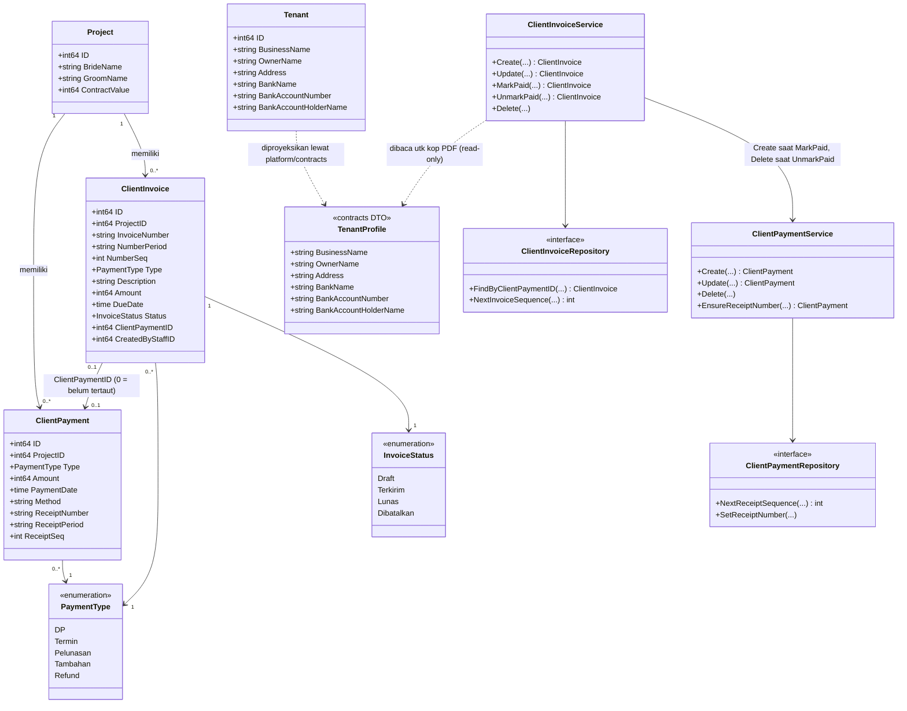
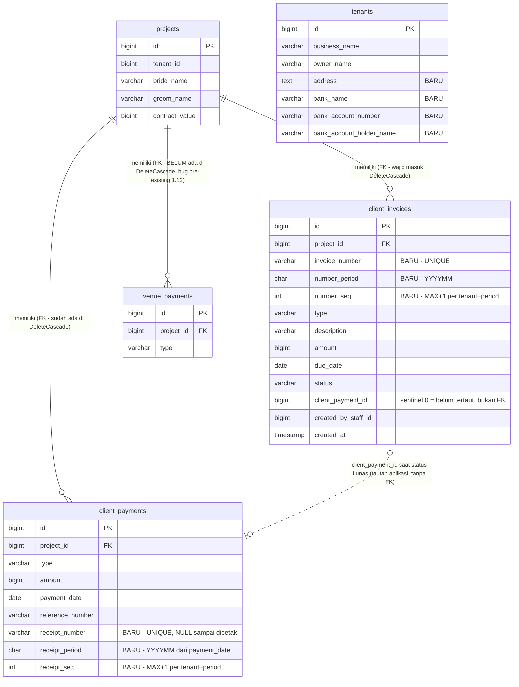
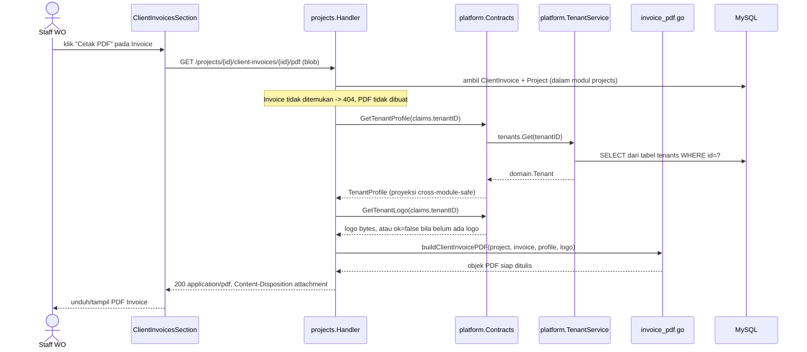
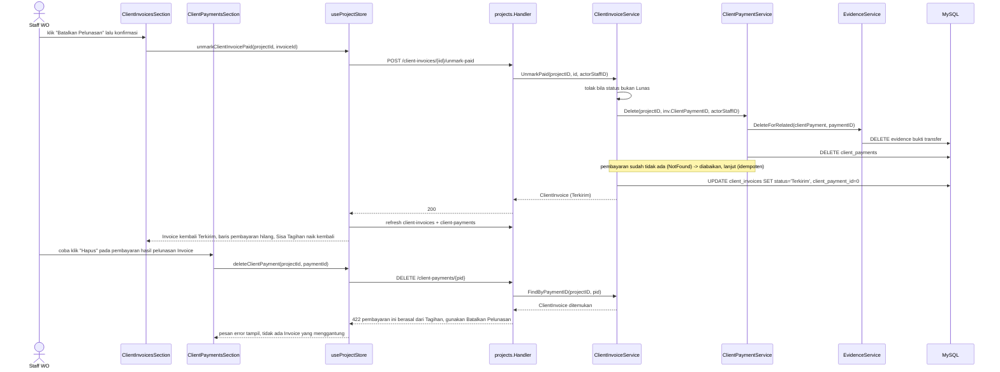

# PLAN.md — Generate Invoice & Kwitansi untuk Uang Masuk dari Client

## 0. Ringkasan Permintaan

Pengguna ingin menambahkan fitur **generate Invoice (tagihan)** dan **generate Kwitansi (bukti terima)**
untuk kebutuhan operasional WO (Wedding Organizer), pada modul `projects` (backend Go modular monolith di
`apps/api/internal/modules`, frontend React di `apps/web/src/modules`), dengan menyentuh juga modul
`platform` (profil bisnis tenant).

**Klasifikasi intent**: **new capability** — belum ada mekanisme generate dokumen (PDF) apa pun di codebase
ini sebelumnya. Trace mengonfirmasi: sebagian besar data pendukung (riwayat pembayaran client, data project,
profil tenant) **reuse** dari struktur yang ada (`ClientPayment`, `Project`, `Tenant`), tapi entity Invoice
dengan lifecycle status, pembuatan PDF (dependency baru), dan self-service profil tenant adalah **murni
baru**.

Konteks eksplisit dari pengguna: PLAN ini **tidak boleh bertabrakan** dengan
`docs/plan/revisi-timeline-vendor-role-sales/PLAN.md` — sudah diverifikasi statusnya selesai
diimplementasikan (spot-check `project.go:53`, `handler.go:266`, `staff_member.go:17`,
`client_handler.go:86`, `LoginPage.tsx:153`, `RequireRole.tsx:26`, `UserRoleBadge.tsx:9`). PLAN ini tidak
mengubah struktur role/PIC/evidence Timeline dari PLAN tersebut; satu-satunya singgungan adalah reuse
`resolveProjectAccess` (termasuk scoping PIC Sales) apa adanya.

> **Catatan revisi**: dokumen ini sudah melewati **sesi pendalaman validasi** (Step 7 pass 7–10) atas
> permintaan pengguna, yang menemukan **3 bug fatal + 6 masalah** pada draft sebelumnya. Semuanya sudah
> diperbaiki dan terintegrasi ke seluruh dokumen. Rinciannya di §9.

## 1. Keputusan yang Sudah Dikunci

Dikumpulkan lewat empat sesi klarifikasi (`AskUserQuestion`). Final — bukan asumsi analis kecuali ditandai
eksplisit "keputusan analis".

### 1.1 Cakupan Transaksi
**Uang masuk dari Client saja** — berbasis data `ClientPayment` yang sudah ada
(`apps/api/internal/modules/projects/domain/payment.go:85-94`). Tidak menyentuh
`VendorPayment`/`VenuePayment`.

### 1.2 Model Data Invoice
**Entity `ClientInvoice` baru**, terpisah dari `ClientPayment`. WO membuat Tagihan (jumlah, jenis,
keterangan, jatuh tempo) dengan status sendiri (Draft/Terkirim/Lunas/Dibatalkan).

### 1.3 Alur Invoice → ClientPayment → Kwitansi
**Saat Invoice ditandai "Lunas", sistem otomatis membuat record `ClientPayment` yang tertaut** — supaya
kalkulasi "Total Diterima"/"Sisa Tagihan" di `ClientPaymentsSection.tsx:64-69` (WO Console) dan
`PembayaranTabPage.tsx:33-38` (Client Portal) — keduanya dihitung dari `ClientPayment`, **tidak pernah** dari
Invoice — tetap akurat tanpa input dobel. Dashboard juga menghitung dari `client_payments`, jadi
**dashboard tidak perlu diubah sama sekali**. Kwitansi digenerate dari `ClientPayment`, mencantumkan nomor
Invoice asal bila ada.

### 1.4 Mekanisme Cetak
**File PDF asli, digenerate di server** (mengoreksi rekomendasi awal analis yang mengusulkan halaman
print-friendly browser).

### 1.5 Nomor Kwitansi
**Ya, Kwitansi mendapat nomor resmi tersendiri** (`KWT/202608/0001`), sejajar nomor Invoice.

### 1.6 Visibilitas Client Portal
**Kwitansi tampil di Client Portal.** **Invoice/Tagihan yang belum dibayar TIDAK ditampilkan ke Client** —
tetap internal WO Console, dikirim manual (WA/email).

### 1.7 Profil Bisnis Tenant (kop surat Invoice/Kwitansi)
**Tambahkan field yang dibutuhkan + halaman baru "Profil Usaha" di grup "Pengaturan"**. Ini mengisi celah
nyata: **Owner tidak punya cara self-service mengedit profil tenannya sendiri sama sekali** —
`PATCH /tenants/{id}` platform_admin-only (`tenant_handler.go:204,217-218`); satu-satunya endpoint
self-service (`GET /tenants/me`, baris 191-194,316-333) **read-only**. Field baru (keputusan analis; NPWP
sengaja tidak dimasukkan — tidak diminta, tidak ada presedennya):
`Address`, `BankName`, `BankAccountNumber`, `BankAccountHolderName`.

Upload logo juga dibuat self-service (`PUT /tenants/me/logo`) — dikonfirmasi pengguna pada sesi klarifikasi
ketiga, setelah trace menemukan `PUT /tenants/{id}/logo` juga platform_admin-only (`tenant_handler.go:204,219`)
padahal logo persis yang muncul di kop PDF.

### 1.8 Mekanisme penomoran — kolom nomor urut eksplisit
Draft sebelumnya memakai `COUNT(*) + 1`. **Itu bug**: satu penghapusan membuat nomor berikutnya duplikat
(`invoice_number` UNIQUE → error 1062; `receipt_number` tanpa UNIQUE → nomor kwitansi resmi kembar tanpa
error apa pun). **Dikonfirmasi pengguna: pakai kolom nomor urut eksplisit.**

- `client_invoices`: kolom `number_period CHAR(6)` + `number_seq INT UNSIGNED`, urutan berikutnya dari
  `MAX(number_seq) + 1` — persis idiom `NextSortOrder` yang sudah ada di codebase ini
  (`mysql_project_repository.go:450-457`, `sql.NullInt64` + `MAX(...)` + `.Int64 + 1`).
- `client_payments`: `receipt_period CHAR(6) NULL` + `receipt_seq INT UNSIGNED NULL`, pola sama.
- **`receipt_number` juga mendapat UNIQUE key** (draft sebelumnya lupa) — di MySQL, UNIQUE mengizinkan
  banyak NULL, jadi cocok dengan penomoran malas (§1.9).
- Alternatif yang ditolak: parsing dari string nomor (`SUBSTRING_INDEX` + `LIKE 'INV/202608/%'`) — hemat
  skema tapi logikanya bergantung pada format string.

### 1.9 Undo pelunasan — tombol "Batalkan Pelunasan" tersendiri
Draft sebelumnya **deadlock**: Invoice `Lunas` tidak boleh dihapus, dan menghapus `ClientPayment` hasil
mark-paid membuat Invoice menggantung (status Lunas menunjuk pembayaran yang sudah hilang) — jadi salah klik
"Tandai Lunas" tidak bisa dibatalkan sama sekali. **Dikonfirmasi pengguna: endpoint + tombol "Batalkan
Pelunasan" tersendiri** (`POST /client-invoices/{id}/unmark-paid`): melepas tautan, mengembalikan status ke
`Terkirim`, dan menghapus `ClientPayment`-nya sekalian dalam 1 aksi (§4.2).

Konsekuensi yang ikut ditutup (keputusan analis, menutup lubang yang sama dari arah lain): penghapusan dan
pengubahan `type`/`amount` sebuah `ClientPayment` yang tertaut Invoice **diblokir** dengan pesan yang
mengarahkan ke tombol "Batalkan Pelunasan" — tanpa ini, jalur hapus/edit langsung di section "Uang Masuk dari
Client" masih bisa membuat Invoice menggantung atau membuat nominal Invoice ≠ nominal Kwitansi (§4.3).

### 1.10 Library PDF
**`github.com/go-pdf/fpdf`** — fork aktif dari `jung-kurt/gofpdf` yang sudah diarsipkan pemiliknya. Pure Go,
tanpa cgo, tanpa binary eksternal (cocok untuk Docker satu-container per CLAUDE.md). **Dikonfirmasi pengguna**
setelah diberi tahu library ini **tidak ada di module cache lokal dan project ini tidak punya folder
`vendor/`** → butuh koneksi internet sekali saat `go get` (§4.5). Alternatif offline yang tersedia di cache
mesin (`phpdave11/gofpdf v1.4.3`) ditolak pengguna karena lebih jarang di-update.

### 1.11 Kwitansi untuk pembayaran jenis "Refund" — diblokir
**Keputusan analis** (bukan dikonfirmasi pengguna — dicatat eksplisit di sini sebagai keputusan analis):
`client_payments` mengizinkan `type = "Refund"` (`client-payment.schema.ts:4`), dan Kwitansi berbunyi "Telah
terima dari <client>" — arah uangnya **berlawanan** untuk refund, jadi dokumennya akan berbohong. Tombol
"Cetak Kwitansi" **disembunyikan** untuk pembayaran `Refund`, dan endpoint-nya menolak dengan pesan jelas.
Bukti sebuah refund tetap ada dalam bentuk evidence Transfer Proof yang sudah didukung hari ini. Dokumen
"bukti pengembalian dana" tersendiri di luar scope PLAN ini.

### 1.12 Perbaikan bug pre-existing `venue_payments` — ikut dikerjakan
Trace menemukan `venue_payments` punya FK ke `projects` (`000030_create_venue_payments_table.up.sql:21`)
tapi **tidak** didaftarkan di `DeleteCascade` (`mysql_project_repository.go:308-346`) → hapus-permanen
project sudah gagal hari ini (FK error 1451) untuk project yang punya pembayaran venue. **Dikonfirmasi
pengguna: perbaiki sekalian**, karena programmer memang akan mengedit fungsi yang sama persis untuk fitur
ini. Ditandai jelas di task list sebagai perbaikan bug terpisah, bukan bagian requirement Invoice/Kwitansi.

## 2. Ruang Lingkup

### In Scope
- Modul `projects` (backend + frontend): entity baru `ClientInvoice` (tabel `client_invoices`), kolom baru
  `client_payments.receipt_number`/`receipt_period`/`receipt_seq`, generate PDF Invoice & Kwitansi, UI di tab
  "Pembayaran → Client" dan Client Portal (Kwitansi saja).
- `DeleteCascade` (`mysql_project_repository.go:308-346`): **wajib** menambah `client_invoices` — tanpa ini
  fitur hapus-permanen project rusak (§9 F1). Plus `venue_payments` (bug pre-existing, §1.12).
- Modul `platform` (backend + frontend): 4 kolom profil bisnis di `tenants`, endpoint self-service
  `PATCH /tenants/me` + `PUT /tenants/me/logo` (Owner-only), halaman "Profil Usaha", dan **kontrak
  cross-module baru** (`platform/contracts`, belum pernah ada) supaya `projects` bisa membaca profil tenant
  untuk kop PDF tanpa import terlarang.
- Dependency baru: `github.com/go-pdf/fpdf`. Tidak ada dependency frontend baru.

### Out of Scope (dan alasannya)
- **VendorPayment & VenuePayment (uang keluar)** — ditolak pengguna (§1.1). `EvidenceType.Invoice` yang sudah
  ada adalah konsep berbeda (invoice masuk dari vendor) dan tidak disentuh.
- **Invoice/Tagihan tampil di Client Portal** — ditolak pengguna (§1.6); hanya Kwitansi.
- **Itemized line items pada Invoice** — tidak ada presedennya (`ContractValue` lump-sum, `ClientPayment`
  juga tidak itemized).
- **NPWP & field pajak formal** — tidak diminta (§1.7).
- **Validasi Invoice terhadap sisa `ContractValue`** — `ClientPaymentService.Create` sendiri tidak melakukan
  validasi ini (`client_payment_service.go:47-58`); Invoice mengikuti pola yang sama.
- **Dokumen "bukti pengembalian dana" untuk Refund** — §1.11.
- **`BrandColorPreset`/`CustomDomain` lewat endpoint self-service** — `PATCH /tenants/me` sengaja sempit,
  hanya field profil (§4.6).
- **Perbaikan `canDelete = role !== "Staff"`** — bug pre-existing yang meloloskan role `Sales` untuk
  hard-delete Client Payment; di luar scope, lihat catatan §4.7.
- **Perubahan apa pun pada role Sales/PIC ganda/evidence Timeline/Gantt** — sudah selesai di PLAN
  `revisi-timeline-vendor-role-sales`.

## 3. Reuse Inventory (diverifikasi dengan membaca kode)

| Kebutuhan | Yang direuse | Verifikasi |
|---|---|---|
| Data pembayaran client untuk Kwitansi | `domain.ClientPayment` + `ClientPaymentService`/`MySQLClientPaymentRepository` | `projects/domain/payment.go:85-94`; `client_payment_service.go:1-99` |
| Data project untuk kop PDF | `domain.Project.BrideName/GroomName/EventDate/PackageName/ContractValue` — satu modul dengan Invoice, tanpa cross-module call | `projects/presentation/dto.go:20-33` |
| Pola CRUD + activity log entity pembayaran | Pola `ClientPaymentService` (repo interface sederhana, `ActivityService.Record`) | `client_payment_service.go:11-27,42-58`; `projects/domain/activity.go:8-24` |
| **Generate nomor urut berikutnya** | Idiom `NextSortOrder`: `sql.NullInt64` + `SELECT MAX(col)` + `.Int64 + 1` — dipakai 3 tempat | `mysql_project_repository.go:450-457`; `mysql_milestone_template_repository.go:88`; `mysql_vendor_engagement_repository.go:291` |
| **Deteksi duplicate-key (1062) → domain error** | `errors.As(err, &mysqlErr) && mysqlErr.Number == 1062` → `domain.ErrDuplicateCustomDomain`, diterjemahkan service jadi `apperror.Validation` | `platform/infrastructure/mysql_tenant_repository.go:166-168`; `platform/domain/tenant.go:48-52`; `platform/application/tenant_service.go:274-277` |
| **Kolom nullable di repo `client_payments`** | Idiom `sql.NullString` untuk `notes` — dipakai identik untuk `receipt_number` | `mysql_client_payment_repository.go:18,23,32` |
| **Hapus cascade anak project** | `DeleteCascade` — satu transaksi, `DELETE` per tabel anak secara eksplisit, project terakhir | `mysql_project_repository.go:308-346` |
| Routing sub-resource project | Pola `switch` di `Item()` + `resolveProjectAccess` sekali di awal — otomatis mewarisi scoping PIC Wedding Planner/PIC Sales | `projects/presentation/handler.go:107-196,244-300` |
| Akses baca principal `client` (untuk Kwitansi di Portal) | `resolveProjectAccess` cabang `"client"` — **mengisi `tenantID`** (dipakai untuk profil tenant & penomoran), `staffID` tetap 0, dan menolak semua method non-GET | `projects/presentation/handler.go:271-295` |
| Generate & stream dokumen biner (precedent pure-Go) | Pola `excelize` export vendor: header `Content-Type`/`Content-Disposition` lalu tulis langsung ke `http.ResponseWriter` | `vendors/presentation/vendor_handler.go:119,161-162,189-206` |
| Streaming file biner | `Content-Disposition: inline` + `io.Copy(w, reader)` | `projects/presentation/evidence_endpoints.go:94,107-109` |
| Wiring cross-module dua-arah tanpa cyclic dependency | Pola `Set<X>(...)` dipanggil setelah kedua modul terkonstruksi | `cmd/server/main.go:210,217,222,227,232,237-246` |
| `Set<X>` yang mengisi field `Handler` (bukan field service) | `SetClientAccessResolver` — satu-satunya presedennya | `projects/presentation/handler.go:61-67`; `projects.module.go:63-70` |
| Import langsung tipe dari `contracts/` modul lain | `vendorscontracts "…/vendors/contracts"` diimpor langsung, `VenueSummary` dipakai sebagai tipe parameter | `projects/presentation/dto.go:7-8,76` |
| Upload & baca logo tenant | `TenantService.UploadLogo`/`DownloadLogo` + `UploadLogoInput{FileName,MimeType,Base64Data}` — application-layer **sudah lengkap** (termasuk validasi MIME), hanya routing Owner-only yang baru | `platform/application/tenant_service.go:294-298,304-316,356-360`; `tenant_handler.go:373-399` |
| Widget upload logo di frontend | `compressFileForUpload`/`CompressedFilePayload` + pola `handleLogoChange`/preview blob | `shared/lib/image-compression.ts:16-29`; `platform-admin/components/TenantFormModal.tsx:89-129` |
| Trigger unduh biner di frontend | `responseType: "blob"` + `URL.createObjectURL` + `window.open` | `vendors/stores/useVendorStore.ts:171,184-187`; `VendorListPage.tsx:180-184`; `VendorFormModal.tsx:94-95` |
| Error "tersimpan tapi bukti gagal upload" | `ClientPaymentEvidenceError` — direuse untuk alur mark-paid + proofFile | `stores/useProjectStore.ts:39,934-971` |
| Nav group "Pengaturan" Owner-only | Pola `NavGroupItem`/`allowedRoles: ["Owner"]` | `shared/layouts/Sidebar.tsx:42-52` |
| Sentinel "0 = belum ada" | Pola `Project.PICSalesStaffID`/`EvidenceRelatedGeneral.RelatedID` (AUTO_INCREMENT tidak mulai dari 0) | `projects/domain/evidence.go:30-44` |

**Gap yang dikonfirmasi butuh kode baru:** entity `ClientInvoice` (tabel + domain + service + repo +
endpoint), dependency PDF, kontrak `platform/contracts`, endpoint `PATCH /tenants/me` &
`PUT /tenants/me/logo`, halaman "Profil Usaha", fungsi terbilang Rupiah.

**Catatan penting soal `activity_log`:** kolom `type` adalah `VARCHAR(50)`, **bukan ENUM**
(`000008_create_project_tables.up.sql:132`) — jadi nilai `ActivityType` baru **tidak** butuh migration.
Diverifikasi juga bahwa frontend hanya merender `entry.description` (string bebas dari backend), tidak
pernah `switch` pada `entry.type` (`ProjectActivitySection.tsx:46`) — jadi nilai baru tidak memecahkan
render. Union `ActivityType` di `types.ts:252-264` tetap perlu diperbarui supaya tipenya tidak berbohong
(komentarnya sendiri menyatakan "Types not listed here never occur").

## 4. Rencana Detail per Area

### 4.1 Migration

**`000043_create_client_invoices_table.up.sql`**
```sql
CREATE TABLE client_invoices (
  id BIGINT UNSIGNED NOT NULL AUTO_INCREMENT,
  project_id BIGINT UNSIGNED NOT NULL,
  invoice_number VARCHAR(40) NOT NULL,
  -- number_period/number_seq: sumber kebenaran penomoran. MAX(number_seq)+1
  -- per (tenant, period) -- tahan terhadap penghapusan invoice, tidak seperti
  -- COUNT(*) yang akan menghasilkan nomor duplikat. Idiom sama dengan
  -- project_milestones.sort_order (mysql_project_repository.go:450-457).
  number_period CHAR(6) NOT NULL,
  number_seq INT UNSIGNED NOT NULL,
  type ENUM('DP', 'Termin', 'Pelunasan', 'Tambahan') NOT NULL,
  description VARCHAR(255) NOT NULL DEFAULT '',
  amount BIGINT UNSIGNED NOT NULL,
  due_date DATE NOT NULL,
  status ENUM('Draft', 'Terkirim', 'Lunas', 'Dibatalkan') NOT NULL DEFAULT 'Draft',
  -- Sentinel 0 = belum tertaut. Sengaja BUKAN foreign key: ClientPayment bisa
  -- dihapus lewat "Batalkan Pelunasan" dan tautannya di-reset ke 0 di alur
  -- aplikasi yang sama, jadi FK constraint hanya akan menghalangi tanpa
  -- menambah jaminan. Konvensi sentinel sama dengan
  -- projects.pic_sales_staff_id.
  client_payment_id BIGINT UNSIGNED NOT NULL DEFAULT 0,
  created_by_staff_id BIGINT UNSIGNED NOT NULL,
  created_at TIMESTAMP NOT NULL DEFAULT CURRENT_TIMESTAMP,
  updated_at TIMESTAMP NOT NULL DEFAULT CURRENT_TIMESTAMP ON UPDATE CURRENT_TIMESTAMP,
  PRIMARY KEY (id),
  UNIQUE KEY uq_client_invoices_invoice_number (invoice_number),
  KEY idx_client_invoices_project (project_id),
  KEY idx_client_invoices_period (number_period),
  KEY idx_client_invoices_payment (client_payment_id),
  CONSTRAINT fk_client_invoices_project FOREIGN KEY (project_id) REFERENCES projects (id)
);
```
`.down.sql`: `DROP TABLE client_invoices;`

ENUM `type` sengaja tanpa `'Refund'` — Invoice adalah tagihan, bukan pengembalian. Pola ENUM + FK
same-module identik `client_payments` (`000027_create_client_payments_table.up.sql:7-20`).

**`000044_add_receipt_number_to_client_payments.up.sql`**
```sql
ALTER TABLE client_payments
  ADD COLUMN receipt_number VARCHAR(40) NULL AFTER reference_number,
  ADD COLUMN receipt_period CHAR(6) NULL AFTER receipt_number,
  ADD COLUMN receipt_seq INT UNSIGNED NULL AFTER receipt_period,
  -- MySQL mengizinkan banyak baris NULL pada UNIQUE key -- persis yang
  -- dibutuhkan penomoran malas: semua pembayaran lama tetap NULL tanpa
  -- backfill, tapi dua kwitansi tidak akan pernah bisa punya nomor sama.
  ADD UNIQUE KEY uq_client_payments_receipt_number (receipt_number),
  ADD KEY idx_client_payments_receipt_period (receipt_period);
```
`.down.sql`: drop kedua key lalu ketiga kolom.

**`000045_add_business_profile_fields_to_tenants.up.sql`**
```sql
ALTER TABLE tenants
  ADD COLUMN address TEXT NULL AFTER city,
  ADD COLUMN bank_name VARCHAR(100) NULL AFTER address,
  ADD COLUMN bank_account_number VARCHAR(50) NULL AFTER bank_name,
  ADD COLUMN bank_account_holder_name VARCHAR(150) NULL AFTER bank_account_number;
```
`.down.sql`: drop keempat kolom.

### 4.2 Domain & Application — `ClientInvoice` (modul `projects`)

**`projects/domain/client_invoice.go`** (baru)
```go
type InvoiceStatus string
const (
    InvoiceDraft     InvoiceStatus = "Draft"
    InvoiceSent      InvoiceStatus = "Terkirim"
    InvoicePaid      InvoiceStatus = "Lunas"
    InvoiceCancelled InvoiceStatus = "Dibatalkan"
)
type ClientInvoice struct {
    ID               int64
    ProjectID        int64
    InvoiceNumber    string
    NumberPeriod     string // "202608"
    NumberSeq        int
    Type             PaymentType // reuse; Refund ditolak di service layer
    Description      string
    Amount           int64
    DueDate          time.Time
    Status           InvoiceStatus
    ClientPaymentID  int64 // sentinel 0 = belum tertaut
    CreatedByStaffID int64
    CreatedAt        time.Time
    UpdatedAt        time.Time
}
```

**`projects/domain/errors.go`** (baru — pola `platform/domain/tenant.go:48-52`)
```go
var ErrDuplicateInvoiceNumber = errors.New("nomor invoice sudah digunakan")
var ErrDuplicateReceiptNumber = errors.New("nomor kwitansi sudah digunakan")
```
Dikembalikan repository saat MySQL error 1062, supaya application layer bisa retry/menerjemahkan tanpa tahu
kode error MySQL (persis pola `ErrDuplicateCustomDomain`).

**`projects/domain/activity.go:8-24`** — tambah 5 konstanta. Catatan konvensi: file ini sengaja **berbagi**
`ActivityPaymentUpdated`/`Deleted` lintas 3 jenis pembayaran (komentar baris 15-18), tapi Invoice adalah
entity berbeda (bukan salah satu jenis pembayaran), jadi konstanta sendiri tepat:
```go
ActivityInvoiceCreated      ActivityType = "invoice_created"
ActivityInvoiceUpdated      ActivityType = "invoice_updated"
ActivityInvoiceMarkedPaid   ActivityType = "invoice_marked_paid"
ActivityInvoiceUnmarkedPaid ActivityType = "invoice_unmarked_paid"
ActivityInvoiceDeleted      ActivityType = "invoice_deleted"
```
Semua ≤ 50 karakter → aman untuk `activity_log.type VARCHAR(50)`.

**`projects/application/client_invoice_service.go`** (baru), pola `client_payment_service.go`:
```go
type ClientInvoiceRepository interface {
    ListByProject(ctx context.Context, projectID int64) ([]domain.ClientInvoice, error)
    FindByID(ctx context.Context, projectID, id int64) (*domain.ClientInvoice, error)
    // FindByClientPaymentID mendukung 2 pemakai: reverse-lookup nomor Invoice
    // saat mencetak Kwitansi, dan guard hapus/edit ClientPayment (§4.3).
    // Memakai idx_client_invoices_payment.
    FindByClientPaymentID(ctx context.Context, projectID, clientPaymentID int64) (*domain.ClientInvoice, error)
    Create(ctx context.Context, inv *domain.ClientInvoice) error
    Update(ctx context.Context, projectID, id int64, inv domain.ClientInvoice) error
    Delete(ctx context.Context, projectID, id int64) error
    NextInvoiceSequence(ctx context.Context, tenantID int64, period string) (int, error)
}
type ClientInvoiceService struct {
    repo     ClientInvoiceRepository
    payments *ClientPaymentService
    activity *ActivityService
}
func NewClientInvoiceService(repo ClientInvoiceRepository, payments *ClientPaymentService, activity *ActivityService) *ClientInvoiceService
```
Konstruktor mengikuti pola `NewClientPaymentService(repo, evidence, activity)`
(`client_payment_service.go:25`). Arah dependency **satu arah** (`ClientInvoiceService` →
`ClientPaymentService`) sehingga tidak ada siklus konstruksi.

- **`Create(ctx, tenantID, projectID, actorStaffID, input)`**: tolak `input.Type == domain.PaymentRefund`
  (`apperror.Validation`); `period := now.Format("200601")`; `seq, _ := repo.NextInvoiceSequence(tenantID, period)`;
  `InvoiceNumber = fmt.Sprintf("INV/%s/%04d", period, seq)`; status `Draft`; `repo.Create`. Jika
  `repo.Create` mengembalikan `domain.ErrDuplicateInvoiceNumber` (dua request bersamaan mendapat `seq`
  sama), **ulangi sekali** dengan `seq` yang dihitung ulang; kalau masih bentrok, kembalikan
  `apperror.Validation("Nomor invoice sedang bentrok, silakan coba lagi")`. Log `ActivityInvoiceCreated`.
- **`Update(ctx, projectID, id, actorStaffID, input)`**: tolak jika `Status == InvoicePaid`
  (`apperror.Validation` — nominal tidak boleh berubah setelah tertaut pembayaran; gunakan "Batalkan
  Pelunasan" dulu). `status` baru hanya boleh `Draft`/`Terkirim`/`Dibatalkan` — **`Lunas` ditolak di
  endpoint ini**, transisi ke Lunas hanya lewat `MarkPaid` supaya `ClientPaymentID` selalu terisi bersamaan.
  `InvoiceNumber`/`NumberPeriod`/`NumberSeq` **tidak pernah** diubah. Log `ActivityInvoiceUpdated`.
- **`MarkPaid(ctx, projectID, id, actorStaffID, paymentInput ClientPaymentInput)`**: tolak jika status
  sudah `Lunas`/`Dibatalkan`; **paksa** `paymentInput.Type = inv.Type` dan `paymentInput.Amount = inv.Amount`
  (nilai dari klien diabaikan — nominal tagihan adalah sumber kebenaran); `p, err := s.payments.Create(...)`
  (reuse penuh, termasuk `ActivityPaymentRecorded`); `inv.ClientPaymentID = p.ID`; `inv.Status = InvoicePaid`;
  `repo.Update`. Log `ActivityInvoiceMarkedPaid`. **Mengembalikan `*domain.ClientInvoice`** yang sudah memuat
  `ClientPaymentID` — dipakai frontend untuk melampirkan bukti transfer (§4.7).
- **`UnmarkPaid(ctx, projectID, id, actorStaffID)`** (baru, §1.9): tolak jika `Status != InvoicePaid`
  (`apperror.Validation("Hanya Tagihan berstatus Lunas yang dapat dibatalkan pelunasannya")`). Jika
  `inv.ClientPaymentID != 0`, panggil `s.payments.Delete(ctx, projectID, inv.ClientPaymentID, actorStaffID)`
  — yang **juga menghapus evidence** pembayaran itu (`client_payment_service.go:90-92`), termasuk bukti
  transfer yang dilampirkan saat mark-paid; kalau pembayarannya ternyata sudah tidak ada
  (`apperror.NotFound`), **abaikan errornya dan lanjutkan** supaya operasi ini idempoten dan Invoice tidak
  terjebak selamanya. Lalu `inv.ClientPaymentID = 0`, `inv.Status = InvoiceSent`, `repo.Update`. Log
  `ActivityInvoiceUnmarkedPaid`.
- **`Delete(ctx, projectID, id, actorStaffID)`**: tolak jika `Status == InvoicePaid` (`apperror.Validation`,
  "Batalkan pelunasannya terlebih dahulu sebelum menghapus Tagihan ini") — tidak lagi deadlock karena
  `UnmarkPaid` sudah menyediakan jalan keluarnya. Selain itu hard-delete + `ActivityInvoiceDeleted`.

### 4.3 Infrastructure & Presentation — `ClientInvoice`

**`projects/infrastructure/mysql_client_invoice_repository.go`** (baru) — pola
`mysql_client_payment_repository.go:1-89`, ditambah:
```go
func (r *MySQLClientInvoiceRepository) NextInvoiceSequence(ctx context.Context, tenantID int64, period string) (int, error) {
    var maxSeq sql.NullInt64
    row := r.db.QueryRowContext(ctx,
        `SELECT MAX(ci.number_seq) FROM client_invoices ci
         JOIN projects p ON p.id = ci.project_id
         WHERE p.tenant_id = ? AND ci.number_period = ?`, tenantID, period)
    if err := row.Scan(&maxSeq); err != nil {
        return 0, err
    }
    return int(maxSeq.Int64) + 1, nil
}
```
`JOIN projects` **bukan** cross-module join — `projects` dan `client_invoices` sama-sama dimiliki modul
`projects` (`.claude/rules/database.md` melarang join lintas modul, bukan join di dalam modul sendiri).
`Create` menerjemahkan MySQL 1062 menjadi `domain.ErrDuplicateInvoiceNumber`
(`errors.As(err, &mysqlErr) && mysqlErr.Number == 1062`, pola `mysql_tenant_repository.go:166-168`).

**`projects/infrastructure/mysql_client_payment_repository.go`**
- `clientPaymentColumns` (baris 18) — tambah `receipt_number, receipt_period, receipt_seq`.
- `scanClientPayment` (baris 20-34) — ketiganya nullable: `sql.NullString` untuk `receipt_number`/
  `receipt_period` dan `sql.NullInt64` untuk `receipt_seq`, di-assign lewat `.String`/`.Int64` persis idiom
  `notes` di baris 23,32. **Tanpa ini `Scan` gagal runtime** untuk semua baris lama yang nilainya NULL.
- `Create` (baris 59-74) — **tidak** menyertakan kolom receipt (selalu NULL saat pembayaran dibuat;
  penomoran malas, §4.4).
- `Update` (baris 76-83) — **sengaja tidak menyentuh kolom receipt sama sekali**. Kalau ketiganya ikut
  dimasukkan ke `UPDATE ... SET`, satu edit pembayaran biasa berisiko menimpa nomor kwitansi yang sudah
  terbit menjadi kosong. Nomor hanya boleh ditulis oleh `SetReceiptNumber` di bawah.
- Tambah:
```go
func (r *MySQLClientPaymentRepository) NextReceiptSequence(ctx context.Context, tenantID int64, period string) (int, error)
// SELECT MAX(cp.receipt_seq) FROM client_payments cp JOIN projects p ON p.id = cp.project_id
// WHERE p.tenant_id = ? AND cp.receipt_period = ?   -- pola sama NextInvoiceSequence
func (r *MySQLClientPaymentRepository) SetReceiptNumber(ctx context.Context, projectID, id int64, number, period string, seq int) error
// UPDATE client_payments SET receipt_number = ?, receipt_period = ?, receipt_seq = ?
// WHERE project_id = ? AND id = ?   -- menerjemahkan 1062 -> domain.ErrDuplicateReceiptNumber
```

**`projects/application/client_payment_service.go`**
- `ClientPaymentRepository` (baris 11-17) — tambah `NextReceiptSequence`, `SetReceiptNumber`.
- Tambah `EnsureReceiptNumber(ctx, tenantID, projectID, id int64) (*domain.ClientPayment, error)`:
  1. `FindByID`; nil → `apperror.NotFound`.
  2. **Tolak `p.Type == domain.PaymentRefund`** dengan `apperror.Validation("Kwitansi tidak tersedia untuk
     pembayaran jenis Refund")` (§1.11).
  3. Jika `p.ReceiptNumber != ""` → kembalikan apa adanya (idempoten: cetak ulang tidak pernah mengubah
     nomor).
  4. `period := p.PaymentDate.Format("200601")` — **periode diambil dari tanggal pembayaran, bukan tanggal
     cetak**, supaya pembayaran Agustus yang dicetak September tetap bernomor `KWT/202608/...` (benar secara
     pembukuan).
  5. `seq := NextReceiptSequence(tenantID, period)`; `number := fmt.Sprintf("KWT/%s/%04d", period, seq)`;
     `SetReceiptNumber(...)`.
  6. Jika hasilnya `domain.ErrDuplicateReceiptNumber` (mis. pengguna klik "Cetak Kwitansi" dua kali cepat,
     dua request menghitung `seq` yang sama), **baca ulang barisnya**: kalau `receipt_number` sudah terisi
     oleh request yang menang, kembalikan itu (pengguna tetap mendapat PDF-nya); kalau masih kosong,
     kembalikan `apperror.Validation("Nomor kwitansi sedang bentrok, silakan coba lagi")`.

**`projects/infrastructure/mysql_project_repository.go:308-346` (`DeleteCascade`) — WAJIB**
Fungsi ini mendaftar tabel anak satu per satu lalu menghapus project terakhir, semuanya dalam 1 transaksi.
Tabel baru ber-FK ke `projects` yang tidak didaftarkan di sini membuat `DELETE FROM projects` gagal dengan
FK error 1451 dan me-rollback seluruh transaksi — artinya **project yang punya minimal 1 invoice tidak akan
pernah bisa dihapus permanen**. Tambahkan sebelum `DELETE FROM projects`:
```go
if _, err := tx.ExecContext(ctx, `DELETE FROM client_invoices WHERE project_id = ?`, id); err != nil {
    return err
}
// Bug pre-existing, §1.12 -- venue_payments punya fk_venue_payments_project
// (000030:21) tapi belum pernah didaftarkan di sini.
if _, err := tx.ExecContext(ctx, `DELETE FROM venue_payments WHERE project_id = ?`, id); err != nil {
    return err
}
```

**`projects/presentation/client_invoice_endpoints.go`** (baru) — handler:
`listClientInvoices`, `createClientInvoice`, `updateClientInvoice`, `markClientInvoicePaid`,
`unmarkClientInvoicePaid`, `deleteClientInvoice`, `downloadClientInvoicePDF`, plus DTO
`clientInvoiceResponse`/`toClientInvoiceResponse` (pola `toClientPaymentResponse`).
`deleteClientInvoice` di-gate eksplisit `claims.role == "Owner" || claims.role == "Admin"` — **bukan** pola
`role != "Staff"` yang dipakai `ClientPaymentsSection.tsx:49`/`ProjectPaymentsSection.tsx:47`, karena pola
itu kini meloloskan role `Sales` (lihat catatan §4.7).

**`projects/presentation/client_payment_endpoints.go`** (existing, diperluas)
- Tambah handler `downloadClientPaymentReceiptPDF` (ditempatkan di sini, satu file dengan seluruh handler
  `ClientPayment` lain — konsisten dengan `listClientPayments`/`createClientPayment`).
- `clientPaymentResponse`/`toClientPaymentResponse` — tambah `receiptNumber string \`json:"receiptNumber"\``,
  supaya frontend bisa menampilkan nomor kwitansi yang sudah terbit.
- **Guard baru pada `deleteClientPayment`** (§1.9): sebelum menghapus, `inv, _ :=
  h.clientInvoices.FindByPaymentID(ctx, projectID, paymentID)`; kalau `inv != nil` → 422 dengan pesan
  `"Pembayaran ini berasal dari Tagihan " + inv.InvoiceNumber + ". Gunakan tombol \"Batalkan Pelunasan\" pada tagihan tersebut."`
- **Guard baru pada `updateClientPayment`** (§1.9): setelah `inv` didapat dari `FindByPaymentID`, tolak 422
  bila `inv != nil && (body.Type != string(inv.Type) || body.Amount != inv.Amount)`. Pembandingnya
  **`inv`, bukan pembayaran saat ini** — sengaja, karena `MarkPaid` sudah memaksa `payment.Type/Amount`
  sama dengan Invoice (§4.2), jadi Invoice adalah acuan yang benar dan handler tidak perlu query tambahan
  untuk mengambil nilai pembayaran lama. Perubahan tanggal/metode/no. referensi/catatan tetap diizinkan
  (tidak merusak invariant nominal).
- Kedua guard diletakkan di **handler**, bukan di `ClientPaymentService`, karena `ClientInvoiceService`
  sudah bergantung pada `ClientPaymentService` (§4.2) — menaruhnya di service akan membuat dependency
  dua arah. `Handler` sudah memegang keduanya, dan orkestrasi baca lintas-service di handler sudah punya
  preseden (`listClientPayments` memanggil `h.clientPayments.List` + `h.evidence.List`,
  `client_payment_endpoints.go:19-33`).

**`projects/projects.module.go`** — `NewModule(...)` (dipanggil `main.go:217`) mengonstruksi semua service
di dalam dirinya sendiri; tambah konstruksi `MySQLClientInvoiceRepository` + `ClientInvoiceService` di sana
(pola `ClientPaymentService` di file yang sama), diteruskan sebagai argumen baru ke
`presentation.NewHandler(...)`.

**`projects/presentation/handler.go`** — struct `Handler` (baris 31-42) tambah field
`clientInvoices *application.ClientInvoiceService` + parameter baru di `NewHandler(...)` (pola
`clientPayments` di baris 35,48,56 — lewat parameter, bukan `Set<X>`, karena tidak ada siklus konstruksi
untuk dependency ini). Field `platform` dibahas di §4.6 (caranya berbeda).

**Urutan pengerjaan yang penting di sini** (tercermin di task list §6 sebagai 3 task terpisah, bukan satu):
field `clientInvoices` + konstruksi service-nya harus **mendahului** penulisan
`client_invoice_endpoints.go`, karena setiap handler di file itu memanggil `h.clientInvoices.…` — kalau
dibalik, file itu tidak bisa dikompilasi. Sebaliknya, 8 `case` di `Item()` harus **menyusul setelah**
kedua file endpoint selesai, karena `case` memanggil method handler yang baru ada di sana. Jadi urutannya:
(1) konstruksi + field, (2) file endpoint, (3) registrasi `case`.

Registrasi di `Item()` (baris 107-196) — 8 `case` baru, pola `client-payments` (baris 157-164):
```go
case len(rest) == 1 && rest[0] == "client-invoices" && r.Method == http.MethodGet:
    h.listClientInvoices(w, r, projectID)
case len(rest) == 1 && rest[0] == "client-invoices" && r.Method == http.MethodPost:
    h.createClientInvoice(w, r, claims, projectID)
case len(rest) == 2 && rest[0] == "client-invoices" && r.Method == http.MethodPatch:
    h.updateClientInvoice(w, r, claims, projectID, rest[1])
case len(rest) == 2 && rest[0] == "client-invoices" && r.Method == http.MethodDelete:
    h.deleteClientInvoice(w, r, claims, projectID, rest[1])
case len(rest) == 3 && rest[0] == "client-invoices" && rest[2] == "mark-paid" && r.Method == http.MethodPost:
    h.markClientInvoicePaid(w, r, claims, projectID, rest[1])
case len(rest) == 3 && rest[0] == "client-invoices" && rest[2] == "unmark-paid" && r.Method == http.MethodPost:
    h.unmarkClientInvoicePaid(w, r, claims, projectID, rest[1])
case len(rest) == 3 && rest[0] == "client-invoices" && rest[2] == "pdf" && r.Method == http.MethodGet:
    h.downloadClientInvoicePDF(w, r, claims, projectID, rest[1])
case len(rest) == 3 && rest[0] == "client-payments" && rest[2] == "receipt-pdf" && r.Method == http.MethodGet:
    h.downloadClientPaymentReceiptPDF(w, r, claims, projectID, rest[1])
```
Dua `case` GET terakhir tidak memeriksa `claims.role`/principal type — sama seperti setiap `case` GET lain
di switch ini, `resolveProjectAccess` (baris 109) sudah mengizinkan principal `client` untuk GET apa pun di
bawah `/projects/{id}/...` (baris 271-295) **dan mengisi `tenantID`-nya** (baris 295). Inilah mekanisme yang
membuat Kwitansi bisa diunduh dari Client Portal tanpa endpoint terpisah (§1.6). Konsekuensi yang disadari:
GET pertama dari Client Portal bisa menjadi request yang men-generate `receipt_number` — sengaja diizinkan
(penomoran malas, tidak butuh `actorStaffID`, tidak menulis activity log).

### 4.4 Numbering & Idempotensi

- Format: `INV/{YYYYMM}/{seq:04d}` dan `KWT/{YYYYMM}/{seq:04d}`, di-scope **per tenant** (join
  `projects.tenant_id`), bukan per project.
- Urutan berikutnya = `MAX(number_seq/receipt_seq) + 1` untuk (tenant, period) — **tahan penghapusan**:
  menghapus invoice tidak pernah membuat nomor dipakai ulang.
- Bentrok karena request bersamaan **gagal keras** lewat UNIQUE key, bukan menghasilkan nomor kembar diam-
  diam; keduanya punya penanganan retry yang dijelaskan di §4.2 (`Create`) dan §4.3
  (`EnsureReceiptNumber`).
- Invoice: nomor **selalu** dibuat saat create. Kwitansi: nomor **malas**, dibuat saat pertama kali dicetak
  (siapa pun yang mencetak lebih dulu, WO atau Client) lalu permanen — ini otomatis membereskan seluruh
  `client_payments` lama tanpa migration backfill.
- Periode Invoice dari waktu pembuatan; periode Kwitansi dari `payment_date` (§4.3), bukan tanggal cetak.

### 4.5 Generate PDF

**Dependency**: `github.com/go-pdf/fpdf` (§1.10). **Task tersendiri di task list** karena library ini tidak
ada di module cache lokal dan project ini tidak punya `vendor/` — butuh koneksi internet saat `go get`.
Programmer wajib memverifikasi versi & lisensi (MIT) yang benar-benar terunduh saat menjalankannya; kalau
ternyata tidak bisa diakses, hentikan dan konfirmasi ke pengguna (alternatif yang sudah dibahas dan ditolak:
`phpdave11/gofpdf v1.4.3`, tersedia offline di cache mesin ini) — **jangan** menukar library sendiri tanpa
konfirmasi, karena §1.10 adalah keputusan pengguna.

**`apps/api/internal/shared/terbilang/terbilang.go`** (baru) — `Rupiah(amount int64) string`, mengubah
nominal jadi teks Bahasa Indonesia (`2500000` → "Dua Juta Lima Ratus Ribu Rupiah") untuk baris "Terbilang"
di Kwitansi. **Keputusan analis**: konvensi standar kwitansi resmi Indonesia, tanpa dependency baru (murni
fungsi string). Ditempatkan di `shared/` karena murni utilitas format angka, bukan domain logic
(`.claude/rules/backend-modular-monolith.md`).

**`projects/presentation/invoice_pdf.go`** (baru) — 2 builder:
- `buildClientInvoicePDF(project domain.Project, inv domain.ClientInvoice, profile platformcontracts.TenantProfile, logo []byte) (*fpdf.Fpdf, error)`
  — kop (logo bila ada + `BusinessName`/`Address`/`Phone`/`Email`), judul "INVOICE / TAGIHAN", No. Invoice,
  Tanggal Terbit (`inv.CreatedAt`), Jatuh Tempo (`inv.DueDate`), "Kepada Yth." (`project.BrideName` &
  `project.GroomName`), detail project (nama, tanggal acara, paket), rincian (jenis + keterangan + jumlah),
  total, info rekening tujuan (`BankName`/`BankAccountNumber`/`BankAccountHolderName`), dan penanda
  "DIBATALKAN" bila `inv.Status == InvoiceCancelled`.
- `buildClientPaymentReceiptPDF(project domain.Project, p domain.ClientPayment, invoiceNumber string, profile platformcontracts.TenantProfile, logo []byte) (*fpdf.Fpdf, error)`
  — kop sama, judul "KWITANSI", No. Kwitansi (`p.ReceiptNumber`), tanggal, "Telah terima dari" (nama
  pasangan), untuk pembayaran (jenis + catatan + rujukan No. Invoice bila `invoiceNumber != ""`), jumlah +
  terbilang (`terbilang.Rupiah`), metode & no. referensi, kolom tanda tangan (`profile.OwnerName`).

**Handler `downloadClientInvoicePDF`**: ambil invoice (404 bila tidak ada) + project +
`h.platform.GetTenantProfile(ctx, claims.tenantID)` + `h.platform.GetTenantLogo(ctx, claims.tenantID)`
(logo opsional — bila `ok == false`, PDF dirender tanpa logo, bukan error), panggil builder, lalu
`Content-Type: application/pdf` + `Content-Disposition: attachment; filename="INV-....pdf"` + `pdf.Output(w)`.

**Handler `downloadClientPaymentReceiptPDF`**: `p, err := h.clientPayments.EnsureReceiptNumber(ctx,
claims.tenantID, projectID, paymentID)` (menolak Refund & menangani bentrok nomor, §4.3) → ambil project →
`inv, _ := h.clientInvoices.FindByPaymentID(ctx, projectID, p.ID)` untuk `invoiceNumber` (string kosong bila
pembayaran dicatat manual, bukan lewat Invoice) → profil + logo → builder → stream.

**PDF digenerate ulang setiap request (stateless), tidak disimpan ke storage** — data sumbernya sudah
immutable-in-practice setelah terbit (Invoice tidak bisa diedit setelah Lunas; nomor kwitansi tidak pernah
berubah), jadi tidak ada risiko dokumen basi, dan tidak menambah state/storage baru.

### 4.6 Profil Tenant — Kontrak Cross-Module Baru & Self-Service

**`platform/contracts/contracts.go`** (baru — modul `platform` belum pernah mengekspos `contracts/`,
terverifikasi `platform.module.go:64-68` hanya punya setter `Set<X>` untuk mengonsumsi modul lain):
```go
package contracts
type TenantProfile struct {
    BusinessName, OwnerName, Phone, Email, Address     string
    BankName, BankAccountNumber, BankAccountHolderName string
}
type Contracts interface {
    GetTenantProfile(ctx context.Context, tenantID int64) (TenantProfile, error)
    GetTenantLogo(ctx context.Context, tenantID int64) (data []byte, contentType string, ok bool, err error)
}
```
`impl` membungkus `*application.TenantService` — reuse `Get(ctx, tenantID)` dan logika baca logo yang sama
dipakai `downloadLogo`/`streamLogo` (`tenant_service.go:356-360`). `GetTenantLogo` mengembalikan
`ok == false` (bukan error) saat tenant belum punya logo, supaya pemanggil PDF tidak perlu membedakan
"belum ada logo" dari kegagalan storage.

**`platform/platform.module.go`** — tambah `Contracts() contracts.Contracts` (pola `staff.module.go:34`).

**Kenapa `projects` mengimpor `platformcontracts` langsung, bukan interface lokal**: codebase ini punya 2
preseden berbeda — (a) `dto.go:7-8,76` mengimpor `vendorscontracts` **langsung** dan memakai
`vendorscontracts.VenueSummary` (struct majemuk) sebagai tipe parameter fungsi; (b)
`application.VenueResolver` (`projects.module.go:80-84`) dan `presentation.ClientAccessResolver`
(`handler.go:21-29`) adalah **interface lokal** yang menghindari impor modul lain — tapi keduanya
signature-nya **hanya tipe primitif** (`int64`/`error`). Interface lokal tidak bisa dipakai untuk
`platformcontracts.Contracts` tanpa mendefinisikan ulang `TenantProfile` sebagai struct lokal, dan Go tidak
menyamakan dua nama struct berbeda meski field-nya identik → butuh fungsi adapter tanpa manfaat nyata.
Karena `TenantProfile` struct majemuk (persis situasi `VenueSummary`), pola (a) yang dipakai.

**`projects/presentation/handler.go`** — tambah field `platform platformcontracts.Contracts` ke struct
`Handler` (baris 31-42) + method `SetTenantContracts(p platformcontracts.Contracts) { h.platform = p }`,
pola identik `SetClientAccessResolver` (`handler.go:61-67` — satu-satunya `Set<X>` yang mengisi field
`Handler`; `SetVenueResolver`/`SetClientCleaner` mengisi field `ProjectService`, `projects.module.go:73-84`).

**`projects/projects.module.go`** — tambah
`SetTenantContracts(p platformcontracts.Contracts) { m.handler.SetTenantContracts(p) }` (pola
`SetClientAccessResolver`, `projects.module.go:63-70`).

**`cmd/server/main.go`** — setelah kedua modul terkonstruksi (`platformModule` baris 210, `projectsModule`
baris 217), tambah:
```go
projectsModule.SetTenantContracts(platformModule.Contracts())
```
Wiring dua-fase ini memutus siklus konstruksi yang sama seperti alasan `ClientAccessResolver` ada:
`platformModule.SetProjects(projectsModule.Contracts())` (baris 222) menunjukkan `platform` sudah bergantung
ke `projects`; kalau `projects` juga menuntut `platform` saat konstruksi, keduanya saling menunggu.

**`platform/domain/tenant.go:27-46`** — tambah field `Address, BankName, BankAccountNumber,
BankAccountHolderName string`.

**`platform/application/tenant_service.go`**
- `UpdateTenantInput` (baris 218-233) — **tidak diubah** (tetap milik `Update` admin-only).
- Tambah struct sempit + method:
```go
type UpdateProfileInput struct {
    BusinessName, OwnerName, Email, Phone, City                 string
    Address, BankName, BankAccountNumber, BankAccountHolderName string
}
func (s *TenantService) UpdateProfile(ctx context.Context, id int64, input UpdateProfileInput) (*domain.Tenant, error)
```
  Assignment langsung ke field `Tenant` (termasuk 5 field lama yang selama ini tidak pernah bisa diedit
  Owner sendiri, §1.7), lalu `s.repo.Update(ctx, tenant)` (repository method yang sama dipakai `Update`).
  **Tidak menyentuh** `BrandColorPreset`/`CustomDomain` — keduanya tetap hanya lewat `Update` admin-only.

**`platform/presentation/tenant_handler.go`**
- `tenantResponse` (baris 30-47) + `toTenantResponse` (baris 67-77) — tambah 4 field baru.
- `Item()`, blok `segments[0]=="me"` (baris 191-202) — tambah 2 case:
```go
case len(segments) == 1 && r.Method == http.MethodPatch:
    h.updateMyProfile(w, r)
case len(segments) == 2 && segments[1] == "logo" && r.Method == http.MethodPut:
    h.uploadMyLogo(w, r)
```
- `updateMyProfile` — pola `me()` (baris 316-333): cek `claims.PrincipalType == "staff" && claims.Role ==
  "Owner"` (403 bila bukan), decode `updateProfileBody` (9 field, sama dengan `UpdateProfileInput`),
  `h.tenants.UpdateProfile(...)`, `response.OK`.
- `uploadMyLogo` — pola `uploadLogo` (baris 381-395) dengan 2 perbedaan: (1) gate `claims.Role == "Owner"`
  alih-alih `requirePlatformAdmin`, (2) `tenantID` dari `selfTenantID(r)` (baris 305-311), bukan dari URL
  path. Decode `logoUploadBody` yang **sudah ada** (baris 373-377, tanpa struct baru), panggil
  `h.tenants.UploadLogo(ctx, tenantID, application.UploadLogoInput{...})` — method application-layer ini
  sudah lengkap termasuk validasi MIME (`tenant_service.go:304-309`), jadi **tidak ada kode
  application-layer baru** untuk logo.

### 4.7 Frontend — WO Console (Tab Pembayaran → Client)

- **`shared/services/api-endpoints.ts`** — tambah 6 builder: `clientInvoices`, `clientInvoice`,
  `clientInvoiceMarkPaid`, `clientInvoiceUnmarkPaid`, `clientInvoicePdf`, `clientPaymentReceiptPdf` (pola
  baris 126-127). `tenantMe` (baris 33) & `tenantMeLogo` (baris 35) **sudah ada** — dipakai apa adanya untuk
  Profil Usaha.
- **`modules/projects/types.ts`** — tambah `interface ClientInvoice` + `type InvoiceStatus`; tambah
  `receiptNumber: string` ke `interface ClientPayment`; dan tambah 5 nilai baru ke union `ActivityType`
  (baris 252-264) — union itu tertutup dan komentarnya menyatakan "Types not listed here never occur", jadi
  tanpa penambahan ini tipenya berbohong terhadap data yang benar-benar datang dari backend.
- **`modules/projects/schemas/client-invoice.schema.ts`** (baru) — `CLIENT_INVOICE_TYPE_OPTIONS =
  ["DP","Termin","Pelunasan","Tambahan"]` (tanpa `Refund`, §4.2), `clientInvoiceSchema` (type, description,
  amount, dueDate), `markInvoicePaidSchema` (paymentDate, method, referenceNumber, notes, proofFile —
  **tanpa** `amount`/`type`, keduanya diwarisi dari Invoice). Pola `client-payment.schema.ts`.
- **`modules/projects/stores/useProjectStore.ts`** — state `clientInvoices: ClientInvoice[]` + actions
  `fetchClientInvoices`, `createClientInvoice`, `updateClientInvoice`, `deleteClientInvoice`,
  `unmarkClientInvoicePaid` (pola baris 929-988), 2 action pengembali `Promise<Blob>`
  (`downloadClientInvoicePDF`, `downloadClientPaymentReceipt` — pola `exportVendors`,
  `useVendorStore.ts:184-187`), dan `markClientInvoicePaid` yang alurnya:
  1. `POST clientInvoiceMarkPaid` → response `ClientInvoice` (memuat `clientPaymentId`, §4.2).
  2. Bila `values.proofFile` ada: `compressFileForUpload` lalu `POST` evidence dengan
     `relatedKind: "clientPayment"`, `relatedId: response.clientPaymentId`, `type: "Transfer Proof"` —
     **inilah gunanya `MarkPaid` mengembalikan Invoice yang sudah memuat `clientPaymentId`**; tanpa itu
     frontend tidak punya id untuk melampirkan bukti.
  3. Bila langkah 2 gagal padahal langkah 1 sukses: refresh state lalu `throw new
     ClientPaymentEvidenceError(...)` — reuse kelas error & pola penanganan yang sudah ada
     (`useProjectStore.ts:39,961-971`), supaya modal ditutup (tidak mengundang submit ulang yang akan
     membuat pembayaran ganda) dan pesannya tetap tampil.
  4. Refresh `fetchClientInvoices` **dan** `fetchClientPayments` — baris pembayaran baru harus langsung
     muncul di section di bawahnya.
  `unmarkClientInvoicePaid` juga me-refresh keduanya (pembayaran terkait hilang dari daftar).
- **`modules/projects/components/detail/ClientInvoicesSection.tsx`** (baru) — tata letak pola
  `ClientPaymentsSection.tsx` (Card + Table/CardList responsif + `usePagination` + `Pagination`): daftar
  Invoice dengan badge per status, tombol "Tambah Tagihan", dan per baris:
  - "Ubah" — disabled saat status `Lunas`.
  - "Tandai Lunas" — hanya saat `Draft`/`Terkirim`; modal berbentuk `AddClientPaymentModal` minus field
    jenis & nominal.
  - **"Batalkan Pelunasan"** — hanya saat `Lunas`; modal konfirmasi yang menyatakan eksplisit bahwa
    pembayaran terkait **beserta bukti transfernya akan dihapus** dan status kembali ke "Terkirim" (§1.9).
  - "Cetak PDF" — `window.open(URL.createObjectURL(blob))`, pola `VendorFormModal.tsx:94-95`.
  - "Hapus" — hanya untuk Owner/Admin, disabled saat `Lunas`.
- **`modules/projects/pages/tabs/PembayaranClientTabPage.tsx`** — render `<ClientInvoicesSection>` di atas
  `<ClientPaymentsSection>` yang sudah ada (Tagihan dulu, lalu riwayat pembayaran).
- **`modules/projects/components/detail/ClientPaymentsSection.tsx`** — tambah `IconActionButton` "Cetak
  Kwitansi" di kedua render (CardList sekitar baris 155-161, Table sekitar baris 187-194), **disembunyikan
  saat `payment.type === "Refund"`** (§1.11).
- **`modules/client-portal/pages/tabs/PembayaranTabPage.tsx`** — tombol "Unduh Kwitansi" di setiap kartu
  riwayat pembayaran (sekitar baris 83-104), memanggil action store yang sama, juga **disembunyikan untuk
  `Refund`**. Tidak ada elemen Invoice apa pun di halaman ini (§1.6).

**Catatan (di luar scope, ditemukan saat trace):** `ClientPaymentsSection.tsx:49` dan
`ProjectPaymentsSection.tsx:47` menghitung `canDelete` dari `role !== "Staff"` sementara komentar di baris
yang sama menyatakan maksudnya "Owner-or-Admin" — karena role `Sales` (ada sejak PLAN
vendor-role-sales) juga bukan `"Staff"`, literal ini **meloloskan Sales untuk hard-delete Client Payment**.
Pre-existing, di luar scope permintaan ini; kode baru PLAN ini sengaja tidak meniru pola tersebut (§4.3).
Direkomendasikan diperbaiki terpisah.

### 4.8 Frontend — Profil Usaha (Pengaturan)

- **`app/routes/route-paths.ts`** — tambah `companyProfile: "/profil-usaha"` (diverifikasi belum dipakai).
- **`shared/layouts/Sidebar.tsx:4`** — tambah `Landmark` ke daftar import `lucide-react` yang sudah ada
  (ikon ini belum pernah dipakai di file itu). Baris 42-52 — tambah child di grup "Pengaturan":
  `{ kind: "link", to: ROUTE_PATHS.companyProfile, label: "Profil Usaha", icon: Landmark, allowedRoles: ["Owner"] }`.
- **`app/routes/protected.routes.tsx`** — lazy import `CompanyProfilePage` + route
  `{ path: ROUTE_PATHS.companyProfile, element: <CompanyProfilePage /> }` di dalam blok
  `RequireRole allow={["Owner"]}` yang sudah ada (baris 71-79).
- **`modules/company-profile/schemas/company-profile.schema.ts`** (baru) — Zod schema 9 field
  (businessName, ownerName, email, phone, city, address, bankName, bankAccountNumber,
  bankAccountHolderName).
- **`modules/company-profile/stores/useCompanyProfileStore.ts`** (baru) — `fetchProfile` (GET
  `API.tenantMe`), `updateProfile` (PATCH `API.tenantMe`), `uploadLogo` (PUT `API.tenantMeLogo` dengan body
  `CompressedFilePayload` dari `compressFileForUpload`, pola `TenantFormModal.tsx:115-127`).
- **`modules/company-profile/pages/CompanyProfilePage.tsx`** (baru) — form 1 kolom, pola visual
  `SubscriptionPage.tsx` (Card + Field). Di atas form teks: Field "Logo Usaha" berisi preview logo saat ini
  (blob dari GET `API.tenantMeLogo`, pola `TenantFormModal.tsx:89-113`) + `<input type="file">` yang
  langsung memanggil `uploadLogo` saat file dipilih (upload logo dan simpan field teks adalah 2 request ke
  2 endpoint/verb berbeda, jadi tidak digabung ke satu submit).

## 5. Diagram

### 5.1 Class Diagram



### 5.2 ERD



### 5.3 Sequence — Invoice dibuat → Tandai Lunas (+ bukti) → Cetak Kwitansi

```mermaid
sequenceDiagram
    actor Staff as Staff WO
    participant InvSec as ClientInvoicesSection
    participant Store as useProjectStore
    participant API as projects.Handler
    participant InvSvc as ClientInvoiceService
    participant PaySvc as ClientPaymentService
    participant Tenant as platform.Contracts
    participant DB as MySQL

    Staff->>InvSec: klik "Tambah Tagihan" (Termin, Rp5.000.000, jatuh tempo)
    InvSec->>Store: createClientInvoice(projectId, values)
    Store->>API: POST /projects/{id}/client-invoices
    API->>InvSvc: Create(tenantID, projectID, actorStaffID, input)
    InvSvc->>InvSvc: tolak bila type=Refund
    InvSvc->>DB: NextInvoiceSequence: MAX(number_seq)+1 utk (tenant, 202608)
    InvSvc->>DB: INSERT client_invoices (INV/202608/0001, status=Draft)
    Note over InvSvc,DB: bila 1062 (bentrok concurrent) -> hitung ulang seq, ulangi sekali
    InvSvc-->>API: ClientInvoice baru
    API-->>Store: 201
    Store-->>InvSec: daftar Invoice diperbarui

    Staff->>InvSec: klik "Tandai Lunas" (tanggal, metode, no. referensi, bukti transfer)
    InvSec->>Store: markClientInvoicePaid(projectId, invoiceId, values)
    Store->>API: POST /client-invoices/{iid}/mark-paid
    API->>InvSvc: MarkPaid(projectID, id, actorStaffID, paymentInput)
    InvSvc->>InvSvc: paksa paymentInput.Type/Amount = invoice.Type/Amount
    InvSvc->>PaySvc: Create(projectID, actorStaffID, paymentInput)
    PaySvc->>DB: INSERT client_payments (receipt_* tetap NULL)
    PaySvc-->>InvSvc: ClientPayment baru
    InvSvc->>DB: UPDATE client_invoices SET status='Lunas', client_payment_id=<pid>
    InvSvc-->>API: ClientInvoice (memuat clientPaymentId)
    API-->>Store: 200
    Store->>API: POST /projects/{id}/evidence (relatedKind=clientPayment, relatedId=clientPaymentId)
    Note over Store,API: bila upload bukti gagal padahal pelunasan sukses -> ClientPaymentEvidenceError
    Store->>API: GET client-invoices + GET client-payments (refresh keduanya)
    Store-->>InvSec: Invoice=Lunas; baris pembayaran baru muncul; Total Diterima/Sisa Tagihan akurat

    Staff->>InvSec: klik "Cetak Kwitansi" (pada ClientPaymentsSection)
    InvSec->>Store: downloadClientPaymentReceipt(projectId, paymentId)
    Store->>API: GET /client-payments/{pid}/receipt-pdf
    API->>PaySvc: EnsureReceiptNumber(tenantID, projectID, pid)
    PaySvc->>PaySvc: tolak bila type=Refund; kembalikan apa adanya bila nomor sudah ada
    PaySvc->>DB: NextReceiptSequence: MAX(receipt_seq)+1 utk (tenant, periode payment_date)
    PaySvc->>DB: UPDATE client_payments SET receipt_number='KWT/202608/0001', receipt_period, receipt_seq
    Note over PaySvc,DB: bila 1062 -> baca ulang; pakai nomor yang sudah terbit
    PaySvc-->>API: ClientPayment (bernomor)
    API->>DB: ambil Project
    API->>InvSvc: FindByPaymentID(projectID, pid) -> invoiceNumber (atau kosong)
    API->>Tenant: GetTenantProfile(tenantID) + GetTenantLogo(tenantID)
    Tenant-->>API: TenantProfile + logo (ok=false bila belum ada logo)
    API->>API: buildClientPaymentReceiptPDF(project, payment, invoiceNumber, profile, logo)
    API-->>Store: 200 application/pdf (blob)
    Store-->>Staff: window.open(objectURL) - PDF Kwitansi tampil
```

### 5.4 Sequence — Cetak Invoice PDF (lintas modul ke `platform`)



### 5.5 Sequence — Batalkan Pelunasan, dan guard hapus pembayaran langsung



## 6. Task List

Backend, urut sesuai dependency (migration → dependency → shared → domain → wiring → repository →
application → presentation):

1. [ ] Migration `000043_create_client_invoices_table` — tabel `client_invoices` (termasuk
   `number_period`/`number_seq`, UNIQUE `invoice_number`, `idx_client_invoices_payment`).
2. [ ] Migration `000044_add_receipt_number_to_client_payments` — `receipt_number`/`receipt_period`/
   `receipt_seq` + UNIQUE `receipt_number`.
3. [ ] Migration `000045_add_business_profile_fields_to_tenants` — 4 kolom profil bisnis.
4. [ ] `go get github.com/go-pdf/fpdf` (butuh internet, §4.5) — verifikasi versi & lisensi MIT yang
   terunduh; kalau gagal diakses, **stop dan konfirmasi ke pengguna**, jangan menukar library sendiri.
5. [ ] `apps/api/internal/shared/terbilang/terbilang.go` — `Rupiah(amount int64) string`.
6. [ ] `platform/domain/tenant.go` — 4 field profil bisnis baru.
7. [ ] `platform/contracts/contracts.go` (baru) — `TenantProfile` + interface `Contracts` + `impl`.
8. [ ] `platform/platform.module.go` — method `Contracts()`.
9. [ ] `projects/domain/client_invoice.go` (baru) — `ClientInvoice`, `InvoiceStatus`.
10. [ ] `projects/domain/errors.go` (baru) — `ErrDuplicateInvoiceNumber`, `ErrDuplicateReceiptNumber`.
11. [ ] `projects/domain/activity.go` — 5 konstanta `ActivityInvoice*`.
12. [ ] `projects/presentation/handler.go` — field `platform platformcontracts.Contracts` +
    `SetTenantContracts`; `projects/projects.module.go` — `SetTenantContracts` yang meneruskannya.
13. [ ] `cmd/server/main.go` — `projectsModule.SetTenantContracts(platformModule.Contracts())` setelah kedua
    modul terkonstruksi.
14. [ ] `platform/application/tenant_service.go` — `UpdateProfileInput` + `UpdateProfile`.
15. [ ] `projects/infrastructure/mysql_client_invoice_repository.go` (baru) — CRUD, `FindByClientPaymentID`,
    `NextInvoiceSequence` (MAX-based), terjemahan 1062 → `ErrDuplicateInvoiceNumber`.
16. [ ] `projects/infrastructure/mysql_client_payment_repository.go` — 3 kolom receipt di
    `clientPaymentColumns` + `scanClientPayment` (`sql.NullString`/`sql.NullInt64`), **dikecualikan dari
    `Create`/`Update`**, plus `NextReceiptSequence` & `SetReceiptNumber` (1062 →
    `ErrDuplicateReceiptNumber`).
17. [ ] **`projects/infrastructure/mysql_project_repository.go` (`DeleteCascade`, baris 308-346)** — tambah
    `DELETE FROM client_invoices` (**wajib**, tanpa ini hapus-permanen project rusak) dan
    `DELETE FROM venue_payments` (*perbaikan bug pre-existing terpisah, §1.12 — bukan bagian requirement
    Invoice/Kwitansi*).
18. [ ] `projects/application/client_invoice_service.go` (baru) — `Create` (+retry 1062), `Update`,
    `MarkPaid`, `UnmarkPaid`, `Delete`.
19. [ ] `projects/application/client_payment_service.go` — interface diperluas + `EnsureReceiptNumber`
    (tolak Refund, idempoten, retry-baca-ulang saat 1062).
20. [ ] `projects/presentation/invoice_pdf.go` (baru) — `buildClientInvoicePDF`,
    `buildClientPaymentReceiptPDF`.
21. [ ] `projects/projects.module.go` (`NewModule`) — konstruksi `MySQLClientInvoiceRepository` +
    `ClientInvoiceService`, diteruskan ke `presentation.NewHandler(...)`; dan
    `projects/presentation/handler.go` — field `clientInvoices` + parameter baru di `NewHandler(...)`.
    **Harus mendahului task 22-23** (setiap handler di sana memanggil `h.clientInvoices.…`).
22. [ ] `projects/presentation/client_invoice_endpoints.go` (baru) — 7 handler + DTO
    `clientInvoiceResponse`.
23. [ ] `projects/presentation/client_payment_endpoints.go` — handler `downloadClientPaymentReceiptPDF`,
    `receiptNumber` di DTO response, guard hapus & guard edit `type`/`amount` untuk pembayaran yang tertaut
    Invoice.
24. [ ] `projects/presentation/handler.go` (`Item()`) — 8 `case` baru. **Harus menyusul setelah task
    22-23**, karena setiap `case` memanggil method handler yang dibuat di kedua file itu.
25. [ ] `platform/presentation/tenant_handler.go` — 4 field di `tenantResponse`/`toTenantResponse`, case
    `PATCH /tenants/me` + handler `updateMyProfile`.
26. [ ] `platform/presentation/tenant_handler.go` — case `PUT /tenants/me/logo` + handler `uploadMyLogo`
    (reuse `TenantService.UploadLogo`, tanpa kode application-layer baru).

Frontend, urut sesuai dependency:

27. [ ] `shared/services/api-endpoints.ts` — 6 builder baru untuk Invoice/Kwitansi (`tenantMe`/
    `tenantMeLogo` sudah ada).
28. [ ] `modules/projects/types.ts` — `ClientInvoice`, `InvoiceStatus`, `ClientPayment.receiptNumber`, dan
    5 nilai baru di union `ActivityType`.
29. [ ] `modules/projects/schemas/client-invoice.schema.ts` (baru).
30. [ ] `modules/projects/stores/useProjectStore.ts` — state `clientInvoices` + 8 action (termasuk
    `markClientInvoicePaid` 4-langkah, `unmarkClientInvoicePaid`, dan 2 pengembali `Blob`).
31. [ ] `modules/projects/components/detail/ClientInvoicesSection.tsx` (baru) — termasuk modal konfirmasi
    "Batalkan Pelunasan".
32. [ ] `modules/projects/pages/tabs/PembayaranClientTabPage.tsx` — render `ClientInvoicesSection` di atas
    `ClientPaymentsSection`.
33. [ ] `modules/projects/components/detail/ClientPaymentsSection.tsx` — tombol "Cetak Kwitansi",
    disembunyikan untuk `Refund`.
34. [ ] `modules/client-portal/pages/tabs/PembayaranTabPage.tsx` — tombol "Unduh Kwitansi", disembunyikan
    untuk `Refund`.
35. [ ] `app/routes/route-paths.ts` — `companyProfile`.
36. [ ] `modules/company-profile/schemas/company-profile.schema.ts` (baru).
37. [ ] `modules/company-profile/stores/useCompanyProfileStore.ts` (baru) — `fetchProfile`/`updateProfile`/
    `uploadLogo`.
38. [ ] `modules/company-profile/pages/CompanyProfilePage.tsx` (baru) — form 9 field + widget logo.
39. [ ] `shared/layouts/Sidebar.tsx` — import ikon `Landmark` + child nav "Profil Usaha".
40. [ ] `app/routes/protected.routes.tsx` — lazy import + route "Profil Usaha".

## 7. Test Plan

**Penomoran (regresi bug utama)**
- Buat 3 Invoice (0001, 0002, 0003) → **hapus** yang 0002 → buat Invoice baru → nomornya **0004**, bukan
  0003 (membuktikan `MAX+1` bukan `COUNT+1`).
- Hal yang sama untuk Kwitansi: cetak 2 kwitansi, hapus salah satu pembayarannya (lewat pembayaran manual
  yang tidak tertaut Invoice), cetak kwitansi ketiga → nomor tidak pernah terulang.
- `GET .../receipt-pdf` dipanggil 2× pada pembayaran yang `receipt_number`-nya masih NULL → nomor
  **identik** di kedua panggilan.
- Kwitansi dari pembayaran bertanggal Agustus yang dicetak bulan September → bernomor `KWT/202608/...`
  (periode dari `payment_date`, bukan tanggal cetak).
- Baris `client_payments` **lama** (dibuat sebelum migration, `receipt_*` NULL) → `GET /client-payments`
  berhasil tanpa error scan, `receiptNumber` terkirim sebagai string kosong.

**Hapus-permanen project (regresi F1)**
- Project **dengan** minimal 1 Invoice, diarsipkan lalu dihapus permanen → **berhasil**, baris
  `client_invoices`-nya ikut terhapus (tanpa perbaikan `DeleteCascade` ini akan gagal FK 1451).
- Project **dengan** minimal 1 `venue_payment`, dihapus permanen → **berhasil** (regresi bug pre-existing
  §1.12).

**Lifecycle Invoice**
- Create Invoice dengan `type="Refund"` → ditolak.
- Update Invoice berstatus `Lunas` → ditolak. Update dengan `status="Lunas"` langsung → ditolak.
- MarkPaid pada `Draft`/`Terkirim` → `ClientPayment` baru dengan `Type`/`Amount` **sama persis** dengan
  Invoice meski body mengirim nilai lain; status Invoice `Lunas`; `client_payment_id` terisi; response
  memuat `clientPaymentId`.
- MarkPaid pada Invoice yang sudah `Lunas`/`Dibatalkan` → ditolak.
- **UnmarkPaid pada Invoice `Lunas`** → status kembali `Terkirim`, `client_payment_id` = 0, `ClientPayment`
  terkait **dan evidence bukti transfernya** terhapus, "Total Diterima" turun sesuai.
- UnmarkPaid pada Invoice non-`Lunas` → ditolak.
- UnmarkPaid ketika `ClientPayment`-nya sudah hilang duluan → tetap berhasil (idempoten), Invoice tidak
  terjebak di status Lunas.
- Delete Invoice `Lunas` → ditolak dengan pesan yang mengarahkan ke "Batalkan Pelunasan"; Delete Invoice
  `Draft`/`Terkirim` → berhasil.
- **Hapus `ClientPayment` yang tertaut Invoice → 422** dengan pesan mengarahkan ke "Batalkan Pelunasan".
- **Edit `amount`/`type` `ClientPayment` yang tertaut Invoice → 422**; edit tanggal/metode/no. referensi/
  catatan pada pembayaran yang sama → **berhasil**.
- Edit `ClientPayment` biasa (tidak tertaut Invoice) setelah kwitansinya terbit → berhasil, dan
  `receipt_number` **tidak hilang** (kolom receipt dikecualikan dari `UPDATE`).

**PDF & akses**
- `GET .../client-invoices/{id}/pdf` untuk invoice yang tidak ada → 404, bukan PDF rusak.
- Cetak Invoice PDF pada tenant yang **belum** punya logo → PDF tetap terbit tanpa logo (bukan error).
- Kwitansi untuk pembayaran `type="Refund"` → ditolak dengan pesan jelas (§1.11), dan tombolnya tidak
  tampil di UI.
- `GET .../client-payments/{id}/receipt-pdf` oleh principal **client** (Client Portal) untuk pembayaran di
  project miliknya → 200 PDF, dan nomor kwitansi ter-generate benar (membuktikan `tenantID` principal client
  terisi, `handler.go:295`).
- Invoice/ClientPayment cross-tenant (project milik tenant lain) → 404 lewat `resolveProjectAccess`.
- Principal client mencoba `POST /client-invoices` (atau mark-paid/unmark-paid) → 403 (`resolveProjectAccess`
  menolak semua non-GET untuk client, `handler.go:272-275`).

**Profil Usaha**
- `PATCH /tenants/me` oleh Owner → 9 field tersimpan; `brandColorPreset`/`customDomain` **tidak berubah**.
- `PATCH /tenants/me` oleh Admin/Staff/Sales → 403.
- `PUT /tenants/me/logo` oleh Owner → tersimpan, `GET /tenants/me/logo` mengembalikan file yang sama;
  logo baru langsung muncul di kop Invoice PDF berikutnya. Oleh role lain → 403.
- `PUT /tenants/me/logo` dengan MIME tidak didukung (mis. SVG) → ditolak validasi (perilaku
  `TenantService.UploadLogo` yang sudah ada).

**Frontend**
- Tab Pembayaran → Client: "Tambah Tagihan" berhasil, badge status "Draft".
- "Tandai Lunas": form tanpa field jumlah/jenis; submit berhasil; badge jadi "Lunas"; baris pembayaran baru
  **langsung muncul** di section "Uang Masuk dari Client" di bawahnya; bukti transfer terlampir.
- "Tandai Lunas" dengan bukti transfer yang gagal diunggah → modal tertutup, pesan error tampil, dan
  pelunasannya **tidak** dobel saat dicoba lagi.
- "Batalkan Pelunasan": modal konfirmasi menyatakan pembayaran + buktinya akan dihapus; setelah konfirmasi,
  Invoice kembali "Terkirim" dan baris pembayaran hilang.
- Tombol "Hapus" Invoice tidak tampil untuk role selain Owner/Admin; disabled saat "Lunas".
- Client Portal tab Pembayaran: tombol "Unduh Kwitansi" ada di tiap kartu (kecuali Refund); **tidak ada**
  elemen Invoice/Tagihan sama sekali.
- Halaman "Profil Usaha": hanya tampil di Sidebar untuk Owner; form ter-prefill dari `GET /tenants/me`;
  simpan 9 field berhasil; ganti logo langsung tersimpan begitu file dipilih (tanpa menunggu submit form
  teks); preview logo lama tampil saat halaman dibuka.

## 8. Catatan Arsitektur & Aturan Rumah

- **Batas modul**: `projects` mengimpor **hanya** `platform/contracts` (bukan application/infrastructure/
  domain-nya) — sesuai `.claude/rules/backend-modular-monolith.md`. Sebaliknya `platform` tetap mengimpor
  `projects/contracts` seperti sebelumnya.
- **Tanpa join lintas modul**: `NextInvoiceSequence`/`NextReceiptSequence` join `client_invoices`/
  `client_payments` ke `projects` — ketiganya milik modul `projects`, jadi bukan pelanggaran
  `.claude/rules/database.md`. Profil tenant diambil lewat pemanggilan kontrak, **bukan** join ke tabel
  `tenants`.
- **Tanpa FK lintas modul**: `client_invoices` hanya ber-FK ke `projects` (satu modul).
- **Standar API** (`.claude/rules/api-standard.md`): semua endpoint baru di bawah `/api/v1`, memakai
  `response.OK`/`response.Created`/`response.Error` yang sudah ada sehingga bentuk
  `{success, message, data}` / `{success, message, errors}` terjaga otomatis. Endpoint PDF adalah
  pengecualian yang disengaja: ia mengembalikan `application/pdf`, mengikuti preseden endpoint biner yang
  sudah ada (`vendor_handler.go:161-162` untuk xlsx, `evidence_endpoints.go:107-109` untuk file evidence).
- **Transaksi**: seluruh alur berada di dalam satu modul. `MarkPaid`/`UnmarkPaid` melakukan 2 penulisan
  (`client_payments` + `client_invoices`) **tanpa** transaksi tunggal, mengikuti gaya service lain di modul
  ini yang juga tidak membuka transaksi eksplisit (`ClientPaymentService.Delete` menghapus evidence lalu
  pembayaran tanpa transaksi, `client_payment_service.go:82-99`). Konsekuensinya kalau proses mati di
  tengah: `MarkPaid` bisa meninggalkan pembayaran yang belum tertaut Invoice (terlihat sebagai pembayaran
  manual — masih bisa diperbaiki manual), dan `UnmarkPaid` bisa meninggalkan Invoice `Lunas` yang
  pembayarannya sudah hilang — yang **sudah ditangani**: `UnmarkPaid` idempoten dan bisa dijalankan ulang
  (§4.2). Ini keputusan analis yang sadar: mengikuti gaya yang ada, dengan jalan pemulihan yang jelas,
  bukan memperkenalkan pola transaksi baru yang belum ada presedennya di modul ini.

## 9. Catatan Validasi (Step 7)

Draft awal PLAN ini sudah melewati validasi pass 1–6. **Sesi pendalaman atas permintaan pengguna
(pass 7–10)** menelusuri ulang setiap hop terhadap kode nyata dan menemukan **3 bug fatal + 6 masalah** yang
lolos dari pass sebelumnya. Semuanya diperbaiki di dokumen ini.

### 9.1 Temuan pass 7 (pendalaman)

| # | Tingkat | Temuan | Perbaikan |
|---|---|---|---|
| F1 | **Fatal** | `client_invoices` ber-FK ke `projects`, tapi `DeleteCascade` (`mysql_project_repository.go:308-346`) mendaftar tabel anak **satu per satu**. Tanpa mendaftarkan `client_invoices`, `DELETE FROM projects` gagal FK 1451 → **project yang punya invoice tidak akan pernah bisa dihapus permanen**, merusak fitur yang sudah jalan (ADR-0013). Draft awal tidak menyebut `DeleteCascade` sama sekali. | §4.3 + task 17 (wajib) + test regresi §7 |
| F2 | **Fatal** | Penomoran `COUNT(*) + 1`: satu penghapusan → nomor duplikat. `invoice_number` UNIQUE → error 1062 (fitur mati); `receipt_number` tanpa UNIQUE → **nomor kwitansi resmi kembar tanpa error apa pun**. | §1.8, §4.1, §4.3, §4.4: kolom `number_period`/`number_seq` + `MAX+1` (idiom `NextSortOrder`) + UNIQUE `receipt_number` + penanganan 1062 |
| F3 | **Fatal (desain)** | Deadlock: Invoice `Lunas` tidak boleh dihapus, dan menghapus `ClientPayment`-nya membuat Invoice menggantung → salah klik "Tandai Lunas" **tidak bisa dibatalkan sama sekali**. | §1.9: endpoint + tombol "Batalkan Pelunasan" (`UnmarkPaid`), plus guard hapus/edit pembayaran tertaut (§4.3), plus sequence §5.5 |
| F4 | Bug | `receipt_number VARCHAR(40) NULL` di-scan ke `string` → gagal runtime untuk **semua** baris lama. Dan bila kolom receipt ikut masuk `UPDATE ... SET`, satu edit pembayaran biasa bisa **menghapus nomor kwitansi** yang sudah terbit. | §4.3: `sql.NullString`/`sql.NullInt64` (idiom `notes`, baris 23,32) + kolom receipt dikecualikan dari `Create`/`Update` |
| F5 | Broken flow | `markInvoicePaidSchema` memuat `proofFile`, tapi tidak ada jalur yang menjelaskan dari mana frontend mendapat `clientPaymentId` untuk melampirkan buktinya. | §4.2 (`MarkPaid` mengembalikan Invoice ber-`ClientPaymentID`) + §4.7 (alur store 4 langkah + reuse `ClientPaymentEvidenceError`) + sequence §5.3 |
| F6 | Salah semantik | Kwitansi untuk pembayaran `Refund` akan mencetak "Telah terima dari <client>" padahal arah uangnya berlawanan — dokumennya berbohong. | §1.11: diblokir di service + tombol disembunyikan (keputusan analis, ditandai eksplisit) |
| F7 | Minor | Union `ActivityType` (`types.ts:252-264`) tertutup dan komentarnya menyatakan "Types not listed here never occur" — nilai `invoice_*` baru membuatnya berbohong. Diverifikasi **tidak** memecahkan render (`ProjectActivitySection.tsx:46` hanya memakai `entry.description`, tidak ada `Record<ActivityType, …>` di seluruh `apps/web/src`) dan **tidak** butuh migration (`activity_log.type` = `VARCHAR(50)`, bukan ENUM). | task 28 |
| F8 | Risiko | `go-pdf/fpdf` tidak ada di module cache lokal dan project ini tidak punya `vendor/` → butuh internet saat implementasi. Draft awal menyajikannya seolah tanpa hambatan. | §1.10 + §4.5 + task 4 tersendiri dengan instruksi stop-and-confirm |
| F9 | Robustness | Klik ganda "Cetak Kwitansi" → dua request menghitung `seq` sama → satu gagal UNIQUE dan pengguna tidak dapat PDF-nya. | §4.3 langkah 6: baca ulang saat 1062, pakai nomor yang sudah terbit |

Ditambah 1 temuan **pre-existing** di luar fitur ini yang dikonfirmasi pengguna untuk ikut diperbaiki:
`venue_payments` ber-FK ke `projects` (`000030:21`) tapi tidak ada di `DeleteCascade` → hapus-permanen
project sudah gagal hari ini (§1.12, task 17).

### 9.2 Pass 8 — re-cek keenam kriteria setelah perbaikan F1–F9

- **Requirement agreement**: §1.1–1.12 mencerminkan seluruh 4 sesi klarifikasi. 4 keputusan baru (§1.8–1.10
  + §1.12) tercatat dengan jawaban pengguna apa adanya; §1.11 ditandai eksplisit sebagai **keputusan
  analis**, bukan diklaim sebagai jawaban pengguna. Batas dengan PLAN vendor-role-sales tetap: tidak ada
  tabel/kolom/endpoint milik PLAN itu yang diubah.
- **Sequence completeness**: 3 sequence (§5.3, §5.4, §5.5). Setiap hop menunjuk fungsi/endpoint yang
  didefinisikan di §4 atau ada di kode. Hop yang sebelumnya menggantung sudah punya asal-usul:
  `invoiceNumber` (via `FindByPaymentID`), `clientPaymentId` (dari response `MarkPaid`), profil & logo (via
  `platform.Contracts`), `Project` (query eksplisit).
- **Ordering/dependency**: task 1-3 migration → 4 dependency PDF (mendahului task 20 yang mengimpornya) →
  5 shared → 6-11 domain (`errors.go` task 10 mendahului repository task 15-16 yang mengembalikannya) →
  12-13 wiring cross-module → 14 application `platform` (memakai field domain task 6) → 15-17
  repository/DB → 18-19 application `projects` (memakai repo task 15-16) → 20 PDF builder → 21 konstruksi
  service + field `Handler` → 22-23 file endpoint (memakai field dari task 21) → 24 registrasi `case`
  (memanggil handler dari task 22-23) → 25-26 endpoint `platform`. Frontend 27-29 tipe/schema → 30 store →
  31-34 & 36-38 komponen → 35, 39-40 routing. Tidak ada task yang memakai sesuatu dari task bernomor lebih
  besar.
- **Diagram↔prosa↔task-list**: `ClientInvoice`, `InvoiceStatus`, `NumberPeriod`/`NumberSeq`,
  `ReceiptNumber`/`ReceiptPeriod`/`ReceiptSeq`, `UnmarkPaid`, `FindByClientPaymentID`,
  `NextInvoiceSequence`/`NextReceiptSequence`, `SetReceiptNumber`, `EnsureReceiptNumber`, `TenantProfile`,
  `platformcontracts.Contracts`, `venue_payments` — semuanya muncul konsisten di class diagram, ERD,
  sequence, prosa §4, dan task list dengan nama yang sama. `venue_payments` ditambahkan ke ERD justru
  supaya task 17 tidak jadi elemen task-list tanpa jejak di diagram.
- **Fact re-check**: dibaca langsung sesi ini — `mysql_project_repository.go:308-346,450-457`,
  `000030_create_venue_payments_table.up.sql:21`, `000008_create_project_tables.up.sql:132`,
  `handler.go:31-67,107-196,244-300`, `mysql_client_payment_repository.go:18,23,32`,
  `client_payment_service.go:82-99`, `mysql_tenant_repository.go:166-168`,
  `tenant_service.go:294-298,304-316,356-360`, `tenant_handler.go:191-202,204,219,305-311,373-399`,
  `dto.go:7-8,76`, `image-compression.ts:16-29`, `TenantFormModal.tsx:89-129`,
  `ProjectActivitySection.tsx:46`, `types.ts:252-264`, `activity.go:8-24`. Satu sitasi yang drift juga
  sudah dikoreksi: `ClientPaymentsSection.tsx:47` → **:49**.
- **Exception path**: Invoice `Refund` ditolak; edit/hapus Invoice `Lunas` ditolak; MarkPaid ganda ditolak;
  UnmarkPaid non-`Lunas` ditolak; UnmarkPaid idempoten saat pembayaran sudah hilang; hapus/edit pembayaran
  tertaut → 422; bentrok nomor (1062) di kedua jalur; Kwitansi `Refund` ditolak; tenant tanpa logo → PDF
  tetap terbit; invoice tidak ditemukan → 404; upload bukti gagal setelah pelunasan sukses →
  `ClientPaymentEvidenceError`; baris `client_payments` lama dengan receipt NULL; 403 non-Owner ke
  `/tenants/me` & `/tenants/me/logo`; MIME logo tidak didukung; principal client menolak non-GET;
  cross-tenant → 404. Semuanya tercantum di §4, §5, dan §7.

### 9.3 Pass 9 — temuan ordering yang lahir dari perbaikan pass 8

Menelusuri task list yang baru disusun, ditemukan **1 masalah ordering yang justru dibuat oleh perbaikan
pass 8 itu sendiri** (contoh persis "collateral damage" yang Step 7 mewajibkan pengulangan penuh):
`client_invoice_endpoints.go` (dulu task 21) memanggil `h.clientInvoices.…`, tapi field itu baru
ditambahkan di task 23 → task 21 tidak bisa dikompilasi sendiri. Sekaligus arah kebalikannya juga salah:
registrasi 8 `case` di `Item()` ikut digabung ke task yang sama padahal ia memanggil method handler yang
baru ada setelah file endpoint ditulis. **Diperbaiki**: dipecah jadi 3 task berurutan — (21) konstruksi
service + field `Handler`, (22-23) file endpoint, (24) registrasi `case` — dengan catatan
ketergantungannya ditulis di §4.3 dan di task list, dan backend jadi 1-26 / frontend 27-40.

Ditemukan juga 1 ambiguitas yang akan membuat programmer menebak: guard edit `ClientPayment` (§4.3)
menyebut "body mengubah `type` atau `amount`" tanpa mengatakan **dibandingkan terhadap apa** — handler
`updateClientPayment` tidak pernah membaca pembayaran lama, jadi tidak ada nilai pembanding. **Diperbaiki**:
pembandingnya dinyatakan eksplisit sebagai `inv.Type`/`inv.Amount` (Invoice yang sudah di-fetch untuk guard
itu), yang sah karena `MarkPaid` memaksa keduanya sama.

### 9.4 Pass 10 — pass bersih

Re-cek keenam kriteria sekali lagi dari awal setelah perbaikan pass 9 terintegrasi: **tidak ada temuan
baru**. Ordering diverifikasi ulang task demi task dengan penomoran final; diagram↔prosa↔task-list
diverifikasi ulang terhadap nomor task yang bergeser (§9.2 sudah memakai penomoran final). Satu hal yang
sengaja tidak diperbaiki dan dicatat terbuka (bukan diabaikan diam-diam):
`canDelete = role !== "Staff"` di `ClientPaymentsSection.tsx:49`/`ProjectPaymentsSection.tsx:47` yang
meloloskan role `Sales` untuk hard-delete Client Payment — pre-existing, di luar scope, dan kode baru PLAN
ini sengaja tidak meniru pola tersebut (dipakai cek eksplisit `role == "Owner" || role == "Admin"`, §4.3).

Tidak ada pertanyaan terbuka yang memerlukan konfirmasi pengguna sebelum implementasi. PLAN.md ini siap
diserahkan ke programmer.
