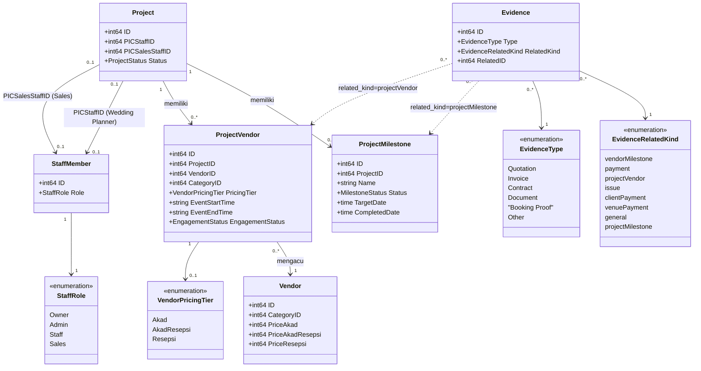
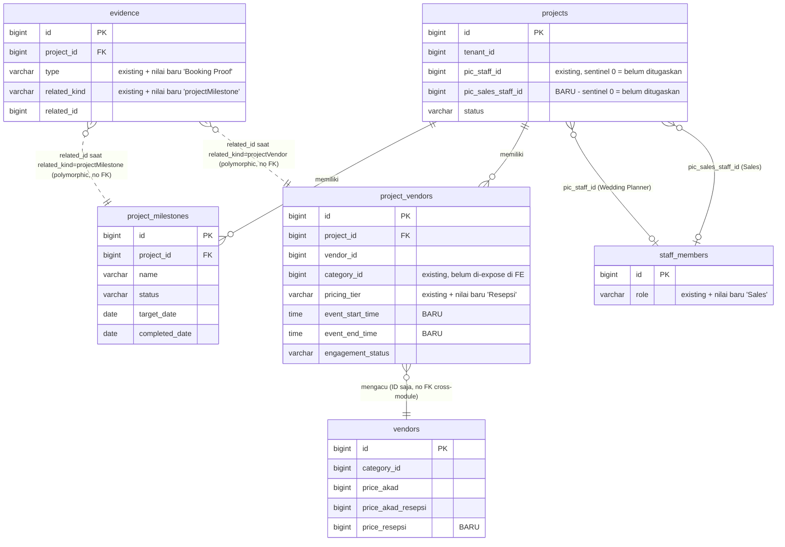
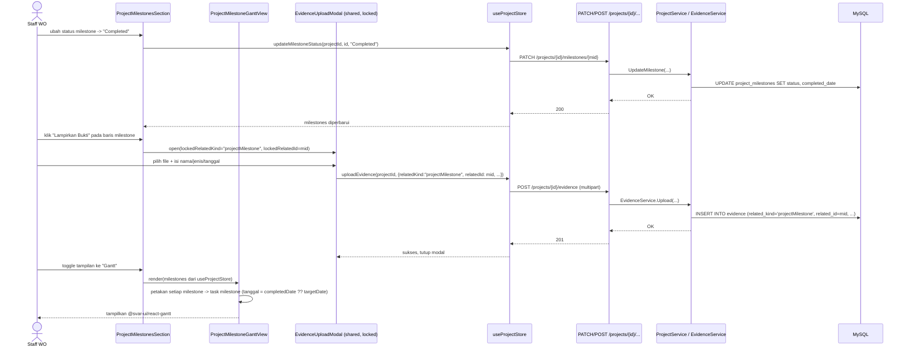
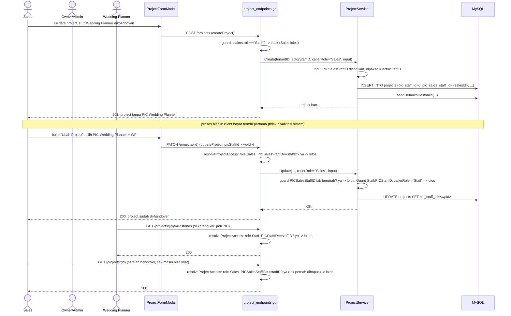

# PLAN.md — Revisi: Evidence Timeline, Gantt Chart, Kategori/Paket/Jam Acara Vendor, Role Sales, Bukti Booked

## 0. Ringkasan Permintaan

Lima revisi yang diminta pengguna, digabung dalam satu paket perubahan pada modul `projects` dan `vendors`
(backend Go modular monolith di `apps/api/internal/modules`, frontend React di `apps/web/src/modules`):

1. Attachment bukti saat item Timeline ditandai selesai.
2. Tampilan Gantt chart untuk Timeline.
3. Di "Tambah Vendor ke Project": kategori vendor yang bisa dipilih, paket 3 pilihan (Pemberkatan / Resepsi
   Only / Pemberkatan + Resepsi), dan jam acara (5 preset + custom).
4. Role baru "Sales" dengan model PIC ganda pada project (PIC Sales + PIC Wedding Planner), termasuk
   kemampuan Sales membuat project dan melakukan handover.
5. Di "Ubah Vendor Project": tambah bukti booked.

**Klasifikasi intent**: campuran **enhancement** (poin 1, 2, 3, 5 — memperluas kapabilitas yang sudah ada:
evidence, Timeline, form vendor-engagement) dan **new capability** (poin 4 — role baru + model PIC ganda,
belum ada presedennya di RBAC yang sudah dikunci di ADR-0017). Trace pada Langkah 2–5 mengonfirmasi: hampir
semua poin adalah **reuse/extend** dari struktur yang sudah ada, hanya poin 4 yang butuh struktur baru murni
(kolom `pic_sales_staff_id`, nilai role `Sales`).

## 1. Keputusan yang Sudah Dikunci

Dikumpulkan lewat dua sesi klarifikasi (`AskUserQuestion`) dan satu koreksi manual dari pengguna. Semua
keputusan di bawah ini final — bukan asumsi analis kecuali ditandai eksplisit "keputusan analis".

### 1.1 Evidence pada Timeline
- **Scope**: **General** — kemampuan lampirkan bukti berlaku untuk **semua** item Timeline (`project_milestones`),
  bukan dibatasi ke nama item tertentu. Alasan: `project_milestones.name` adalah teks bebas yang bisa diubah
  tenant sendiri (`apps/api/internal/modules/projects/application/milestone_template_service.go`), dan
  default template saat ini bernama "Survei Venue & Vendor" / "DP / Tanda Jadi ke Vendor"
  (`apps/api/migrations/000024_create_project_milestone_templates.up.sql:24-36`) — bukan persis "Pemilihan
  Venue"/"DP Venue" seperti disebut di permintaan awal. "Pemilihan Venue" & "DP Venue" adalah kasus pakai
  pertama, bukan pembatasan permanen.
- **Wajib/opsional**: **Opsional** — status boleh berubah ke "Completed" tanpa bukti terlampir; bukti bisa
  diunggah kapan saja.

### 1.2 Gantt Chart
- **Implementasi**: pakai **library pihak ketiga** (keputusan eksplisit pengguna, mengoreksi rekomendasi awal
  analis untuk build custom). Dipilih **`@svar-ui/react-gantt`** — MIT license, dikonfirmasi kompatibel React 19
  (SVAR React Gantt v2.3). Alternatif yang dipertimbangkan dan ditolak: `wx-react-gantt` (GPL-3.0, tidak cocok
  untuk produk SaaS closed-source), `gantt-task-react`/fork-nya (lisensi MIT tapi status kompatibilitas React 19
  tidak terkonfirmasi jelas di rilis utama).

### 1.3 Paket & Preset Harga Vendor
- Paket "Resepsi Only" (paket ke-3) **mendapat preset harga baru** di data Vendor (`Harga Resepsi Only`),
  sejajar dengan `priceAkad`/`priceAkadResepsi` yang sudah ada — supaya auto-fill Nilai Kerja Sama tetap
  konsisten untuk ketiga paket.
- Mapping label baru ke nilai `pricingTier` yang sudah ada (tidak mengganti nilai tersimpan, hanya label
  tampilan + 1 nilai baru):
  | Nilai (`pricingTier`) | Label baru | Label lama |
  |---|---|---|
  | `Akad` | **Pemberkatan** | "Akad Saja" |
  | `AkadResepsi` | **Pemberkatan + Resepsi** | "Akad + Resepsi" |
  | `Resepsi` *(baru)* | **Resepsi Only** | — |

### 1.4 Jam Acara
- Disimpan sebagai **2 kolom waktu** (`eventStartTime`, `eventEndTime`) pada `project_vendors` — bukan teks
  label. Preset dari permintaan (08.00-13.00, 16.00-21.00, 06.00-21.00, 10.45-13.00, 18.45-21.00) otomatis
  mengisi kedua kolom ini; opsi "Custom" membuka input jam manual. **Dikonfirmasi pengguna (sesi klarifikasi
  ketiga, `AskUserQuestion`): "Opsional"** — boleh kosong, mengikuti rekomendasi analis, bukan lagi asumsi.

### 1.5 Role "Sales" (Wedding Consultant) — model PIC ganda
Ini fork desain terbesar; dikoreksi total dari opsi awal analis lewat jawaban naratif pengguna, lalu dikunci
lewat sesi klarifikasi kedua:

- **Struktur PIC**: **kolom baru `pic_sales_staff_id`** pada `projects`, berdampingan dengan kolom `pic_staff_id`
  yang sudah ada. `pic_staff_id` **tetap** berarti "PIC Wedding Planner" (tidak berganti nama kolom — hanya
  makna/label tampilannya kini eksplisit "PIC Wedding Planner", sama presedennya dengan rename tampilan-saja
  Milestone→Timeline). Ditolak: tabel PIC generik multi-role — tidak dibutuhkan untuk 2 peran PIC yang sudah
  jelas ini (YAGNI).
- **PIC Wedding Planner boleh kosong saat create** — project yang dibuat Sales belum tentu langsung punya
  Wedding Planner (belum di-handover).
  - **Keputusan analis (mekanisme)**: kolom `projects.pic_staff_id` **tetap `NOT NULL`** (tidak perlu migration
    relax-nullable) — nilai `0` dipakai sebagai sentinel "belum ditugaskan", mengikuti konvensi yang **sudah
    ada** di codebase ini untuk kasus identik: `EvidenceRelatedGeneral`'s `RelatedID` sentinel `0`
    (`apps/api/internal/modules/projects/domain/evidence.go:30-37`, comment eksplisit "AUTO_INCREMENT never
    starts at 0") dan `Project.VenueID`'s tri-state wire convention (0 = detach) di
    `apps/api/internal/modules/projects/application/project_service.go:319-329` (`ProjectService.Update`,
    bukan di layer presentation — DTO-nya sendiri ada di `project_endpoints.go:107`). Backend `Create`/`Update`
    sudah tidak memvalidasi `PICStaffID > 0` di mana pun (`project_service.go:277-333`), jadi tidak ada
    perubahan skema atau validasi backend untuk poin ini — hanya frontend yang perlu mengizinkan field ini
    dikosongkan.
- **Siapa boleh handover (mengisi/mengubah PIC Wedding Planner)**: **Owner/Admin, DAN Sales pemilik project
  itu sendiri** (bukan hanya Owner/Admin seperti aturan reassign-PIC yang sudah ada di ADR-0017). Ini
  perluasan eksplisit dari aturan lama, hanya untuk kombinasi "Sales mengubah PIC Wedding Planner di project
  miliknya sendiri".
- **Validasi handover berbasis pembayaran**: **tidak ada** — pengisian PIC Wedding Planner murni keputusan
  manual, sistem tidak mengecek status Client Payment ("termin pertama") sama sekali.
- **Akses tulis Sales dalam project miliknya**: **setara Wedding Planner** — bisa mengubah Timeline, vendor
  engagement, pembayaran, evidence — ditambah bisa **membuat project baru** dan melakukan **handover** (isi
  PIC Wedding Planner). Setelah handover, Wedding Planner ikut bisa mengerjakan hal yang sama di project itu;
  Sales tetap bisa melihat project itu selamanya (kolom `pic_sales_staff_id` tidak pernah dihapus/diganti oleh
  proses handover).
- **Keputusan analis (turunan, belum ditanyakan eksplisit ke pengguna — perlu dikonfirmasi sebelum coding)**:
  1. Saat Sales membuat project baru, `pic_sales_staff_id` **otomatis diisi staff Sales yang membuat**
     (dipaksa oleh server, mengabaikan nilai apa pun yang dikirim klien) — meniru preseden ADR-0017 "hanya
     Owner/Admin yang menentukan PIC siapa pun", jadi seorang Sales tidak bisa membuat project atas nama Sales
     lain. Owner/Admin tetap boleh mengisi `pic_sales_staff_id` bebas (termasuk membiarkannya kosong) saat
     mereka sendiri yang membuat project.
  2. Sales **tidak** mendapat kapabilitas **Duplikat Project** — aturan ADR-0017 lama (Owner/Admin-only) tetap
     berlaku utuh untuk aksi ini; kapabilitas baru Sales secara eksplisit hanya "membuat project baru dari nol"
     dan "handover", bukan "menduplikasi project sebagai template".
  3. Sales **tidak** melihat Dashboard sama sekali (guard `Dashboard` di
     `apps/api/internal/modules/projects/presentation/dashboard_endpoint.go:171` saat ini memakai exclusion-list
     `if claims.role == "Staff"` — literal ini **akan meloloskan Sales tanpa sengaja** kalau tidak diperluas;
     lihat §4.5).
  4. Sales **mendapat akses tulis ke tab Client** pada project miliknya (create/edit data Client), berbeda dari
     Wedding Planner yang menurut ADR-0017 hanya mendapat **read**-only Client bahkan di project sendiri
     ("`clients` ... PIC-scoped read for Wedding Planner ... Owner/Admin-only write"). Ini pengecualian sadar
     dari "paritas penuh dengan Wedding Planner" — tanpa akses tulis Client, Sales tidak bisa menjalankan fungsi
     inti onboarding klien yang jadi alasan role ini dibuat. **Dikonfirmasi pengguna (sesi klarifikasi ketiga,
     `AskUserQuestion`): "Ya, tulis penuh"** — mengikuti rekomendasi analis, bukan lagi asumsi.

## 2. Ruang Lingkup

### In Scope
- Modul `projects` (backend + frontend): `project_milestones` (evidence + Gantt), `projects` (PIC ganda,
  role Sales scoping), `project_vendors` (kategori/paket/jam acara, evidence bukti booked).
- Modul `vendors` (backend + frontend): `vendors` (preset harga ke-3).
- Modul `staff` (backend) + frontend `users`: role `Sales` baru.
- `evidence` (dimiliki modul `projects`): 2 nilai enum baru (`related_kind`, `type`).

### Out of Scope (dan alasannya)
- **Client Portal** — tidak disinggung permintaan; Gantt chart & evidence Timeline baru hanya untuk WO Console.
  Evidence yang terkait `projectMilestone` **tidak** otomatis client-visible (`isClientVisible` hanya berlaku
  untuk kind `general`, per `evidence.go:53-61` — tidak diubah).
- **Perubahan tabel `project_milestones` itu sendiri** — tidak perlu kolom baru; keterkaitan ke evidence murni
  lewat `evidence.related_kind`/`related_id` yang sudah polymorphic.
- **Validasi/gate otomatis handover berdasarkan Client Payment** — eksplisit ditolak pengguna (§1.5).
- **Tabel PIC generik multi-role** — ditolak, YAGNI untuk kebutuhan 2 peran PIC saat ini (§1.5).
- **Kapabilitas Duplikat Project untuk Sales** — eksplisit dikecualikan (§1.5 poin analis #2).
- **Mengubah nilai `pricingTier` yang tersimpan** (`Akad`/`AkadResepsi`) — hanya label tampilan yang berubah,
  ditambah 1 nilai baru `Resepsi`; tidak ada migration data/backfill.

## 3. Reuse Inventory (diverifikasi dengan membaca kode)

| Kebutuhan | Yang direuse | Verifikasi |
|---|---|---|
| Attach evidence ke entity apa pun | `EvidenceRelatedKind` polymorphic (`related_kind`+`related_id`) — pola yang sama dipakai `vendorMilestone`, `payment`, dst. | `apps/api/internal/modules/projects/domain/evidence.go:21-38`; frontend `RELATED_KIND_LABEL`/`contextLabel()`/`relatedOptionsFor()` generik di `ProjectEvidenceSection.tsx:30-38,85-135` |
| Upload UI evidence | `AddEvidenceModal` (form file+nama+jenis+konteks+tanggal) | `ProjectEvidenceSection.tsx:324-455` — direuse (diekstrak jadi shared, lihat §4.1) untuk upload evidence dari Timeline & dari form Ubah Vendor Project |
| Bukti booked pada vendor engagement | `EvidenceRelatedKind.projectVendor` — **sudah ada**, tidak perlu enum baru untuk relasinya, hanya UI upload yang belum ada di modal | `evidence.go:26`; `ProjectVendorFormModal.tsx:118-197` belum punya file input sama sekali |
| Kategori vendor pada engagement | Kolom `project_vendors.category_id` + `vendorEngagementInputBody.CategoryID` — **backend sudah menerima**, hanya FE belum expose field-nya | `apps/api/migrations/000008_create_project_tables.up.sql:38`; `vendor_engagement_endpoints.go:75,96` |
| Auto-fill harga dari preset vendor | Pola `useEffect` yang sudah ada untuk `Akad`/`AkadResepsi` di `ProjectVendorFormModal.tsx:92-97` — direuse persis untuk cabang `Resepsi` | dibaca langsung |
| Sentinel "0 = belum ada" untuk PIC opsional | Pola yang sama dengan `EvidenceRelatedGeneral.RelatedID` & `Project.VenueID` tri-state | `evidence.go:30-37`; `project_service.go:319-329` |
| Guard role per-endpoint (bukan middleware generik) | Pola literal `if claims.role == "..."` ada di setiap handler — pola yang sama dipakai untuk menambah cabang `"Sales"` | `project_endpoints.go:139` (createProject), `project_endpoints.go:313` (duplicateProject), `dashboard_endpoint.go:171` (Dashboard), `handler.go:261` (resolveProjectAccess) |

## 4. Rencana Detail per Area

### 4.1 Evidence pada Timeline (Revisi 1)

**Backend**
- `apps/api/migrations/000039_add_project_milestone_to_evidence_related_kind.up.sql` (dan `.down.sql`):
  `ALTER TABLE evidence MODIFY COLUMN related_kind ENUM('vendorMilestone','payment','projectVendor','issue','clientPayment','venuePayment','general','projectMilestone') NOT NULL;`
- `apps/api/internal/modules/projects/domain/evidence.go:21-38` — tambah
  `RelatedProjectMilestone EvidenceRelatedKind = "projectMilestone"`.
- Tidak ada perubahan di `evidence_service.go`/`evidence_endpoints.go` — keduanya generik terhadap nilai
  `related_kind` (tidak ada whitelist Go-side, hanya divalidasi oleh constraint ENUM MySQL — dikonfirmasi saat
  trace `evidence_endpoints.go:52-66`).

**Frontend**
- `apps/web/src/modules/projects/schemas/evidence.schema.ts:17-25` — tambah `"projectMilestone"` ke
  `EVIDENCE_RELATED_KIND_OPTIONS`.
- `apps/web/src/modules/projects/components/detail/ProjectEvidenceSection.tsx`:
  - `RELATED_KIND_LABEL` (baris 30-38): tambah `projectMilestone: "Timeline"`.
  - `contextLabel()` (baris 85-113): tambah cabang — cari di `useProjectStore((s) => s.milestones)` by id,
    kembalikan `` `Timeline: ${milestone.name}` ``.
  - `relatedOptionsFor()` (baris 115-135): tambah cabang mapping `milestones` store ke `{id, label: m.name}`.
  - **Ekstrak `AddEvidenceModal`** (baris 324-455) jadi komponen shared, mis.
    `apps/web/src/shared/components/ui/EvidenceUploadModal.tsx`, dengan 2 prop opsional baru
    `lockedRelatedKind`/`lockedRelatedId` — kalau diisi, field "Konteks" & "Terkait" disembunyikan dan
    langsung memakai nilai terkunci itu. Ini murni ekstraksi + generalisasi, bukan file baru yang tidak
    berhubungan — dipakai ulang oleh `ProjectMilestonesSection.tsx` (Timeline) dan `ProjectVendorFormModal.tsx`
    (bukti booked, §4.5), menghindari duplikasi logic compress-file + validasi yang sudah ada.
  - `ProjectEvidenceSection.tsx` sendiri diupdate untuk memakai komponen shared hasil ekstraksi ini (tanpa
    `lockedRelatedKind`/`lockedRelatedId`, perilaku tidak berubah).
- `apps/web/src/modules/projects/components/detail/ProjectMilestonesSection.tsx`:
  - Tambah state `[evidenceMilestone, setEvidenceMilestone]` + tombol ikon baru ("Lampirkan Bukti", ikon mis.
    `Paperclip` dari `lucide-react`) di sebelah tombol `Pencil`/`Ban` — baik versi mobile (`CardList`, sekitar
    baris 158) maupun versi desktop (`Table`, sekitar baris 256).
  - Render `EvidenceUploadModal` (hasil ekstraksi) dengan `lockedRelatedKind="projectMilestone"`,
    `lockedRelatedId={evidenceMilestone.id}` saat `evidenceMilestone` terisi.
  - Upload dilakukan lewat store action `uploadEvidence` yang **sudah ada** (`useProjectStore`, dipakai juga
    oleh `ProjectEvidenceSection.tsx:54`) — tidak perlu action store baru.

### 4.2 Gantt Chart untuk Timeline (Revisi 2)

- Tambah dependency `@svar-ui/react-gantt` (MIT) di `apps/web/package.json`.
- Komponen baru `apps/web/src/modules/projects/components/detail/ProjectMilestoneGanttView.tsx`:
  - Input: `milestones: ProjectMilestone[]` (dari `useProjectStore((s) => s.milestones)`, field yang sama
    dipakai `ProjectMilestonesSection.tsx`).
  - Karena satu item Timeline hanya punya satu titik waktu (`targetDate`, dan `completedDate` kalau sudah
    selesai) — **bukan rentang** — setiap milestone dipetakan sebagai task bertipe **milestone/diamond**
    (bukan bar berdurasi) pada tanggal `completedDate ?? targetDate`, diurutkan berdasarkan `order`
    (`project_milestones.sort_order`), diwarnai berdasarkan `status` (mis. merah untuk item overdue — reuse
    fungsi `isMilestoneOverdue` dari `@/modules/projects/lib/dates` yang sudah dipakai
    `ProjectMilestonesSection.tsx:16,132`).
- `apps/web/src/modules/projects/pages/tabs/ProjectMilestoneTabPage.tsx` (atau di dalam
  `ProjectMilestonesSection.tsx`, di atas `MilestoneRail`): tambah toggle tampilan "List" / "Gantt"
  (`useState<"list"|"gantt">`), me-render `ProjectMilestonesSection` atau `ProjectMilestoneGanttView` sesuai
  pilihan.
- Tidak ada perubahan backend — data sudah tersedia dari endpoint milestone yang ada.

### 4.3 Kategori, Paket, Jam Acara di Vendor Engagement (Revisi 3)

**Backend**
- `apps/api/migrations/000041_add_event_hours_to_project_vendors.up.sql`:
  `ALTER TABLE project_vendors ADD COLUMN event_start_time TIME NULL AFTER event_date, ADD COLUMN event_end_time TIME NULL AFTER event_start_time;`
- `apps/api/migrations/000042_add_price_resepsi_to_vendors.up.sql`:
  `ALTER TABLE vendors ADD COLUMN price_resepsi BIGINT UNSIGNED NULL AFTER price_akad_resepsi;`
  (pola identik `price_akad`/`price_akad_resepsi` yang ditambahkan di
  `apps/api/migrations/000023_alter_vendors_add_fields.up.sql:14-15`, sama-sama nullable meski akan divalidasi
  wajib di form Vendor untuk vendor baru — lihat komentar baris 5 migration itu).
- `apps/api/internal/modules/projects/domain/vendor_engagement.go`:
  - Baris 25-28: tambah `PricingTierResepsi VendorPricingTier = "Resepsi"`.
  - Baris 30-51 (`ProjectVendor`): tambah `EventStartTime *string` dan `EventEndTime *string` (format
    `"HH:MM"`, nullable — opsional, lihat §1.4).
- `apps/api/internal/modules/vendors/domain/vendor.go:16-17` — tambah `PriceResepsi *int64` (pola identik
  `PriceAkad`/`PriceAkadResepsi`).
- `apps/api/internal/modules/projects/application/vendor_engagement_service.go` (sekitar baris 74-112,
  `Create`/`Update`) dan `apps/api/internal/modules/vendors/application/vendor_service.go` — thread field baru
  lewat (assignment langsung dari input, sama seperti field lain — tidak ada logic khusus).
- `apps/api/internal/modules/projects/presentation/vendor_engagement_endpoints.go:75+` — tambah
  `EventStartTime`/`EventEndTime` di `vendorEngagementInputBody` dan mapping-nya. `CategoryID` **sudah ada**
  (baris 75, 96) — tidak perlu perubahan backend untuk field kategori.
- `apps/api/internal/modules/vendors/presentation/vendor_handler.go` — tambah `PriceResepsi` di body vendor.
- Repository: `apps/api/internal/modules/projects/infrastructure/mysql_vendor_engagement_repository.go` dan
  `apps/api/internal/modules/vendors/infrastructure/mysql_vendor_repository.go` — tambah kolom baru ke semua
  query `INSERT`/`UPDATE`/`SELECT` yang menyentuh `project_vendors`/`vendors`.

**Frontend**
- `apps/web/src/modules/projects/schemas/project-vendor.schema.ts`:
  - Baris 15: `PRICING_TIER_OPTIONS = ["Akad", "AkadResepsi", "Resepsi"]`.
  - Tambah `categoryId: z.string().optional().default("")`, `eventStartTime: z.string().optional().default("")`,
    `eventEndTime: z.string().optional().default("")`.
- `apps/web/src/modules/projects/components/ProjectVendorFormModal.tsx`:
  - Field baru **"Kategori Vendor"** (`Select`, dari `useVendorCategoryStore` — modul `vendor-categories`,
    lihat `MODULE_MAP.md` baris 113) **sebelum** field "Vendor" (baris 133-145) — memilih kategori memfilter
    opsi dropdown Vendor (`vendors.filter(v => v.categoryId === selectedCategoryId)`); memilih Vendor tetap
    menyinkronkan `categoryId` ke kategori vendor tersebut (konsisten dengan `category_id` yang sudah dikirim
    backend).
  - Field "Paket" (baris 146-151): tambah `<option value="Resepsi">Resepsi Only</option>`, ubah label 2 opsi
    lama sesuai §1.3 ("Pemberkatan", "Pemberkatan + Resepsi"). Efek auto-fill harga (baris 92-97) tambah cabang
    `values.pricingTier === "Resepsi" ? selectedVendor.priceResepsi : ...`.
  - Field baru **"Jam Acara"**: `Select` preset (5 opsi + "Custom") yang, saat dipilih (selain Custom),
    langsung mengisi `eventStartTime`/`eventEndTime`; saat "Custom" dipilih, tampilkan 2 `Input type="time"`
    manual. Preset persis sesuai permintaan: `08:00-13:00`, `16:00-21:00`, `06:00-21:00`, `10:45-13:00`,
    `18:45-21:00`.
- `apps/web/src/modules/vendors/schemas/vendor.schema.ts:16-17,28-29` — tambah `priceResepsi` (pola identik
  `priceAkadResepsi`).
- `apps/web/src/modules/vendors/components/VendorFormModal.tsx:167-172` — tambah Field "Harga Resepsi Only
  (Rp)" setelah "Harga Akad+Resepsi", pola identik.

### 4.4 Bukti Booked di "Ubah Vendor Project" (Revisi 5)

**Backend**
- `apps/api/migrations/000040_add_booking_proof_to_evidence_type.up.sql`:
  `ALTER TABLE evidence MODIFY COLUMN type ENUM('Quotation','Invoice','Contract','Transfer Proof','Receipt','Purchase Order','Photo','Document','Screenshot','Minutes of Meeting','Other','Booking Proof') NOT NULL;`
- `apps/api/internal/modules/projects/domain/evidence.go:7-19` — tambah
  `EvidenceBookingProof EvidenceType = "Booking Proof"`.
- Relasi `related_kind = "projectVendor"` **sudah ada** (`evidence.go:26`) — tidak ada migration/domain
  tambahan untuk relasinya.

**Frontend**
- `apps/web/src/modules/projects/schemas/evidence.schema.ts:3-15` — tambah `"Booking Proof"` ke
  `EVIDENCE_TYPE_OPTIONS`.
- `apps/web/src/modules/projects/components/ProjectVendorFormModal.tsx` — tambah section evidence **hanya saat
  mode edit** (`initialProjectVendor` terisi — sesuai nama "Ubah Vendor Project"; saat "Tambah Vendor" belum
  ada `project_vendors.id` untuk dikaitkan):
  - Daftar evidence yang sudah ada untuk engagement ini (filter `evidence` store by
    `relatedKind === "projectVendor" && relatedId === initialProjectVendor.id`).
  - Tombol "Tambah Bukti Booked" membuka `EvidenceUploadModal` (hasil ekstraksi §4.1) dengan
    `lockedRelatedKind="projectVendor"`, `lockedRelatedId={initialProjectVendor.id}`, default `type="Booking Proof"`.

### 4.5 Role "Sales" & PIC Ganda (Revisi 4)

**Migration**
- `apps/api/migrations/000037_add_pic_sales_to_projects.up.sql`:
  `ALTER TABLE projects ADD COLUMN pic_sales_staff_id BIGINT UNSIGNED NOT NULL DEFAULT 0 AFTER pic_staff_id;`
- `apps/api/migrations/000038_add_sales_role_to_staff_members.up.sql`:
  `ALTER TABLE staff_members MODIFY COLUMN role ENUM('Owner','Admin','Staff','Sales') NOT NULL;`
  (kolom asli: `apps/api/migrations/000003_create_staff_members_table.up.sql:7`)

**Domain & Application**
- `apps/api/internal/modules/staff/domain/staff_member.go:10-14` — tambah `RoleSales StaffRole = "Sales"`.
- `apps/api/internal/modules/projects/domain/project.go:18-51` (`Project`) — tambah field `PICSalesStaffID int64`
  (sentinel `0` = belum ditugaskan, sama seperti `PICStaffID`).
- `apps/api/internal/modules/projects/application/project_service.go` — struct `ProjectInput` (field
  sejenis `VenueRentalPrice`/`VenueCharge` di sekitar baris 273-275) — tambah field `PICSalesStaffID int64`,
  supaya `input.PICSalesStaffID` yang dipakai `Create`/`Update` di bawah ini benar-benar ada.
- `apps/api/internal/modules/projects/presentation/project_endpoints.go`:
  - `projectInputBody` (baris 90-115) — tambah `PICSalesStaffID int64 \`json:"picSalesStaffId"\``.
  - `toProjectInput` (baris 117-133) — tambah mapping `PICSalesStaffID: body.PICSalesStaffID,`.
- `apps/api/internal/modules/projects/application/project_service.go` (lanjutan):
  - `Create` (baris 277-293) — tambah parameter `callerRole string`. Kalau `callerRole == "Sales"`:
    `p.PICSalesStaffID = actorStaffID` (paksa, abaikan `input.PICSalesStaffID`). Selain itu: pakai
    `input.PICSalesStaffID` apa adanya (Owner/Admin bebas mengisi/mengosongkan).
  - `Update` (baris 300-307) — tambah cabang setelah guard `Staff` yang sudah ada:
    `if callerRole == "Sales" && input.PICSalesStaffID != p.PICSalesStaffID { return Forbidden(...) }`
    (Sales tidak bisa memindahkan PIC Sales dirinya sendiri ke orang lain). Guard `PICStaffID` yang sudah ada
    (khusus role `"Staff"`) **tidak disentuh** — otomatis berarti Sales **boleh** mengubah `PICStaffID`
    (mekanisme handover), karena scoping akses project untuk Sales (lihat `handler.go` di bawah) sudah
    memastikan hanya pemilik (`PICSalesStaffID == actorStaffID`) yang bisa mencapai baris ini sama sekali.
  - `List`/`ListPaginated` (baris 190,221 + interface baris 15,23) — tambah parameter kedua
    `picSalesStaffID *int64`, threaded ke `ProjectRepository.List`/`ListPaginated`.
- `apps/api/internal/modules/projects/infrastructure/mysql_project_repository.go:56,190` — tambah filter SQL
  `AND pic_sales_staff_id = ?` saat `picSalesStaffID` tidak nil; sertakan kolom baru di semua
  `INSERT`/`UPDATE`/`SELECT` project.

**Presentation (guard per-endpoint, mengikuti pola literal yang sudah ada — bukan middleware generik)**
- `apps/api/internal/modules/projects/presentation/project_endpoints.go:135-142` (`createProject`) — **tidak
  ada perubahan logic** (`if claims.role == "Staff"` sudah otomatis meloloskan `"Sales"`); update komentar
  baris 135-137 supaya tidak lagi menyatakan "Owner/Admin only" secara keliru. Tambah pemanggilan
  `h.projects.Create(..., claims.role, input)` (thread `callerRole` yang baru ditambah di service).
- Baris 24-27 (`listProjects`) — tambah:
  ```go
  var picSalesStaffID *int64
  if claims.role == "Sales" {
      picSalesStaffID = &claims.staffID
  }
  ```
  dan sertakan di kedua pemanggilan `h.projects.List`/`ListPaginated`.
- Baris 171-174 (`dashboard_endpoint.go`, `Dashboard`) — **ubah** guard jadi
  `if claims.role == "Staff" || claims.role == "Sales" { 403 }` — tanpa ini, Sales otomatis bisa mengakses
  Dashboard penuh karena guard lama berbasis exclusion-list, bukan whitelist (§1.5 poin analis #3).
- Baris 313-316 (`duplicateProject`) — **ubah** guard jadi
  `if claims.role == "Staff" || claims.role == "Sales" { 403 }` (§1.5 poin analis #2 — Sales tidak boleh
  duplikat, beda dari createProject).
- `apps/api/internal/modules/projects/presentation/handler.go:243-265` (`resolveProjectAccess`) — tambah
  cabang setelah baris 261:
  ```go
  if sc.role == "Sales" && p.PICSalesStaffID != sc.staffID {
      return sc, false // 403
  }
  ```

**Frontend**
- `apps/web/src/modules/users/types.ts:3,10-14` — `StaffRole` tambah `"Sales"`; `ROLE_LABELS` tambah
  `Sales: "Sales"`.
- `apps/web/src/modules/users/schemas/user.schema.ts:8,13` — `STAFF_ROLE_OPTIONS` tambah `"Sales"`;
  `z.enum(["Owner","Admin","Staff","Sales"])`.
- `apps/web/src/shared/layouts/Sidebar.tsx` — nav item **Project** (yang saat ini bisa diakses Wedding Planner)
  perlu `allowedRoles` diperluas menyertakan `"Sales"`; nav item Dashboard/Vendor/Venue/Pengaturan **tidak**
  disentuh (Sales tetap tidak muncul di situ, sesuai §1.5).
- `apps/web/src/modules/projects/schemas/project.schema.ts:17` — `picStaffId: z.string().min(1,...)` diubah
  jadi `z.string().optional().default("")`; tambah `picSalesStaffId: z.string().optional().default("")`.
- `apps/web/src/modules/projects/components/ProjectFormModal.tsx`:
  - Field "Penanggung Jawab WO" (baris 149-159) — tambah opsi kosong "Belum ditugaskan", tidak lagi wajib.
  - Tambah field baru "PIC Sales" — untuk pembuat berrole Sales: tampil sebagai `<Input disabled>` terisi
    nama diri sendiri (pola identik `picLocked` yang sudah ada di baris 65 untuk Wedding Planner); untuk
    Owner/Admin: `<Select>` bebas (termasuk opsi kosong).
- `apps/web/src/modules/projects/components/ProjectHeaderCard.tsx`:
  - Tambah `InfoField` kedua "PIC Sales" di sebelah `InfoField` PIC Wedding Planner yang sudah ada (baris 236).
  - Baris 40 (`canDuplicate`) — ubah `role !== "Staff"` jadi `role !== "Staff" && role !== "Sales"`.
- `apps/web/src/modules/projects/components/detail/ProjectClientsSection.tsx` — beri Sales akses tulis (tombol
  create/edit Client) untuk project miliknya, berbeda dari Wedding Planner yang read-only (§1.5 poin analis
  #4) — **flag untuk konfirmasi pengguna**.

## 5. Diagram

### 5.1 Class Diagram



### 5.2 ERD



### 5.3 Sequence Diagram — Evidence Timeline + Gantt (Revisi 1 & 2)



### 5.4 Sequence Diagram — Sales membuat Project & Handover (Revisi 4)



## 6. Task List

Backend, urut sesuai dependency (migration → domain → repository → application → presentation):

1. [x] Migration `000037_add_pic_sales_to_projects` — `projects.pic_sales_staff_id`.
2. [x] Migration `000038_add_sales_role_to_staff_members` — enum role + `Sales`.
3. [x] Migration `000039_add_project_milestone_to_evidence_related_kind` — enum `related_kind` + `projectMilestone`.
4. [x] Migration `000040_add_booking_proof_to_evidence_type` — enum `type` + `Booking Proof`.
5. [x] Migration `000041_add_event_hours_to_project_vendors` — `event_start_time`, `event_end_time`.
6. [x] Migration `000042_add_price_resepsi_to_vendors` — `vendors.price_resepsi`.
7. [x] `staff/domain/staff_member.go` — const `RoleSales`.
8. [x] `projects/domain/project.go` — field `PICSalesStaffID`; `project_service.go`'s `ProjectInput` struct + `project_endpoints.go`'s `projectInputBody`/`toProjectInput` — thread `PICSalesStaffID` end to end.
9. [x] `projects/domain/evidence.go` — const `RelatedProjectMilestone`, `EvidenceBookingProof`.
10. [x] `projects/domain/vendor_engagement.go` — const `PricingTierResepsi`; field `EventStartTime`/`EventEndTime`.
11. [x] `vendors/domain/vendor.go` — field `PriceResepsi`.
12. [x] `mysql_project_repository.go` — kolom `pic_sales_staff_id` di Create/Update/Get/List/ListPaginated + parameter filter kedua.
13. [x] `mysql_vendor_engagement_repository.go` — kolom `event_start_time`/`event_end_time`.
14. [x] `mysql_vendor_repository.go` — kolom `price_resepsi`.
15. [x] `project_service.go` — `Create` terima `callerRole`, paksa `PICSalesStaffID` untuk role Sales; `Update` tambah guard immutability `PICSalesStaffID` untuk Sales; `List`/`ListPaginated` tambah parameter `picSalesStaffID`.
16. [x] `vendor_engagement_service.go` — thread `EventStartTime`/`EventEndTime`.
17. [x] `vendor_service.go` — thread `PriceResepsi`.
18. [x] `project_endpoints.go` — `createProject` update komentar + pass `callerRole`; `listProjects` tambah scoping Sales; `dashboard_endpoint.go` & `duplicateProject` tambah exclusion `"Sales"`.
19. [x] `handler.go` (`resolveProjectAccess`) — tambah cabang scoping Sales via `PICSalesStaffID`.
20. [x] `vendor_engagement_endpoints.go` — body + mapping `EventStartTime`/`EventEndTime`.
21. [x] `vendor_handler.go` (vendors module) — body + mapping `PriceResepsi`.

Frontend, urut sesuai dependency:

22. [x] `users/types.ts` + `users/schemas/user.schema.ts` — tambah role `"Sales"`.
23. [x] `Sidebar.tsx` — `allowedRoles` nav Project sertakan `"Sales"`.
24. [x] `project.schema.ts` — `picStaffId` jadi opsional; tambah `picSalesStaffId`.
25. [x] `ProjectFormModal.tsx` — field PIC Wedding Planner opsional + opsi kosong; field baru PIC Sales (locked-to-self untuk Sales, bebas untuk Owner/Admin).
26. [x] `ProjectHeaderCard.tsx` — tampilkan PIC Sales; `canDuplicate` kecualikan `"Sales"`.
27. [x] `ProjectClientsSection.tsx` — akses tulis Client untuk Sales pada project miliknya (dikonfirmasi, §1.5 poin analis #4).
28. [x] `evidence.schema.ts` — tambah `"projectMilestone"` & `"Booking Proof"`.
29. [x] Ekstrak `AddEvidenceModal` → `shared/components/ui/EvidenceUploadModal.tsx` dengan `lockedRelatedKind`/`lockedRelatedId`.
30. [x] `ProjectEvidenceSection.tsx` — pakai komponen shared hasil (29); tambah label/cabang `projectMilestone`.
31. [x] `ProjectMilestonesSection.tsx` — tombol "Lampirkan Bukti" per baris, pakai (29) locked ke `projectMilestone`.
32. [x] Install `@svar-ui/react-gantt`; buat `ProjectMilestoneGanttView.tsx`.
33. [x] `ProjectMilestoneTabPage.tsx` — toggle List/Gantt.
34. [x] `project-vendor.schema.ts` — `PRICING_TIER_OPTIONS` + `Resepsi`; tambah `categoryId`, `eventStartTime`, `eventEndTime`.
35. [x] `ProjectVendorFormModal.tsx` — field Kategori (filter cascading), opsi Paket ke-3 + relabel, field Jam Acara (preset+custom), section evidence "Bukti Booked" (mode edit saja, pakai (29) locked ke `projectVendor`).
36. [x] `vendors/schemas/vendor.schema.ts` — tambah `priceResepsi`.
37. [x] `VendorFormModal.tsx` — field "Harga Resepsi Only".

## 7. Test Plan

**Backend**
- Sales membuat project baru → `pic_sales_staff_id` otomatis = staff Sales tersebut, `pic_staff_id` tetap `0`.
- Sales mencoba set `PICSalesStaffID` ke staff Sales lain saat create/update → nilai dipaksa/ditolak sesuai §4.5.
- Sales pemilik project mengisi `picStaffId` (handover) → berhasil, tidak butuh Client Payment apa pun.
- Wedding Planner mencoba ubah `picStaffId` di project sendiri → tetap 403 (perilaku lama, tidak berubah).
- Sales mengakses project yang bukan miliknya (`PICSalesStaffID` beda) → 403 dari `resolveProjectAccess`.
- Sales memanggil `GET /projects/dashboard` → 403 (bukan 200).
- Sales memanggil `duplicateProject` → 403.
- Upload evidence dengan `relatedKind="projectMilestone"` → tersimpan, muncul di `GET /projects/{id}/evidence`.
- Upload evidence dengan `relatedKind="projectVendor"`, `type="Booking Proof"` → tersimpan.
- Buat `project_vendors` dengan `pricingTier="Resepsi"` dan `eventStartTime`/`eventEndTime` custom → tersimpan & terbaca kembali persis.
- Menandai milestone "Completed" tanpa evidence apa pun → tetap berhasil (opsional, bukan wajib).

**Frontend**
- Form Tambah Project: PIC Wedding Planner boleh dikosongkan; submit berhasil.
- Form Tambah Vendor ke Project: pilih Kategori → daftar Vendor terfilter; pilih Paket "Resepsi Only" → Nilai Kerja Sama auto-fill dari `priceResepsi` vendor (bila terisi); pilih preset Jam Acara → 2 field waktu terisi otomatis; pilih "Custom" → field waktu manual muncul & bisa diisi bebas.
- Form Ubah Vendor Project: section "Bukti Booked" muncul hanya saat edit (tidak muncul saat mode Tambah); upload berhasil & langsung tampil di daftar.
- Timeline: tombol "Lampirkan Bukti" per item berfungsi untuk status apa pun (bukan hanya Completed); toggle ke tampilan Gantt menampilkan seluruh item terurut sesuai `sort_order`.

## 8. Catatan Validasi (Step 7)

Divalidasi dalam 1 pass menyeluruh terhadap 6 kriteria (requirement agreement, sequence completeness,
ordering/dependency, diagram↔prosa↔task-list, fact re-check, exception path):

- **Requirement agreement**: semua 5 revisi awal tercakup; setiap keputusan terkunci dari kedua sesi klarifikasi
  tercermin di §1 dan diturunkan konsisten ke §4.
- **Sequence completeness**: kedua diagram sequence (§5.3, §5.4) hanya memanggil fungsi/endpoint yang disebut
  di §4 dengan file:line konkret — tidak ada hop ke entity yang tidak terdefinisi.
- **Ordering/dependency**: task list backend (poin 1-21) migration→domain→repository→application→presentation;
  frontend (22-37) role/schema dulu sebelum komponen yang memakainya; ekstraksi `EvidenceUploadModal` (29)
  mendahului 2 pemakainya (30-31, 35) — tidak ada task yang bergantung pada task setelahnya.
- **Diagram↔prosa↔task-list**: `PICSalesStaffID`, `EventStartTime/EventEndTime`, `PriceResepsi`,
  `RelatedProjectMilestone`, `EvidenceBookingProof`, `RoleSales` muncul konsisten di class diagram, ERD, §4,
  dan task list dengan nama yang sama.
- **Fact re-check**: seluruh file:line kunci (guard `createProject`/`duplicateProject`/`Dashboard`,
  `resolveProjectAccess`, skema `pic_staff_id NOT NULL`, enum `evidence.type`/`related_kind`,
  `PRICING_TIER_OPTIONS`, struktur `ProjectVendor`/`Vendor` domain) dibaca langsung dari kode pada sesi ini.
- **Exception path**: guard 403 untuk Sales di luar project miliknya, Sales ke Dashboard, Sales ke duplikat
  project, dan "evidence opsional saat Completed" masing-masing tercantum di §5 (sequence) dan §7 (test plan).

Dua keputusan analis di §1.5 (poin #4, akses tulis Client untuk Sales) dan §1.4 (jam acara opsional) sempat
ditandai belum dikonfirmasi eksplisit oleh pengguna. **Sudah dikonfirmasi** pada sesi klarifikasi ketiga
(`AskUserQuestion`) — keduanya mengikuti rekomendasi analis: Sales dapat akses tulis penuh ke Client pada
project miliknya, dan Jam Acara tetap opsional. Tidak ada lagi pertanyaan terbuka yang memerlukan konfirmasi
pengguna sebelum implementasi — PLAN.md ini siap diserahkan ke programmer.

## 9. Status Implementasi

**Seluruh 37 task di §6 sudah dikerjakan dan diverifikasi** (backend Go + frontend React), oleh programmer
pada sesi ini. Detail di bawah: penyesuaian yang muncul saat implementasi, 3 celah yang ditemukan dan
diperbaiki di luar task list literal (karena diperlukan agar keputusan §1 benar-benar berfungsi end-to-end),
dan bukti verifikasi.

### 9.1 Penyesuaian saat implementasi

- **Migration di-renumber 000036–000041 → 000037–000042.** Saat trace ulang sebelum menulis migration,
  ditemukan `schema_migrations` di database dev lokal sudah tercatat di versi 36 — sisa dari migration
  `next_due_date` pada tabel `projects` yang tidak terkait fitur ini, tidak ada di kode/migration manapun di
  repo saat ini (bukan hasil kerja sesi ini), kemungkinan sisa eksperimen sebelumnya yang filenya sudah
  dihapus tanpa migrate-down. Menulis file baru bernomor 000036 akan membuat `migrate up` **melewati begitu
  saja** migration `pic_sales_staff_id` (golang-migrate hanya menjalankan versi > versi tercatat, tidak
  mencocokkan isi file). Diperbaiki dengan: renumber 6 migration baru menjadi 000037–000042, lalu
  `migrate force 35` (hanya menulis ulang baris bookkeeping, tidak menjalankan SQL apa pun) untuk
  mengembalikan pointer ke versi terakhir yang skemanya benar-benar cocok, baru `migrate up` dijalankan ulang
  sampai 000042. Kolom `next_due_date` yang menggantung (tidak dipakai kode manapun) dibiarkan apa adanya —
  di luar scope task ini untuk dihapus.
- **Sidebar.tsx, ProjectListPage.tsx, ProjectClientsSection.tsx: tidak ada perubahan kode.** Trace ulang saat
  implementasi menemukan pola guard di tiga file ini sudah generik terhadap role baru: nav item "Project" di
  Sidebar tidak punya `allowedRoles` sama sekali (tampil ke semua role), dan `canCreate`/`canManage` di dua
  file lainnya memakai pola eksklusi `role !== "Staff"` — begitu `StaffRole` bertambah `"Sales"`, ketiganya
  otomatis benar tanpa disentuh. Task #23 dan #27 di §6 selesai secara otomatis oleh perubahan tipe di task
  #22, bukan oleh edit terpisah di file-file ini.

### 9.2 Celah yang ditemukan & diperbaiki (di luar task list literal §6)

Ketiganya adalah konsekuensi langsung dari keputusan yang sudah dikunci di §1 — tanpa perbaikan ini,
keputusan tersebut tidak benar-benar berfungsi meski task list literal sudah "selesai secara tekstual":

1. **Modul `clients` masih memblokir semua write untuk role apa pun selain Owner/Admin** (`requireManagerRole`
   di `client_handler.go` lama: `if !claims.HasRole("Owner","Admin")`). §1.5 poin analis #4 (dikonfirmasi:
   Sales dapat akses tulis penuh ke Client di project miliknya) tidak pernah bisa terjadi tanpa mengubah guard
   ini — task #27 di §6 hanya menyebut sisi frontend (`ProjectClientsSection.tsx`), yang ternyata sudah benar
   secara otomatis (lihat §9.1), tapi backend-nya sendiri belum pernah disentuh oleh task manapun. Diperbaiki:
   - `projects/contracts/contracts.go` — tambah `ProjectPICSalesStaffID` ke `Contracts` interface (pola sama
     dengan `ProjectPICStaffID` yang sudah ada), supaya `clients` bisa resolve PIC Sales sebuah project tanpa
     cross-module import terlarang.
   - `clients/application/client_service.go` — `VerifyProjectReadAccess` diperluas: cabang `"Sales"` di-scope
     ke PIC Sales project itu sendiri (sebelumnya `role != "Staff"` meloloskan Sales tanpa scoping sama sekali
     untuk read — celah keamanan tersendiri: Sales bisa baca client project manapun via query param
     `projectId` sembarang). Tambah `VerifyProjectSalesOwner` untuk sisi write.
   - `clients/presentation/client_handler.go` — ganti gate `requireManagerRole` pada `create`/`Item` dengan
     `requireManagerOrProjectSales` (Owner/Admin bebas seperti semula; Sales lolos hanya jika PIC Sales
     project terkait). `Item` sekarang fetch client sekali di awal untuk resolve `ProjectID`-nya sebelum guard.
2. **`LoginPage.tsx` dan `RequireRole.tsx` memakai pola `role === "Staff" ? projects : dashboard`.** Setelah
   `Sales` jadi `StaffRole` baru, pola ini akan mengirim Sales ke Dashboard (baik saat login maupun saat
   guard redirect) — padahal §4.5 mengunci Sales **tidak** boleh mengakses Dashboard sama sekali. Diperbaiki:
   kedua kondisi diperluas jadi `role === "Staff" || role === "Sales"`.
3. **`UserRoleBadge.tsx`'s `ROLE_TONE` adalah `Record<StaffRole, BadgeTone>` yang exhaustive** — tanpa entri
   `Sales`, ini gagal type-check begitu `StaffRole` bertambah nilai baru. Tambah `Sales: "success"`.

Ketiganya ditemukan lewat kombinasi `grep` menyeluruh untuk pola `role ===`/`role !==`/`Record<StaffRole` di
seluruh `apps/web/src`, dan trace manual modul `clients` (dipicu oleh keputusan §1.5 poin #4) — bukan dugaan,
tapi verifikasi langsung terhadap kode nyata sebelum dan sesudah perubahan.

### 9.3 Verifikasi yang dilakukan

- **Backend**: `go build ./...` dan `go vet ./...` bersih di `apps/api`.
- **Frontend**: `npx tsc -b --force` bersih (strict mode, `noUnusedLocals`/`noUnusedParameters` aktif), dan
  `npx vite build` sukses (semua route lazy-load termasuk `ProjectMilestoneTabPage` yang membawa
  `@svar-ui/react-gantt`).
- **Migration**: dijalankan sungguhan terhadap database dev lokal (`elproof_db`); skema akhir tabel
  `projects`/`staff_members`/`evidence`/`project_vendors`/`vendors` dicek kolom-per-kolom cocok dengan yang
  didesain di §5.2.
- **API end-to-end (live, terhadap server yang benar-benar dijalankan)**: dibuat 1 akun staff role Sales dan
  1 akun Owner sementara untuk pengujian (dibersihkan lagi setelah selesai — tidak ada data uji yang
  tertinggal), lalu diverifikasi lewat pemanggilan API sungguhan:
  - Sales membuat project → `picSalesStaffId` dipaksa server ke staff Sales pembuat (mengabaikan nilai lain
    yang dikirim di body), `picStaffId` tetap 0 ("belum ditugaskan").
  - Sales memanggil `GET /dashboard` → 403. Sales memanggil `POST /projects/{id}/duplicate` → 403.
  - Sales mencoba ubah `picSalesStaffId` project miliknya ke staff lain → 403 ("Sales tidak dapat memindahkan
    PIC Sales project ini"); Sales mengisi `picStaffId` (handover) pada project yang sama → berhasil.
  - Owner bisa melihat project yang dibuat Sales, dengan `picStaffId`/`picSalesStaffId` yang sudah benar.
  - Upload evidence dengan `relatedKind="projectMilestone"` ke milestone project nyata → tersimpan (termasuk
    upload fisik ke object storage S3).
  - Vendor engagement dibuat dengan `pricingTier="Resepsi"` + `eventStartTime`/`eventEndTime` custom →
    tersimpan & terbaca kembali persis; `vendors.priceResepsi` bisa diisi/dibaca via `PATCH`/`GET`.
  - Sales membuat Client di project miliknya sendiri → berhasil; mencoba di project **lain** (bukan
    miliknya) → 403 (memverifikasi fix §9.2 poin 1 bekerja, termasuk sisi read-scoping-nya).
  - Wedding Planner (`"Staff"`) dites ulang setelah perubahan di atas: tetap 403 untuk create Client dan
    create Project — tidak ada regresi pada aturan lama.
- **UI di browser**: **tidak dilakukan** — tidak ada tool otomasi browser yang tersedia di lingkungan sesi
  ini untuk klik-uji interaktif (login, buka modal, dst). Kompilasi TypeScript ketat + build produksi yang
  bersih menutup risiko error tipe/import, tapi belum memverifikasi tata letak visual (mis. toggle List/Gantt,
  layout field Kategori/Jam Acara di modal, tampilan Gantt chart itu sendiri). **Rekomendasi**: sebelum rilis,
  jalankan `npm run dev:web` + `npm run dev:api` lalu klik-uji manual minimal alur: login sebagai Sales →
  buat project → handover; buka Timeline → toggle Gantt → lampirkan bukti; buka Tambah Vendor → pilih
  Kategori/Paket Resepsi Only/Jam Acara preset & custom; buka Ubah Vendor Project → tambah Bukti Booked.
